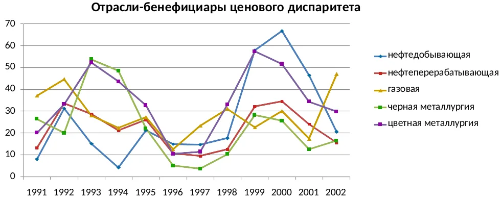
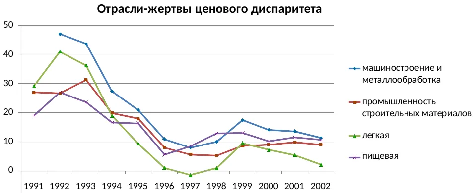
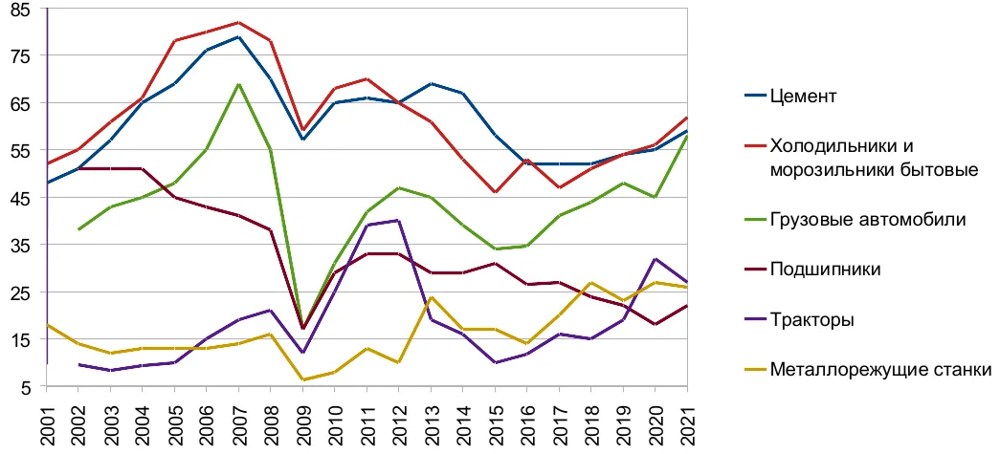
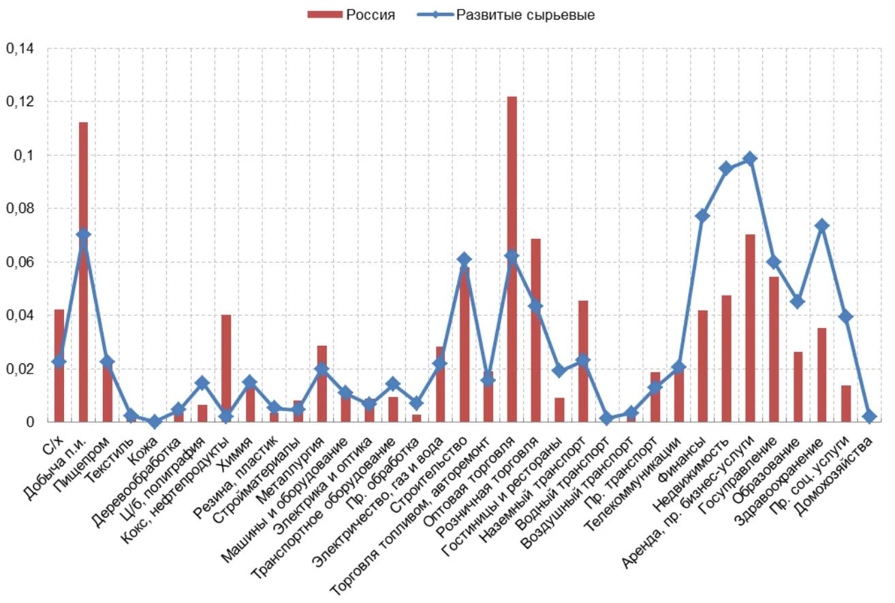
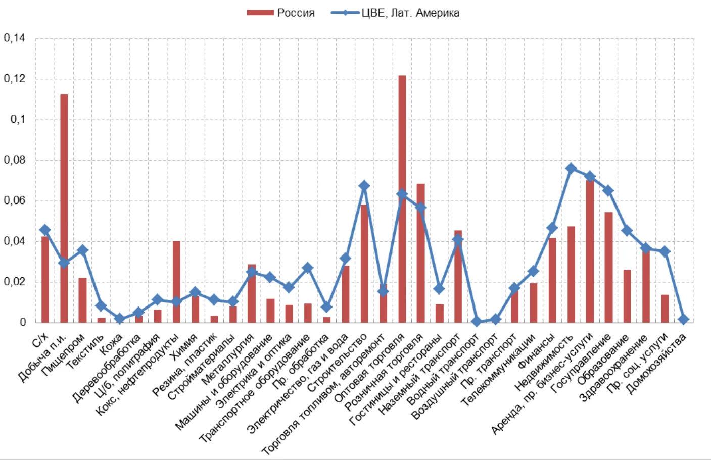

**Андрей Полянский**

*Начало статьи — в [Части 1](/docs/our/special-path-of-dependence).*

{/* TODO: добавить <DownloadPDFButton pdfUrl="/pdf/…" /> после публикации PDF статьи */}

## 5. Отраслевое развитие и экономическая динамика {#ch-5}

Эта глава посвящена анализу влияния, которое описанные выше особенности российской экономики оказывают на развитие основных отраслей *—* в первую очередь промышленности *—* а также на экономическую динамику в целом.

Как было показано выше, в российской экономике (и в особенности в промышленности) можно выделить два сектора *—* отрасли-бенефициары и отрасли-жертвы ценового диспаритета. Надо сказать, что концепция двухсекторности экономики капиталистических стран была выдвинута ещё в первой половине прошлого века с подъёмом монополистического капитализма. Первоначально её суть состояла в том, что в тех отраслях, где преобладает конкуренция между множеством производителей, цены определяются главным образом соотношением спроса и предложения, а в тех, где господствуют монополии или олигополии, у них есть возможность регулировать предложение путём наращивания или сокращения выпуска, тем самым удерживая цены на выгодном для себя уровне[^1]. Таким образом, во втором случае цены товаров как бы задаются или назначаются руководством корпораций-монополистов. В терминологии авторов данной концепции это называлось административной (управляемой) ценой[^2]. Во второй половине XX века был разработан ещё один вариант этой концепции, выделяющий специфические признаки указанных секторов. К первому сектору, названному периферией, были отнесены добывающая промышленность и сельское хозяйство. Продукция этих отраслей, во-первых, как правило, поставляется на рынок множеством конкурирующих производителей, а во-вторых, её предложение не может значительно меняться в короткие сроки в силу естественных причин — невозможности быстрого увеличения (а также сложности и дороговизны консервации) добывающих мощностей и сельскохозяйственного цикла соответственно. Таким образом, цены на их продукцию в значительной мере зависят от спроса. Ко второму сектору, который был назван центром, была отнесена обрабатывающая промышленность. В этом секторе доминируют крупные корпорации, образующие олигополии. У них есть значительные резервы производственных мощностей, благодаря чему они могут повышать или понижать объёмы производства в зависимости от спроса и, соответственно, менять уровень предложения, меняя цены лишь в небольшой степени[^3].

Можно заметить, что эта концепция подходит для анализа принципов ценообразования на мировом рынке в том виде, в каком он сложился к середине прошлого века. Ведущий сектор мировой экономики — обрабатывающая промышленность (в особенности производство средств производства) — в основном контролируется корпорациями стран центра, тогда как производство минерального и сельскохозяйственного сырья по большей части сконцентрировано в странах периферии. Первый сектор имеет возможность регулировать цены на свои товары благодаря олигополии и тем самым перераспределять в свою пользу прибавочную стоимость, произведённую во втором[^4], где господствует конкуренция между большим количеством производителей взаимозаменяемой продукции[^5].

Как с точки зрения этой концепции можно оценить ценообразование на продукцию разных отраслей в России? Производители сырья образуют олигополии и могут регулировать предложение своих товаров путём наращивания или сокращения поставок на внутренний рынок благодаря высокой доле экспорта в их продажах. Более того, существуют оценки — которые приводятся в т. ч. в докладах ФАС — согласно которым в российском нефтегазовом секторе цены поставок на внутренний рынок устанавливаются руководством корпораций исходя из заданных нормативов прибыли и рентабельности (сопоставимых с продажами на экспорт)[^6], что соответствует концепции административных цен. В то же время большинство предприятий обрабатывающей промышленности, производящих конечную продукцию, не могут устанавливать свои цены, игнорируя уровень спроса, поскольку вынуждены конкурировать и между собой, и с импортом[^7]. Таким образом, в России именно сырьевые экспортоориентированные отрасли оказались в роли центра, тогда как производства конечной продукции на внутренний рынок — в роли периферии[^8]. Наряду с экспортными производствами к привилегированному сектору также можно отнести посреднические отрасли — торговлю и финансовые операции[^9].

Исходя из этого разделения достаточно легко понять различия в уровне рентабельности, инвестиций, динамике производства и других экономических показателях между отраслями этих двух секторов, которые рассматриваются далее.

### 5.1. Отраслевая дифференциация: рентабельность, инвестиции, состояние основных фондов. Динамика промышленного производства {#sec-5-1}

#### *Рентабельность отраслей экономики и промышленности*

Исторически известны два основных способа перераспределения природной ренты. Первый, скрытый, который использовался, например, в СССР и в нефтяных корпорациях стран центра на протяжении первой половины XX века[^10] (а во многих вертикально-интегрированных ТНК — и сейчас, благодаря трансфертному ценообразованию внутри их структур), состоит в регулировании цен на сырьё и удержании их на низком уровне. Таким образом, происходит дотирование обрабатывающей промышленности, поскольку её издержки понижаются, снижается органическое строение капитала (за счёт снижения стоимости части постоянного капитала, приходящейся на сырьё) и повышается норма прибыли[^11]. Второй, явный, состоит в налогообложении добывающих отраслей с последующим перераспределением поступлений в пользу обрабатывающей промышленности — например, с помощью субсидий или льготных кредитов. У последнего способа перераспределения есть два ключевых недостатка. Во-первых, из-за налогов повышаются цены на продукцию добывающих отраслей, что увеличивает издержки всех потребителей сырья, включая обрабатывающую промышленность[^12]. Во-вторых, производители сырья могут разными способами занижать размер своей прибыли, тем самым занижая и налоговые поступления. Как было показано выше, оба этих недостатка ярко проявляются в российской экономике.

Вследствие этого уровень рентабельности разных отраслей сильно различается — как в экономике в целом, так и в промышленности.

Практически всё время с конца 90-х крайне высока рентабельность добычи полезных ископаемых, металлургии (примерно в 2-2,5 раза выше средней рентабельности экономики)[^13], нефтепереработки, химической промышленности. Большинство из этих отраслей связаны с производством сырья и полуфабрикатов, их продукция активно экспортируется. На рис. 25 видно, что резкий рост рентабельности произошёл после девальвации рубля в 1998 году, которая увеличила их сверхприбыль (как экспортную, так и полученную за счёт потребителей на внутреннем рынке). Также показателен рост рентабельности сельского хозяйства с 2014 года и рыболовства с 2009 года (и особенно резкий скачок в 2014-2015 годах), который был напрямую связан с наращиванием экспорта зерна, рыбы и морепродуктов, а также других продовольственных товаров в 2010-х, параллельно со снижением курса рубля[^14] (см. табл. 10).

*Рисунок 25. Рентабельность продукции по отраслям в 1991-2002 годах, %*[^15]

*Таблица 10. Рентабельность продукции (товаров, услуг) по отраслям в среднем за 2003-2008, 2009-2013 и 2014-2016 годы, %*[^16]

<table>
<tbody>
<tr><th></th><th className="num">2003-2008</th><th className="num">2009-2013</th><th className="num">2014-2016</th></tr>
<tr><td>в среднем по экономике</td><td className="num">12,7</td><td className="num">9,2</td><td className="num">7,7</td></tr>
<tr><td><em>отрасли-бенефициары ценового диспаритета</em></td><td colSpan="3"></td></tr>
<tr><td>добыча полезных ископаемых, кроме топливно-энергетических</td><td className="num">38,1</td><td className="num">45,9</td><td className="num">45,6</td></tr>
<tr><td>добыча топливно-энергетических полезных ископаемых</td><td className="num">27,8</td><td className="num">26,3</td><td className="num">20,8</td></tr>
<tr><td>металлургическое производство</td><td className="num">33,2</td><td className="num">15,2</td><td className="num">22,1</td></tr>
<tr><td>химическое производство</td><td className="num">18,1</td><td className="num">18</td><td className="num">25,1</td></tr>
<tr><td>производство кокса и нефтепродуктов</td><td className="num">22,6</td><td className="num">19,2</td><td className="num">6,4</td></tr>
<tr><td><em>отрасли-жертвы ценового диспаритета</em></td><td colSpan="3"></td></tr>
<tr><td>производство прочих неметаллических минеральных продуктов</td><td className="num">17,5</td><td className="num">9,3</td><td className="num">7,9</td></tr>
<tr><td>производство электрооборудования, электронного и оптического оборудования</td><td className="num">8,8</td><td className="num">8,5</td><td className="num">10,5</td></tr>
<tr><td>текстильное и швейное производство</td><td className="num">3,3</td><td className="num">6,3</td><td className="num">10,3</td></tr>
<tr><td>производство пищевых продуктов, напитков и табака</td><td className="num">8,6</td><td className="num">9,7</td><td className="num">9,4</td></tr>
<tr><td>обработка древесины и производство изделий из дерева</td><td className="num">5,3</td><td className="num">2,9</td><td className="num">11,8</td></tr>
<tr><td>производство машин и оборудования</td><td className="num">7,9</td><td className="num">7,2</td><td className="num">6,8</td></tr>
<tr><td>производство резиновых и пластмассовых изделий</td><td className="num">6,1</td><td className="num">6,9</td><td className="num">7</td></tr>
<tr><td>производство транспортных средств и оборудования</td><td className="num">6,8</td><td className="num">4,3</td><td className="num">4,6</td></tr>
<tr><td><em>непромышленные отрасли</em></td><td colSpan="3"></td></tr>
<tr><td>связь</td><td className="num">34,2</td><td className="num">25,3</td><td className="num">18,8</td></tr>
<tr><td>рыболовство, рыбоводство</td><td className="num">4,3</td><td className="num">18,2</td><td className="num">45,8</td></tr>
<tr><td>операции с недвижимостью, аренда</td><td className="num">10,1</td><td className="num">10</td><td className="num">13,2</td></tr>
<tr><td>сельское и лесное хозяйство</td><td className="num">7,9</td><td className="num">8,4</td><td className="num">17,9</td></tr>
<tr><td>оптовая торговля</td><td className="num">12</td><td className="num">9,5</td><td className="num">7,3</td></tr>
<tr><td>строительство</td><td className="num">5,1</td><td className="num">5,4</td><td className="num">3,8</td></tr>
<tr><td>розничная торговля, ремонт бытовых изделий</td><td className="num">3,6</td><td className="num">2,0</td><td className="num">1,9</td></tr>
<tr><td>финансовая деятельность</td><td className="num">2,6</td><td className="num">1,2</td><td className="num">1,2</td></tr>
</tbody>
</table>

Рентабельность отраслей обрабатывающей промышленности, производящих конечную продукцию и ориентированных в основном на внутренний рынок, значительно ниже, в большинстве из них она не превышает средней рентабельности экономики[^17]. Вместе с тем показательно повышение прибыльности некоторых из них одновременно со стагнацией и последующим падением цен на нефть, нефтепродукты, газ (и некоторые другие виды сырья) на мировом рынке в 2012-2016 годах[^18]. Поскольку для большинства обрабатывающих производств они являются необходимым сырьём или энергоресурсом, снижение внутренних цен (хотя и меньшее, чем снижение мировых), на которое были вынуждены пойти нефтяники под давлением внешних рынков, сослужило им хорошую службу. При этом рентабельность добычи углеводородов после кратковременного снижения в 2014 году практически восстановилась, чему поспособствовало сокращение доли налогов (часть которых привязана к ценам на мировом рынке) в прибыли[^19] и налоговый манёвр, перераспределивший нагрузку на нефтепереработку (рентабельность которой, напротив, снизилась в разы).

Надо оговориться, что данные официальной статистики нельзя считать полностью достоверными. С одной стороны, рентабельность может занижаться, поскольку занижается прибыль, с другой стороны, она может завышаться, поскольку занижаются отчисления на амортизацию основного капитала. В первом приближении можно считать, что эти факторы уравновешивают друг друга. В любом случае, поскольку у компаний из экспортных отраслей больше возможностей скрывать прибыль посредством экспорта по заниженным ценам, их реальная рентабельность значительно выше, чем у компаний из отраслей, работающих на внутренний рынок[^20].

В отраслях торговли и услуг, по официальным данным, рентабельность, как правило, не превышает среднюю по экономике, а чаще даже несколько ниже (за исключением связи, бурно развивающейся благодаря огромному неудовлетворённому спросу в начале периода и соответствующему расширению рынка). В то же время в экономической литературе неоднократно отмечалось, что показатели этих отраслей ещё менее достоверны из-за большей доли теневой деятельности и внешнеторговых операций, что позволяет занижать прибыль сильнее[^21].

Понятие рентабельности в мэйнстримовой экономической науке не идентично понятию нормы прибыли в марксистской политэкономии (т. к. включает непроизводительные расходы), но для нашего анализа это не принципиально. В общем случае они коррелируют между собой, и по ситуации в российской экономике видно, что тенденция к выравниванию нормы прибыли встречает в ней непреодолимые препятствия. Кратко напомним, в чём она состоит. При значительном превышении нормы прибыли над средней по экономике в какой-либо отрасли происходит переток капитала из остальных отраслей до тех пор, пока нехватка капитала в них не приведёт к снижению производства, недостаточности предложения относительно спроса, росту цен и, как следствие, росту нормы прибыли. Одновременно с этим приток капитала в более прибыльную отрасль вызовет рост производства, превышение предложения над спросом, снижение цен и, как следствие, снижение нормы прибыли. Таким образом, норма прибыли выравнивается[^22].

В российских условиях ни того, ни другого не происходит, т. к. экспортоориентированные отрасли, как правило, защищены как природными (ограниченность числа месторождений полезных ископаемых), так и административными барьерами — монополией крупных корпораций, большинство из которых связаны с государством или высшими чиновниками и могут ограничить проникновение конкурентов в свои отрасли, в т. ч. внеэкономическими методами[^23]. При этом излишек капитала, образующийся в экспортных отраслях, как правило, не перетекает в другие отрасли из-за сохраняющейся разницы в уровне рентабельности (норме прибыли) — его попросту невыгодно туда вкладывать[^24]. Дело доходит до того, что экспортёры предпочитают вкладываться в финансовые инструменты и спекуляции, покупку активов за рубежом, поскольку они приносят более высокую прибыль[^25] (впрочем, из-за практически гарантированной и намного более быстрой прибыли многие компании не только из отраслей-бенефициаров, но и из отраслей-жертв ценового диспаритета на протяжении практически всего постсоветского периода осуществляли большие финансовые вложения — например, покупку акций и долговых бумаг других компаний или банковские вклады[^26]).

Надо сказать, что значительные и устойчивые различия в рентабельности отмечаются не только между отраслями-бенефициарами и жертвами ценового диспаритета, но и внутри первых[^27]. Так, в ходе исследования предприятий чёрной металлургии при их группировке по экономическому весу (размер, положение в рейтингах, составляемых кредитными агентствами и профильными изданиями, охват рынков и т. п.) было установлено, что рентабельность продаж в первой группе (куда вошли 9 холдингов и корпораций, 6 из которых приведены в [разделе 1.3](/docs/our/special-path-of-dependence#sec-1-3)[^28]) на протяжении длительного времени была в разы выше, чем в остальных группах. В то же время в третьей группе (средние и крупные предприятия, не входящие в состав вертикально-интегрированных структур) она была чуть выше нулевого уровня или вовсе отрицательной[^29].

Вообще говоря, существование в экономике устойчивых различий в норме прибыли — не уникальная ситуация. Ещё в начале 70-х она была отмечена Э. Манделем, который на основе статистических данных показал, что на долгом горизонте существуют немонопольная и монопольная нормы прибыли, причём вторая включает, как он выразился, «среднюю норму сверхприбыли»[^30]. Но в условиях современной России ситуация дошла до крайности, поскольку в «нормальном» положении абсолютной монополии существовать не может — если в некоторой отрасли существует норма прибыли, намного превышающая среднюю, то рано или поздно она привлечёт капиталы, например, из других монополизированных отраслей, что вызовет её понижение[^31]. В России же этому препятствуют не только чисто экономические, но и институциональные или административные барьеры.

#### *Инвестиции в основной капитал. Состояние производственных мощностей и технологическое развитие промышленности*

Следствие устойчивых различий в рентабельности — огромная разница в уровне капиталовложений в разных отраслях. Ситуация здесь схожа с личным потреблением: их объём не только недостаточен для сбалансированного развития экономики, но и их распределение крайне неравномерно. Компании из отраслей-бенефициаров ценового диспаритета нередко имеют избыток средств[^32], тогда как предприятия отраслей-жертв не только не имеют достаточно собственного капитала для вложений, но и, как было показано выше, в большинстве своём не могут воспользоваться кредитными средствами в нужном объёме и по приемлемым условиям. Таким образом, для них зачастую затруднительно даже простое воспроизводство капитала.

В 2000-2016 годах инвестиции в основной капитал в одной только добыче углеводородов были сопоставимы с вложениями во всей обрабатывающей промышленности вместе взятой[^33]. При этом в последней более половины инвестиций пришлось на 4 отрасли, 3 из которых целиком или почти целиком заняты производством полуфабрикатов и в большой степени ориентированы на экспорт — металлургию, нефтепереработку и химическую промышленность. Лишь пищевая промышленность ориентирована в основном на внутренний рынок, но она в значительной мере контролировалась иностранным капиталом. Высокотехнологичные отрасли получали в разы меньше, чем добыча сырья и производство полуфабрикатов. Так, доля машиностроения и смежных отраслей в общих капиталовложениях снизилась более чем в 2 раза — с 7-8% в 1990-1991 годах до 3% в первой половине 2000-х[^34]. Здесь можно в очередной раз провести параллели с другими зависимыми индустриальными экономиками, ставшими жертвами неолиберальных преобразований: схожая структура инвестиций после их проведения сложилась, например, в Аргентине и Чили[^35].

*Таблица 11. Инвестиции в основной капитал по отраслям в среднем за 2000-2008, 2009-2013 и 2014-2016 годы, % от общего объёма*[^36]

|  | 2000-2008 | 2009-2013 | 2014-2016 |
|---|---:|---:|---:|
| сельское и лесное хозяйство | 4,2 | 3,8 | 3,8 |
| добыча полезных ископаемых | 15,7 | 14,3 | 17,5 |
| в т. ч. добыча топливно-энергетических полезных ископаемых | 14,3 | 12,9 | 16,0 |
| обрабатывающие производства | 15,7 | 13,7 | 15,0 |
| в т. ч. |  |  |  |
| пищевая и табачная промышленность | 3,2 | 1,8 | 1,8 |
| производство кокса и нефтепродуктов | 1,5 | 2,5 | 3,1 |
| химическое производство | 1,5 | 1,5 | 2,4 |
| производство прочих неметаллических минеральных продуктов | 1,1 | 1,2 | 0,7 |
| металлургическое производство | 2,9 | 2,0 | 1,7 |
| производство машин и оборудования | 0,9 | 0,6 | 0,7 |
| производство электрооборудования, электронного и оптического оборудования | 0,6 | 0,4 | 0,6 |
| производство транспортных средств и оборудования | 1,2 | 1,1 | 1,5 |
| прочие обрабатывающие отрасли\* | 2,9 | 2,4 | 2,4 |
| энергетика и водоснабжение | 6,4 | 9,0 | 7,4 |
| строительство | 4,6 | 3,3 | 2,9 |
| оптовая и розничная торговля; ремонт автотранспорта и бытовых изделий | 3,5 | 3,5 | 4,2 |
| транспорт | 18,2 | 23,6 | 17,3 |
| в т. ч. трубопроводный транспорт | 6,3 | 6,7 | 5,1 |
| финансовая деятельность | 1,1 | 1,4 | 1,4 |
| операции с недвижимым имуществом, аренда и предоставление услуг\*\* | 16,5 | 15,2 | 19,1 |

*\* лёгкая, деревообрабатывающая и целлюлозно-бумажная промышленность, производство резиновых и пластмассовых изделий, готовых металлических изделий*

*\*\* без научных исследований и разработок*

В среднем около 20% всех инвестиций за этот период пришлось на транспортную отрасль (от 15 до 25 процентов в разные годы), из них около трети шло на строительство трубопроводов, т. е. преимущественно на обеспечение экспорта углеводородов. Таким образом, в одну только трубопроводную инфраструктуру было вложено почти столько же, сколько в половину всей обрабатывающей промышленности. Но инфраструктура для вывоза природных ресурсов, построенная в постсоветский период, не ограничивается трубопроводами: мощности российских морских портов за это время выросли в несколько раз, причём основная их часть задействована именно в экспорте, а практически все новые железнодорожные ветки прокладывались к месторождениям или к портам[^37].

Вложения в большинство производственных отраслей были крайне низкими, тогда как в отрасли торговли и услуг — очень высокими. О причинах говорилось выше: неустойчивость прав собственности и краткосрочность горизонта планирования, предрасполагающие к инвестициям в отрасли с относительно низкой капиталоёмкостью (т. е. более коротким сроком окупаемости вложений)[^38], а также наличие значительного платёжеспособного спроса со стороны высокодоходных слоёв населения. Так, капиталовложения в операции с недвижимостью и аренду были больше, чем во всю добывающую или обрабатывающую промышленность[^39]. Инвестиции в торговле и ремонте были больше, чем в любой из отраслей обрабатывающей промышленности[^40] — судя по всему, за счёт строительства большого количества супермаркетов, торговых центров, складов и т. п. (очевидно, что другие элементы основного капитала в торговле несопоставимы по стоимости с промышленными сооружениями и оборудованием). Исследователи отмечают важные изменения в отраслевой структуре капиталовложений после выхода из кризиса 90-х:

> «...темпы роста инвестиций в отечественную экономику были весьма высоки до 2008 г. Но ... если до 2001 г. этот рост обеспечивался преимущественно за счёт инвестиций в материальное производство ... то с 2002 г. ... уже за счёт услуг ... Невозможно не заметить и связь между характером инвестиционного роста и динамикой нефтяных цен: чем дороже нефть, тем относительно меньше инвестиций идёт в материальное производство и, соответственно, больше в услуги»[^41].

Так, в 1999-2002 годы больше половины инвестиций в основной капитал приходилось на отрасли материального производства, тогда как после 2002 года бóльшая часть приходилась уже на отрасли сферы услуг, и до начала 2010-х их доля в общем объёме продолжала расти. Одновременно снижалась доля обрабатывающей промышленности (с 15,5-16,5% в 2000-2006 годах до 13-14,5% в 2009-2013 годах)[^42]. Вследствие недостаточного уровня инвестиций и нарастающего технологического отставания её конкурентоспособность продолжала снижаться параллельно бурному росту сферы услуг, что считается одним из характерных признаков «голландской болезни»:

> «В результате страна получает сравнительно развитый добывающий сектор экономики, постепенно слабеющую, размывающуюся обрабатывающую промышленность и гипертрофированную относительно своего реального производственного потенциала сферу услуг»[^43].

Примечательно, что в ходе кризиса 2014-2016 годов при общем падении инвестиций, в т. ч. в обрабатывающую промышленность (где оно составило 19%), вложения в добывающие отрасли заметно выросли (на 11%)[^44], так что их доля в общем объёме капиталовложений увеличилась с 13,5-15,5% в 2004-2014 годах до 18-19% в 2016-2018 годах. В 2021 году физический объём инвестиций в обрабатывающей промышленности был лишь на 2,5% выше уровня 2013 года, по экономике в целом — на 8%, тогда как в добывающей промышленности — более чем на 17%[^45]; иначе говоря, падение цен на углеводороды в середине 2010-х не помешало опережающему росту капиталовложений. Некоторые авторы связывают это с тем, что добыча полезных ископаемых как основной источник валютных поступлений оказалась в привилегированном положении, и капиталовложения в неё уже практически не подвержены влиянию рыночной конъюнктуры[^46]. При этом в машиностроении инвестиции в основной капитал в 2015-2016 годах сократились примерно на треть и впоследствии не восстановились, несмотря на декларируемую политику импортозамещения и достижения «технологического суверенитета» — в 2021 году они были на 35% ниже, чем в 2014 году (в сопоставимых ценах), а их доля в общем объёме инвестиций сократилась с 0,6% в 2014-2015 годах до 0,3% в 2020-2022 годах[^47].

Хотя с 2021 года уровень вложений в основной капитал в реальном выражении превышает показатели 2013 года, это произошло за счёт инвестиций в здания и сооружения — в т. ч. строительства транспортной инфраструктуры для адаптации к изменившимся условиям внешней торговли — а также в объекты интеллектуальной собственности (включая программное обеспечение), которые статистика относит к капитальным. В то же время физический объём инвестиций в машины и оборудование (важный показатель с точки зрения технологической модернизации) дважды достигал уровня 2013 года — в 2021 и 2024 годах, но по состоянию на конец 2024 года так и не превысил его[^48]. Кроме того, как отмечают аналитики, рост капиталовложений после 2022 года не сопровождается сопоставимым вводом в действие основных фондов: в 2024-2025 годах разрыв между этими показателями составлял порядка 20 п.п. в среднем по экономике (против 9 п.п. в 2020 году), а в обрабатывающей промышленности и строительстве он был значительно выше. Такое отставание говорит об удлинении сроков ввода фондов, росте объёмов незавершённого строительства, а также росте расходов на поддержание существующих мощностей вместо их расширения и строительства новых[^49].

Следствие недостаточного уровня инвестиций — рост износа и устаревание машин, оборудования и других составляющих основного капитала. В ходе опросов руководителей предприятий, проводившихся в 2000-2020 годах сотрудниками ИНП РАН, доля опрошенных, отметивших необходимость полной или частичной модернизации, ни разу не опускалась ниже 70%[^50]. По данным тех же опросов с 2000 по 2018 годы от 17 до 30% респондентов в разное время заявляли о том, что объём инвестиций не обеспечивает даже существующий технологический уровень производства, ещё порядка 30% отмечали, что он обеспечивает лишь поддержание существующего технологического уровня, но не более[^51]. Не менее показательны данные официальной статистики о состоянии основных фондов. Их износ по экономике в целом вырос с 35,5% в 1991 году до 40-41% в 2021-2023 годах. При этом в 2010-2018 годах он превышал 46%, а затем резко снизился, что трудно объяснить реальным обновлением основного капитала (коэффициенты обновления и выбытия в эти годы практически не менялись) — скорее всего, это снижение обусловлено изменением методики подсчёта. Доля полностью изношенных фондов выросла с 7,5% в 1993 году до 21,5% в 2021 году[^52].

За 2004-2021 годы уровень износа в добывающей промышленности увеличился с 55 до 61%, в обрабатывающей — с 48 до 52%, в строительстве — с 40 до 50,5%; на транспорте за 2004-2016 годы износ вырос с 51 до 56% (более ранние данные по отраслям отсутствуют)[^53]. В 2021 году на предприятиях добывающих отраслей (кроме добычи металлических руд) износ основных фондов превышал 50%. В добыче нефти и газа он составлял 63-64%, а доля полностью изношенных фондов — около 27%, т. е. даже в высокорентабельных добывающих отраслях в течение более чем 15 лет уровень инвестиций был недостаточным для своевременного воспроизводства основного капитала. В добыче нефти, вероятно, это объясняется тем, что вместо обновления имеющихся фондов основная часть инвестиций вкладывалась в новые месторождения, из-за чего общая изношенность росла, т. к. ввод новых относительно небольших мощностей не перекрывал износ гораздо бóльших по объёму старых (подробнее см. ниже в этом разделе). Во всех отраслях обрабатывающей промышленности износ превышал 40%, а в подавляющем большинстве был выше 50% (причём в нефтепереработке он составлял 55%, в металлургии — 53%, а доля полностью изношенных фондов в этих отраслях — 29 и 21 процент соответственно)[^54].

*Таблица 12. Уровень износа основных фондов в отраслях материального производства, инфраструктуры и торговле в 2021 году, %*

<table>
<tbody>
<tr><td>всего</td><td className="num">40,5</td></tr>
<tr><td>сельское, лесное хозяйство, охота, рыболовство и рыбоводство</td><td className="num">43,9</td></tr>
<tr><td>добыча полезных ископаемых</td><td className="num">60,9</td></tr>
<tr><td>обрабатывающие производства</td><td className="num">52,2</td></tr>
<tr><td>обеспечение электрической энергией, газом и паром; кондиционирование воздуха</td><td className="num">48,4</td></tr>
<tr><td>водоснабжение; водоотведение, организация сбора и утилизации отходов</td><td className="num">43,9</td></tr>
<tr><td>строительство</td><td className="num">50,5</td></tr>
<tr><td>торговля оптовая и розничная; ремонт автотранспортных средств и мотоциклов</td><td className="num">47,5</td></tr>
<tr><td>транспортировка и хранение</td><td className="num">57,1</td></tr>
</tbody>
</table>

При этом износ машин и оборудования — наиболее технологически значимой составляющей производственного капитала — заметно выше, чем в среднем по всем основным фондам. Так, в начале 2020-х уровень их износа составлял порядка 60%, а в некоторых отраслях был ещё выше[^55]. В те же годы возраст машин и оборудования в среднем по обрабатывающей промышленности составлял, по разным оценкам, 10-12 лет[^56]. В тяжёлой промышленности производственные мощности ещё старше: по состоянию на 2020 год в металлургии их средний возраст составлял 17 лет, в производстве стройматериалов — 14,5, в химической промышленности (включая производство резиновых и пластмассовых изделий) — 13, в деревообработке и целлюлозно-бумажной промышленности — 12,5; в нефтепереработке в 2018 году средний возраст мощностей составлял 19 лет[^57]. Таким образом, их возраст значительно превышает срок службы, который специалисты считают предельным — 7-8 лет[^58]. Зачастую для экономии средств российские предприятия покупают оборудование, бывшее в употреблении: с начала 2000-х до конца 2010-х приобретение подержанной техники российского производства отмечали в разные годы 13-36% представителей предприятий, опрошенных сотрудниками ИНП РАН; не менее распространена была закупка бывших в употреблении машин и оборудования из-за рубежа, это практиковали 15-25% в 2002-2008 годах и 10-13% в 2010-2017 годах[^59]. Таким образом, многие предприятия изначально оснащаются и переоснащаются с использованием не самого современного или просто устаревшего и изношенного оборудования.

Как относительно высокий уровень капиталовложений в экспортоориентированных отраслях соотносится с таким плачевным состоянием основных фондов? Нефтедобыча обладает самыми изношенными мощностями среди крупных отраслей промышленности, что никак не вяжется с большими инвестициями в неё; в схожем положении находятся нефтепереработка и металлургия. Есть несколько объяснений этому видимому противоречию. Во-первых, как говорилось выше, крупные корпорации, господствующие в отрасли, имеют множество возможностей завышать свои расходы, в т. ч. на капитальные вложения, включая туда статьи, не имеющие никакого отношения к производственным инвестициям: строительство административных зданий, расширение авиапарка, приобретение непрофильных активов и т. д.[^60] Во-вторых, значительная часть инвестиций в основной капитал сырьевых компаний направлена на создание и поддержание активов с короткими сроками службы, непосредственно связанных с извлечением ресурсов (скважин, шахт, карьеров и т. д.), поскольку без их постоянного обновления функционирование таких производств невозможно[^61]. Наконец, можно предположить, что уровень вложений в экспортных отраслях не позволяет своевременно замещать устаревшие и изношенные основные фонды из-за их очень больших объёмов, т. к. они выбывали из производственного процесса в гораздо меньшей степени по сравнению с разоряющимися и закрывающимися обрабатывающими производствами, где оборудование простаивало и консервировалось, продавалось за границу, разбиралось на запчасти или утилизировалось[^62].

Рассматривая инвестиции в нефтяную промышленность, стоит остановиться на важном для понимания специфики российской экономики вопросе о динамике вложений и производства. После спада 90-х (который был гораздо меньшим, чем в большинстве отраслей промышленности) отрасль стала быстро восстанавливаться, при том что темпы роста инвестиций в неё были заметно ниже. Так, за 2000-2007 годы добыча нефти выросла более чем в 1,5 раза, тогда как инвестиции в сопоставимых ценах — примерно в 1,3 раза[^63]. Конечно, это было обусловлено восстановительным характером роста — до показателей, уже достигнутых отраслью в СССР[^64]. Но кроме того, как отмечают исследователи, в большой степени такому росту поспособствовала активная эксплуатация нефтяными компаниями наиболее продуктивных месторождений и скважин, в т. ч. с использованием агрессивных методов интенсификации добычи, в то время как значительная часть мощностей (у некоторых компаний — до 50% скважин) не работала, а малодебитные скважины выводились из эксплуатации[^65]. В следующий период инвестиции уже заметно опережали добычу: за 2008-2019 годы они выросли в сопоставимых ценах на треть, тогда как производство — лишь на 15%[^66]. Основные причины — истощение прежних месторождений и наращивание добычи на новых, отличающихся сложными условиями и неразвитой инфраструктурой (в Восточной Сибири, на Крайнем Севере и на шельфе), рост доли трудноизвлекаемой нефти в общей добыче[^67], а также очень слабые ограничения для роста производственных издержек (которые можно переложить в цены для внутренних потребителей или скомпенсировать налоговыми льготами от государства) из-за высокой монополизации отрасли[^68]. Короче говоря, капиталоёмкость стала неуклонно повышаться, тогда как темпы роста снизились. При этом значительная часть выручки отрасли уходит за границу как посредством закупок импортного оборудования и технологий, необходимых для разработки более сложных месторождений (об этом см. в следующем разделе), так и из-за вывода капитала нефтегазовыми компаниями. Таким образом, всё больше вложений требуется для поддержания производства, а также фактически для поддержания уровня чистого экспорта, т. е. вывоза капитала корпорациями (а также государством — путём наращивания валютных резервов)[^69]. По сути на протяжении как минимум прошлого десятилетия основную выгоду от инвестиций получал экспортный сектор и некоторые его подрядчики, а также, отчасти, государственный бюджет, благодаря росту поступлений (хотя и этот рост постепенно замедлялся из-за расширения налоговых льгот в нефтегазовом секторе для всё того же стимулирования роста его производства[^70]). В то же время потребность в этих инвестициях стала причиной роста издержек всей остальной экономики из-за постоянного повышения внутренних цен на энергоносители. Можно сказать, что поддержание нефтегазового сектора с определённого момента стало едва ли не самоцелью, при этом требуя всё больших средств, тогда как эти инвестиции могли быть потрачены с большей отдачей — на повышение продуктивности нынешних месторождений и эффективности отрасли, а не на новые проекты, требующие больших затрат[^71].

*Таблица 13. Отношение затрат на технологические инновации к инвестициям в основной капитал в некоторых отраслях промышленности в среднем за соответствующий период, %*[^72]

<table>
<tbody>
<tr><th></th><th className="num">2010-2011</th><th className="num">2012-2013</th><th className="num">2014-2015</th></tr>
<tr><td>добыча топливно-энергетических полезных ископаемых</td><td className="num">4,5</td><td className="num">4,8</td><td className="num">5,3</td></tr>
<tr><td>производство машин и оборудования</td><td className="num">18</td><td className="num">16</td><td className="num">17</td></tr>
<tr><td>химическое производство</td><td className="num">20</td><td className="num">24</td><td className="num">18</td></tr>
<tr><td>металлургия и производство готовых металлических изделий</td><td className="num">37</td><td className="num">30</td><td className="num">21</td></tr>
<tr><td>производство кокса и нефтепродуктов</td><td className="num">29</td><td className="num">39</td><td className="num">35</td></tr>
<tr><td>производство транспортных средств и оборудования</td><td className="num">34</td><td className="num">48</td><td className="num">41</td></tr>
<tr><td>производство электрооборудования, электронного и оптического оборудования</td><td className="num">63</td><td className="num">66</td><td className="num">73</td></tr>
<tr><th></th><th></th><th className="num">2017-2018</th><th></th></tr>
<tr><td>добыча полезных ископаемых</td><td></td><td className="num">5,5</td><td></td></tr>
<tr><td>производство химических веществ и химических продуктов</td><td></td><td className="num">12</td><td></td></tr>
<tr><td>производство машин и оборудования</td><td></td><td className="num">23</td><td></td></tr>
<tr><td>производство металлургическое</td><td></td><td className="num">24</td><td></td></tr>
<tr><td>производство электрического оборудования</td><td></td><td className="num">25</td><td></td></tr>
<tr><td>производство кокса и нефтепродуктов</td><td></td><td className="num">33</td><td></td></tr>
<tr><td>производство автотранспортных средств</td><td></td><td className="num">34</td><td></td></tr>
<tr><td>производство прочих транспортных средств и оборудования</td><td></td><td className="num">49</td><td></td></tr>
<tr><td>производство готовых металлических изделий, кроме машин и оборудования</td><td></td><td className="num">62</td><td></td></tr>
<tr><td>производство компьютеров, электронных и оптических изделий</td><td></td><td className="num">78</td><td></td></tr>
</tbody>
</table>

Несмотря на относительно большие объёмы капиталовложений, технологический уровень и инновационность российской нефтедобычи и нефтепереработки находятся на достаточно низком уровне (о чём уже говорилось в [разделе 2.4](/docs/our/special-path-of-dependence#sec-2-4)), причём он низок в т. ч. по сравнению со многими другими отраслями промышленности. При сравнении статистических данных о расходах на инновации и инвестициях в основной капитал[^73] видно, что в добыче топливно-энергетических полезных ископаемых в прошлом десятилетии на инновации тратились суммы, эквивалентные 4-6% вложений в основные фонды. Схожая ситуация была в других отраслях-бенефициарах ценового диспаритета. В среднем за 2010-2015 и 2017-2018 годы на нефтепереработку, металлургию и производство металлических изделий пришлось почти 45% всех расходов на инновации в обрабатывающей промышленности. В то же время расходы на инновации в металлургии (вместе с металлообработкой) в 2010-2011 годах соответствовали 37% их инвестиций в основной капитал, а в 2014-2015 годах они упали до 21%. В 2017-2018 годах в металлургии (без металлообработки) на расходы на инновации приходилось лишь четверть вложений в основной капитал. В нефтепереработке они составляли порядка трети инвестиций. При этом наибольшую долю расходы на инновации составляли в капиталовложениях некоторых из отраслей-жертв ценового диспаритета, в особенности тех, где был широко представлен иностранный капитал. Так, в производстве электрооборудования, электронного и оптического оборудования в течение всего рассматриваемого периода они превышали 60%, а в 2013-2014 годах составляли 70-75%. В 2017-2018 годах доля расходов на инновации в инвестициях была наибольшей в производстве компьютеров, электронной и оптической техники, металлообработке и производстве транспортных средств, кроме автотранспорта. По объёму расходов на инновации металлообработка и транспортное машиностроение сопоставимы с нефтепереработкой, хотя общие объёмы капиталовложений в этих отраслях были в 3-4 раза меньше.

Характерный пример технологической политики нефтедобывающих компаний — большое количество оборудования из Китая, закупаемого по причине его дешевизны и отличающегося низким качеством. В конце 2000-х и в начале 2010-х на Китай приходилось больше половины всех поставляемых буровых установок; очень активно китайское оборудование для отрасли импортировалось и во второй половине прошлого десятилетия из-за санкций на поставки из США и европейских стран. Более того, зачастую формально произведённое в России оборудование для отрасли на деле собирается из китайских запчастей[^74].

В схожем положении находится металлургическая промышленность. По состоянию на 2020 год доля оборудования, введённого до 2000 года, превышала здесь 40%[^75]. В ходе опроса, проведённого в 2019 году среди представителей предприятий металлургии и производства металлических изделий, доля отметивших физическую изношенность оборудования, его моральное устаревание и использование устаревших технологий в числе наиболее важных проблем, сдерживающих развитие, была наибольшей из всех отраслей тяжёлой промышленности — 41, 48 и 31 процент соответственно. Основным сдерживающим фактором для внедрения передовых технологий была названа их несовместимость с имеющимся оборудованием (в частности, из-за его устаревания) — его отметили 72% опрошенных[^76]. Об этой проблеме металлургии говорят и промышленники из смежных отраслей — металлообработки и машиностроения[^77].

Компании из отраслей-бенефициаров ценового диспаритета реже инвестируют в передовые технологии из-за извлечения инсайдерской ренты и отсутствия острой необходимости снижать производственные издержки, поскольку многие из них занимают на внутреннем рынке положение, близкое к монопольному. В лучшем случае они поддерживают текущее состояние производственных мощностей и осуществляют их частичную модернизацию[^78]. Из-за борьбы за инсайдерский контроль над предприятиями, их владельцы и менеджмент, как правило, заинтересованы в первую очередь во вложениях с коротким сроком окупаемости, к которым не относится глубокое техническое перевооружение[^79].

Таким образом, конфигурация экономики, сложившаяся в начале 2000-х, привела к тому, что промышленность в целом (за исключением нескольких отраслей) не может самостоятельно поддерживать собственное развитие.

1\. Производители сырья из-за своего близкого к монопольному положения не имеют экономической необходимости повышать производительность и технологичность производства, вкладываться в НИОКР. Им достаточно поддерживать на ходу старые мощности, доставшиеся от СССР, и расширять их, если это будет экономически оправдано, т. е. в условиях высоких цен на сырьё. Но в долгосрочной перспективе ориентация на экстенсивные методы добычи и наращивание экспорта сырья ведёт в тупик, поскольку старые месторождения истощаются, а разработка новых требует больших вложений, которые для сырьевых компаний, с одной стороны, невыгодны, поскольку не сулят быстрых прибылей, а с другой — не всегда возможны из-за отсутствия необходимых технологий и достаточно квалифицированного персонала[^80]. По этим же причинам большинство производителей сырья практически не вкладывается в его переработку, за исключением производства полуфабрикатов.

Поведение контролируемых государством сырьевых корпораций в этом отношении отличается незначительно. Вместо повышения продуктивности нынешних месторождений и наращивания глубокой переработки запускаются новые мегапроекты (месторождения в труднодоступных регионах, гигантские заводы по производству полуфабрикатов, трубопроводы и другая транспортная инфраструктура для экспорта), которые дают возможность «освоить» выделяемые государством средства, т. е. извлечь большие объёмы инсайдерской ренты через завышение расходов и аффилированных подрядчиков[^81].

2\. У производителей конечной продукции необходимость повышать производительность и технологичность, разумеется, есть, но нет финансовых возможностей из-за потерь от ценового диспаритета, узости внутреннего рынка и низкой конкурентоспособности на внешних рынках, государственной денежно-кредитной политики и сложившейся конфигурации банковской системы (а также из-за всё того же извлечения инсайдерской ренты).

Из-за этого технологическое отставание от других стран в промышленности не сокращается, а, вероятно, даже растёт. К примеру, показатели наукоёмкости продукции (рассчитанные как отношение затрат на исследования и разработки к выручке от продаж) в России ниже, чем в США в разы, а в некоторых отраслях — на порядок: в 2017 году в промышленном производстве в целом наукоёмкость составляла 0,3% против 4,74%, по всем машиностроительным отраслям в целом — 0,84% против 6,45%, в транспортном машиностроении — 0,72% против 4,54%[^82].

Как следствие, российская промышленность отличается крайне низким уровнем производительности труда по сравнению не только со странами центра, но и со многими индустриальными полупериферийными странами[^83]. Основные причины — технологическая отсталость и недостаточная капиталовооружённость (т. е. нехватка капитальных вложений)[^84]. За исключением отдельных отраслей со значительным присутствием иностранного капитала (например, автомобильной и пищевой промышленности), механизация и автоматизация труда в течение всего постсоветского периода оставались на уровне позднего СССР, а нередко даже снижались из-за растущего износа оборудования, замены более дорогой и сложной техники более простой и дешёвой, а автоматизированных операций ручными[^85].

Из-за дорогого сырья, низкой технологичности производства и высоких накладных расходов промышленная продукция оказывается неконкурентоспособной по сравнению с импортом из стран центра и Китая[^86]. Особенно ярко это проявляется в машиностроении и металлообработке[^87]. К примеру, в 2024 году цена одних и тех же деталей для сельскохозяйственной техники (шестерней) российского производства была в 1,6-2 раза выше, чем китайского (а до введения санкций запчасти российского производства проигрывали по цене японским). При этом металлические заготовки для них были дороже в 3,5-4,5 раза, накладные расходы (включающие, например, коммунальные услуги) — выше в 2-5 раз, в то время как удельные расходы на оплату труда были даже ниже (зачастую в 1,5-2 раза)[^88].

В результате обрабатывающая промышленность проигрывает конкуренцию и вытесняется импортом, тогда как отечественные предприятия сокращают выпуск. Мы рассмотрим обе эти тенденции далее.

#### *Динамика промышленного производства*

В качестве индикатора развития промышленности в постсоветский период можно рассматривать динамику производства в разных отраслях.

*Таблица 14. Индексы производства по отраслям в 2008, 2014 и 2016 годах, % от уровня 1991 года*[^89]

|  | 2008 | 2014 | 2016 |
|---|---:|---:|---:|
| производство резиновых и пластмассовых изделий | 124 | 220 | 220 |
| добыча топливно-энергетических полезных ископаемых | 116 | 126 | 129 |
| химическое производство | 87 | 110 | 123 |
| производство электрооборудования, электронного и оптического оборудования | 139 | 131 | 119 |
| целлюлозно-бумажное производство; издательство и полиграфия | 128 | 117 | 111 |
| пищевая и табачная промышленность | 86 | 102 | 106 |
| металлургия и производство готовых металлических изделий | 98 | 104 | 95 |
| производство кокса и нефтепродуктов | 80 | 97 | 95 |
| *обрабатывающая промышленность в целом* | 84 | 91 | 86 |
| производство транспортных средств и оборудования | 69 | 75 | 66 |
| обработка древесины и производство изделий из дерева | 54 | 51 | 51 |
| производство прочих неметаллических минеральных продуктов | 65 | 56 | 49 |
| производство машин и оборудования | 61 | 50 | 46 |
| текстильное и швейное производство | 26 | 25 | 23 |

К середине 2010-х нарастили выпуск и превысили показатели 1991 года или приблизились к ним отрасли-бенефициары ценового диспаритета (добыча углеводородов, химическая промышленность, металлургия, нефтепереработка), отрасли с большим присутствием иностранного капитала (производство электрооборудования, пищевая и целлюлозно-бумажная промышленность) или отрасли, которые в СССР были развиты относительно слабо (производство резиновых и пластмассовых изделий). В то же время почти везде прирост относительно уровня 1991 года был крайне незначительным — не более 15-30%. Иными словами, даже наиболее успешные отрасли смогли лишь восстановить выпуск до достигнутого ранее, и после этого их рост был минимальным (при этом надо помнить, что в 1991 году промышленность уже переживала серьёзный спад). Отрасли-жертвы ценового диспаритета, ориентированные на внутренний рынок и контролируемые российским капиталом (такие как лёгкая промышленность и производство строительных материалов), значительно сократили объём выпуска; в частности, очень сильно пострадало машиностроение, где с начала 2010-х выпуск колебался на уровне половины от объёмов 1991 года.

Показательно, что после кризиса 2008 года во многих относительно успешных отраслях рост практически остановился или даже началось снижение (например, в целлюлозно-бумажной, электронной и электротехнической промышленности), а часть ориентированных на внутренний рынок (машиностроение, производство стройматериалов) испытали новый спад. Около половины отраслей в 2013-2014 годах производили меньше продукции, чем в 2008 году. Иными словами, в начале 2010-х в обрабатывающей промышленности за исключением нескольких (в основном экспортоориентированных) отраслей был явно заметен упадок или по меньшей мере стагнация. Ниже будет показано, что уже тогда прежние источники роста оказались исчерпаны, и экономическая модель 2000-х зашла в тупик.

Начиная с 2017 года однозначно сопоставимые с предыдущим периодом данные по большинству отраслей отсутствуют, поэтому целесообразно рассмотреть динамику добывающей и обрабатывающей промышленности в целом. Показатели в сборниках разных лет заметно различаются (в т. ч. из-за корректировки методики Росстата и регулярных пересмотров данных — причём, как правило, в большую сторону[^90]), но итоговые индексы за несколько лет позволяют подтвердить сказанное выше. Хотя за 2017-2021 годы рост обрабатывающей промышленности был несколько больше, чем добывающей *—* 117-125% против 111-113% (что во многом обусловлено сокращением добычи сырья в 2020 году из-за спада мирового спроса во время коронакризиса), это не переломило общей тенденции постсоветского периода: в 2021 году в добывающей промышленности индекс производства относительно 1991 года составил около 125%, в обрабатывающей, по разным данным, — от 106 до 114%[^91].

По альтернативным оценкам, спад в некоторых обрабатывающих отраслях был куда сильнее: так, в начале 2010-х объём производства в машиностроении и металлообработке составлял чуть больше трети от уровня 1991 года, а в инвестиционном машиностроении — менее 1/5 от уровня 1990 года[^92]. В основном эти оценки основываются на официальных данных о физических объёмах производства, которые весьма показательны сами по себе. По некоторым ключевым для самостоятельного промышленного развития видам продукции спад был огромным, зачастую на порядок: например, металлорежущих станков — с 74 тыс. в 1990 году до 7,2 тыс. в 2021 году, станков с ЧПУ — с 16,7 тыс. до 563 штук соответственно, кузнечно-прессовых машин — с 27 до 6 тыс. соответственно, подшипников — с 784 до 42 млн соответственно[^93].

Наряду с объёмами производства состояние разных отраслей промышленности хорошо иллюстрирует загрузка производственных мощностей. Поскольку у отраслей-бенефициаров ценового диспаритета есть гораздо более ёмкий мировой рынок сбыта, это ведёт к более высокому уровню использования мощностей (что помимо прочего снижает удельные издержки производства). Отрасли-жертвы ценового диспаритета из-за слабого внутреннего спроса и конкуренции с иностранными поставщиками не могут поддерживать высокий уровень загрузки и имеют большие объёмы постоянно простаивающих мощностей, в основном оставшихся у них со времён СССР, где спрос на их продукцию был намного выше[^94] (при том, что в отраслях-жертвах ценового диспаритета происходило активное сокращение мощностей[^95]). Это дополнительно ухудшает их финансовое положение, в т. ч. потому что незагруженные мощности всё равно требуют затрат на их поддержание. Кроме того, загрузка их мощностей отличается гораздо большей нестабильностью. В экспортных производствах с середины 2000-х она, как правило, колебалась в пределах 10 п.п. (за исключением короткого спада во время мирового кризиса), тогда как в производствах продукции на внутренний рынок колебания доходили до 15-20 п.п. и более. Характерно, что ни снижение мировых цен на сырьё, ни стагнация российской экономики в середине 2010-х не оказали большого влияния на уровень использования мощностей в экспортных отраслях, в отличие от отраслей внутреннего рынка, загрузка большинства из которых заметно снизилась по сравнению с началом десятилетия и с 2000-ми годами.

*Рисунок 26. Уровень использования производственных мощностей в производстве продукции отраслей-бенефициаров и жертв ценового диспаритета, %*[^96]

Одним из факторов экономического роста после 2022 года было повышение уровня загрузки мощностей в производстве конечной продукции из-за роста ВПК и импортозамещения. Впрочем, даже в 2023-2024 годах для многих видов товаров он оставался в пределах 40-50%, т. е. намного ниже, чем в среднем для сырья и полуфабрикатов и зачастую ниже, чем для этих же товаров в середине 2000-х[^97].

Согласно подсчётам на основе данных Росстата о динамике выпуска по отдельным видам промышленной продукции, за 2000-2016 годы снизилось производство по каждому третьему виду продукции обрабатывающей промышленности и по 40% видам машин и оборудования, причём «в 2016 г. по 56% видов обрабатывающих производств и по 68% видов производства машин и оборудования производилось меньше продукции, чем в 2007 г.»[^98]. По сути это означает всё большее снижение как технологического уровня, так и самостоятельности промышленности (и как следствие, всей экономики). В частности, сократился удельный вес более передовых и технологичных отраслей, а доля более старых, напротив, выросла. По некоторым оценкам, с середины 90-х до середины 2010-х доля отраслей т. н. пятого технологического уклада (микроэлектроника и другие отрасли, связанные с информационными технологиями) в ВВП снизилась с 20 до 10%, четвёртого (машиностроение, в т. ч. автомобильная промышленность и самолётостроение, приборостроение, органическая химия) — с 60 до 50%, тогда как третьего (добыча полезных ископаемых, металлургия и другие отрасли, доминировавшие в конце XIX века) — выросла с 20 до 30%[^99]. Машиностроение — одна из ключевых для современной промышленности отраслей — теперь занимает очень незначительное место в общем объёме продукции обрабатывающих производств: в середине 2010-х в России на неё приходилось около 19%, тогда как во Франции и США — 32%, в Германии — 45%, в Японии — 47%[^100]. Не менее велико отставание в технологичности производимой продукции. К примеру, в Японии в конце 2010-х станки с ЧПУ составляли более 90% всех выпускаемых станков, в Германии и США — более 70%, в Китае — около 30%, тогда как в России их доля составляла менее 10%, включая доукомплектованные ЧПУ обычные станки[^101].

Параллельно со снижением объёмов производства и ростом технологического отставания в машиностроении и других отраслях, составляющих основу современной промышленности, их продукция постепенно замещалась импортом. В следующем разделе мы рассмотрим этот процесс и некоторые его специфические черты.

### 5.2. Зависимость от импорта {#sec-5-2}

Важная особенность российской экономики, характеризующая её как зависимую *—* крайне высокая доля импорта, причём не только среди конечной продукции (средств производства и потребительских товаров), но и среди промежуточной, необходимой для производства (сырьё, полуфабрикаты, комплектующие и т. д.), а также зависимость от современных производственных технологий.

Импорт составлял почти 25% ВВП с конца 90-х до середины 2000-х и 20-22% в 2004-2021 годах[^102]. Для одной из крупнейших экономик мира и страны с большим индустриальным сектором это очень высокий уровень. Так, в прошлом десятилетии доля импорта составляла около 21% ВВП, среди крупных экономик она была выше лишь в Германии — около 35% и в Индии — около 24%, тогда как в Китае — 18,5%, в Японии — 17%, в США — около 15%[^103].

С 2004 года машины, оборудование и транспортные средства составляют более 40% от общей стоимости импорта. В среднем за 2010-2020 годы на них приходилось 47%, ещё более 15% — на продукцию химической промышленности. Таким образом, промышленная продукция составляет почти 2/3 импорта (и после 2022 года её доля не снизилась)[^104]. По оценкам на основе данных ОЭСР, в конце 2010-х на импорт приходилось около 43% всего потребления продукции обрабатывающей промышленности в стране[^105]; как будет показано далее, в некоторых ключевых отраслях его доля ещё выше.

В сфере средств производства зависимость можно считать критической: по разным оценкам, на рубеже 2010-х и 2020-х годов порядка 75-85% машин и оборудования, используемых для валового накопления основного капитала (т. е. в основном инвестиционной техники) ввозились из-за рубежа[^106]. Собственная производственная база не способна обеспечить развитие (а зачастую — даже поддержание) отраслей, составляющих основу экономики — например, добывающей промышленности, нефтепереработки, металлообработки и машиностроения.

Приведём несколько примеров. По данным Минпромторга, в 2017 году 78,5% приобретаемых в стране металлорежущих станков приходилось на импорт[^107]. В середине 2010-х внутреннее производство составляло около 30% внутреннего потребления в натуральном выражении и менее 10% в денежном, т. е. внутри страны производились более простые и дешёвые станки, тогда как импортировались более дорогие[^108]. По данным Росстата, производство станков снизилось с 9 тыс. в 2000 году до 5 тыс. в 2005-2008 годах — уровень, который был превышен лишь в 2020 году[^109]. В 2010-2019 годах производилось 2,8-4,6 тыс. станков, тогда как ввозилось 500-800 тыс. (кроме 2015-2016 годов, когда импорт составлял 300-400 тыс.). Таким образом, разрыв между производством и импортом составлял более 100 раз[^110]. При этом в импорте преобладали наиболее дорогие высокотехнологичные станки и оборудование с ЧПУ, тогда как внутреннее производство станков с ЧПУ выросло незначительно (563 штук в 2021 году против 430 штук в 2008 году)[^111]. Ситуация не изменилась и после 2022 года, несмотря на заметный рост внутреннего производства: так, в 2024 году доля импортных станков на рынке составляла 75%, а в некоторых высокотехнологичных отраслях она приближалась к 100% (в том году выпуск станков составил почти 13 тыс., станков с ЧПУ — более 960)[^112]. Другой пример — столь же необходимое для машиностроения литейное оборудование. По состоянию на середину 2010-х импортировалось порядка 2/3 литейных машин, а некоторые виды этого оборудования в России не производились вовсе[^113].

Схожая ситуация наблюдается с техникой для нефтегазовой отрасли. Только за 2005-2010 годы доля отечественных машин и оборудования в закупках снизилась с 51 до 41%. Доля импортного бурового оборудования в общих поставках в конце 2000-х превысила 2/3 (причём на Китай приходилось более половины)[^114]. По данным Минпромторга, в 2019 году доля импортного оборудования в нефтегазовой отрасли составляла 45%, несколько снизившись по сравнению с серединой десятилетия (60% в 2014 году и 53% в 2017 году). Но в более технологичном сегменте положение хуже: доля зарубежной техники для увеличения нефтеотдачи (в т. ч. для бурения наклонно-направленных и горизонтальных скважин) составляла 61% общего парка, оборудования для нефтепереработки – 49%, оборудования для производства сжиженного природного газа (СПГ) и для реализации шельфовых проектов – 68%, геологоразведочного оборудования – 48%[^115]. По оценкам ведомства на вторую половину 2010-х, среди самого сложного оборудования (для добычи углеводородов на шельфе, гидроразрыва пласта, добычи трудноизвлекаемой нефти, модернизации нефтеперерабатывающих заводов) импорт достигал 90%[^116]. По некоторым данным, в таком же положении находится угледобыча. К примеру, в Кемеровской области, где добывается около 60% российского угля, несмотря на сокращение машиностроительного импорта в несколько раз в 2015 году из-за роста курса валют, на него приходилась бóльшая часть поставок. В натуральном выражении импорт составлял 60% всего нового оборудования для отрасли, а в денежном — 78%, причём среди оборудования для добычи угля импорт в натуральном выражении составлял 88%, для проходки и подготовки угледобычи — 67%[^117].

Похожие цифры можно привести по подавляющему большинству подотраслей машиностроения. Ограничимся ещё одним примером — дорожно-строительной техникой. По данным ассоциации Росспецмаш, доля российской техники на рынке составляла 22% в 2022 году, а на следующий год она снизилась до 16% (вероятно, из-за потери доступа к зарубежным комплектующим, что вызвало сокращение производства *—* см. далее в этом разделе). В 2023 году на импорт в натуральном выражении приходилось 59% грейдеров, 72% бульдозеров и 88-98% дорожных катков, фронтальных погрузчиков, экскаваторов и асфальтоукладчиков[^118].

Важный аспект зависимости производственной сферы — замещение импортом отечественной продукции не только в части оборудования, но и в части сырья, полуфабрикатов и комплектующих. В экономической литературе отмечается, что, как правило, это происходит из-за потребности производителей конечной продукции в более качественных и технологичных компонентах (в целях расширения присутствия на рынке и успешной конкуренции с импортом), которую их поставщики внутри страны не могут удовлетворить по приемлемой цене, в результате чего целые производственные цепочки могут отсекаться и замещаться поставками из-за рубежа[^119]. Многие товары, формально произведённые в России, на деле практически полностью состоят из импортных материалов. Есть целые отрасли, где до недавнего времени доминировали иностранные компании, построившие «отвёрточные» производства и собиравшие продукцию из готовых запчастей — например, автомобильная промышленность или производство бытовой техники и потребительской электроники; кроме того, многие российские производства полного цикла сами превращаются в сборочные, отказываясь от изготовления комплектующих и замещая их импортом[^120].

По данным Росстата, удельный вес промежуточных товаров в общем объёме импорта вырос с 37% в 2006 году до 42% в 2019-2020 годах, при том, что импорт в текущих долларовых ценах за это время вырос примерно в полтора раза[^121]. Резкий рост доли импорта в промежуточной продукции произошёл с середины 2000-х до середины 2010-х, что можно считать одним из проявлений «голландской болезни». Так, его удельный вес затратах на сырье, материалы и комплектующие в общем машиностроении вырос с 13 до 30 процентов за 2005-2013 годы, в транспортном машиностроении — с 12 до 42,5 процентов за 2006-2013 годы (в частности, в автомобилестроении — с 10% в 2005 году до 56% в 2013 году), в производстве резиновых и пластмассовых изделий — с 16,5 до 25,5 процентов за те же годы[^122].

По состоянию на середину 2010-х максимальная зависимость от производственного импорта была характерна для лёгкой, фармацевтической, автомобильной и электронной промышленности, а также производства медицинской техники. При этом сильнее остальных от него зависят высокотехнологичные предприятия[^123]. По результатам расчётов на основе данных ОЭСР о межстрановых и межотраслевых балансах за 2018 год, на импорт в стоимостном выражении приходилось 88,5% промежуточной продукции в автомобильной промышленности, 70% в производстве компьютеров и электроники, 65,5% в производстве изделий из резины и пластика, 62,5% в производстве электрооборудования, 62% в прочем транспортном машиностроении, 60,5% в общем машиностроении, 57,5% в лёгкой, обувной и кожевенной промышленности[^124].

Опять же, можно привести примеры конкретных видов продукции — ими особенно богаты машиностроение и смежные отрасли. В 2013 году российские бытовые электроприборы на 85% состояли из зарубежных комплектующих; в станкостроении по состоянию на 2017 год импортировались от 40 до 70 процентов комплектующих в зависимости от категории (а по некоторым видам компонентов импорт составлял 80-90%)[^125]. В некоторых ключевых для экономики видах техники, выпускаемых внутри страны, самые дорогие и высокотехнологичные узлы ввозятся из-за рубежа — например, в оборудовании для добычи и переработки нефти и газа[^126], станках[^127], энергетическом оборудовании (газовых турбинах, особенно большой мощности)[^128], сельскохозяйственной и специальной технике[^129]. Впрочем, это же относится и к относительно простым видам комплектующих, таким как подшипники или электронные компоненты — например, конденсаторы. В 2020-2022 годах доля подшипников отечественного производства на рынке оценивалась в 23-25%[^130]. В 2019 году объём российского рынка конденсаторов оценивался в 4 млрд штук, тогда как объём внутреннего производства — в 49 млн, т. е. чуть больше 1% внутреннего потребления[^131].

В других обрабатывающих отраслях положение отличается лишь тем, что импортная промежуточная продукция, как правило, преобладает лишь в самых высокотехнологичных сегментах. Например, хотя в химической промышленности в целом уровень зависимости от импорта в 2013 году составлял лишь 17,5%, в более сложных подотраслях он был в разы выше: в производстве химических средств защиты растений (пестицидов) и прочих агрохимических продуктов — более 74%, в производстве искусственных и синтетических волокон — 43%[^132]. Для нефтепереработки и нефтехимии критически важны поставки катализаторов (на начало 2022 года зависимость от импорта здесь составляла 70-80%, а по отдельным категориям — до 100%) и присадок к топливу[^133]. Крайне велика зависимость фармацевтической промышленности: по разным оценкам, она составляет 45-50% в денежном выражении и 75-80% в натуральном[^134].

Важно подчеркнуть, что рост доли импорта, особенно в сфере средств производства и промежуточных товаров, напрямую связан с недостаточными инвестициями (т. е. низким уровнем накопления капитала в большинстве производственных отраслей, о причинах которого говорилось в [главе 4](/docs/our/special-path-of-dependence#ch-4)) и, как следствие, технологической отсталостью основной части обрабатывающей промышленности:

> «...проблемой российской промышленности нужно считать не её зависимость от импорта как таковую и не вовлеченность российской промышленности в систему международного разделения труда. Дело в технологической отсталости российских производственных цепочек, которые принудительно прерывают производители продукции, потенциально востребованной на рынке, напрямую используя высококачественные импортные сырье, материалы и комплектующие»[^135].

Показательно, что до разрыва экономических связей со странами центра и их союзниками в 2022 году ослабление рубля уже достаточно долгое время не способствовало повышению конкурентоспособности отечественной конечной продукции и импортозамещению[^136]: зависимость от импортного сырья, комплектующих и технологий настолько велика, что от них невозможно отказаться или заместить отечественными, которые отсутствуют или отличаются гораздо худшим качеством[^137]. Так, в ходе опросов представителей промышленных предприятий, проведённых сотрудниками ВШЭ, отсутствие отечественных аналогов среди машин и оборудования отметили 30% в 2018 году и 39% в 2022 году, среди деталей, компонентов и агрегатов — 27% и 34% соответственно, среди сырья и материалов — 20% и 31% соответственно. В 2022 году доля отметивших более высокое качество импортной продукции как причину её использования, превышала 60% во всех отраслях, а в автомобильной и текстильной промышленности она приближалась к 90%; тогда же отсутствие аналогов импортной продукции отмечали от 40% опрошенных в металлургии до 70% в электронной и электротехнической промышленности[^138]. Как следствие, производственные издержки предприятий растут пропорционально изменению валютного курса[^139]. Об этом, в частности, говорят результаты опросов менеджмента: доля производств, для которых курсы основных валют (доллара и евро) имели среднее или большое значение, увеличилась с менее чем 40% весной 2008 года до 2/3 весной 2021 года (причём в 2021 году курсы валют имели большое значение для каждого третьего предприятия). Основными причинами были необходимость закупать сырьё и комплектующие (доля соответствующих ответов выросла с 44% весной 2008 до 61-68% во второй половине 2010-х и несколько снизилась — до 55% — весной 2021 года), а также машины и оборудование (доля соответствующих ответов за все годы опросов только один раз — в самый разгар кризиса, весной 2015 года — была ниже 40%; весной 2008 года она составляла 47%, весной 2021 года — 52%)[^140].

Таким образом, перевооружение и модернизация промышленности невозможны без наращивания импорта оборудования, комплектующих и технологий, для чего, в свою очередь, необходимо либо нарастить экспорт, либо значительно сократить вывоз капитала (последнее отчасти произошло после 2022 года, но затронуло главным образом отрасли, связанные с ВПК[^141]).

Очень велика доля производственного импорта в агропромышленном комплексе: успехи сельского хозяйства и пищевой промышленности в последние десятилетия в значительной степени обеспечивались ввозом техники, семян, технологий и т. д. Так, в 2021-2023 годах порядка 40-45% сельскохозяйственной техники поставлялось из-за рубежа[^142]. Эта техника практически не может обойтись без импортных запчастей и расходных материалов — не только крупных и сложных узлов (например, электроники или гидравлики), но даже машинного масла и фильтров[^143]. В те же годы на импорт приходилось 45-55% оборудования для пищевой промышленности[^144], причём в некоторых сегментах его доля намного выше и не снижается: в 2025 году в мясной, птицеперерабатывающей и сахарной промышленности она составляла около 70%, в масложировой и хлебопекарной отраслях, а также в сегменте фасовки и упаковки — около 80%[^145]. Пищевая промышленность также остро нуждается в импорте некоторых видов сырья и полуфабрикатов, производство которых в России незначительно — например, заквасок для кисломолочных продуктов и хмеля для пивоварения[^146].

Сельское хозяйство зависит от зарубежного семенного материала не в меньшей степени, чем от оборудования. В 2022 году на импорт приходилось более 56% семян соевых бобов, 58% семян кукурузы, почти 70% семян рапса, более 75% семян подсолнечника, более 93% семян картофеля, более 98% семян сахарной свёклы; также преобладают импортные семена овощей — в 2020 году, по некоторым оценкам, на них приходилось более 80% посевных площадей в товарном овощеводстве[^147]. Результатом сокращения закупок за рубежом и попыток перейти на отечественные семена стало снижение урожая (например, свёклы и подсолнечника, чьи семена российской селекции заметно хуже по своим качественным характеристикам, в т. ч. урожайности)[^148].

Российское животноводство критически нуждается в импорте кормовых добавок, ветеринарных препаратов и племенного материала. Некоторые аминокислоты в стране не производятся вообще, другие же (как и витамины) — в явно недостаточном объёме[^149]. В 2021 году из-за рубежа поставлялись 90% кормовых добавок для производства комбикормов и 70% ветеринарных препаратов[^150]. Доля импортного скота в 2017 году превышала 43% поголовья племенных животных, а среди крупного рогатого скота молочного направления импорт достигал 60%[^151]. По данным Росптицесоюза, в мясном птицеводстве из-за рубежа завозится 98% племенной продукции (яиц и птиц-прародителей)[^152].

Крайне велика доля импорта в сфере потребительских товаров, особенно в некоторых сегментах (например, в продукции текстильной, обувной и кожевенной промышленности — 75%, товарах для детей, кроме детского питания — 65%, лекарствах — около 55%[^153]). Официальная статистика не отражает реальный уровень зависимости потребительского рынка от внешней торговли, поскольку не берёт в расчёт происхождение промежуточной продукции. По её данным, на розничном рынке потребительских товаров на импорт приходилось 42-44% в начале 2010-х и 38-39% в 2019-2021 годах[^154] — иными словами, более трети личного потребления товаров напрямую обеспечивается иностранной продукцией и непосредственно зависит от зарубежных поставщиков. При этом среди продуктов питания на импорт приходилось лишь 28%, но его доля в розничной торговле непродовольственными товарами составила 75%[^155]. Однако в этих данных не учитывается продукция, произведённая в России из импортного сырья и комплектующих. По некоторым оценкам, в начале 2010-х годов в потребительских товарах с учётом промежуточной продукции доля импорта составляла около 2/3[^156]. В этом состоит одна из основных причин всплесков инфляции при падении курса рубля (например, в 2014-2015 годах).

Резюмируя сказанное в этом разделе, нужно ещё раз подчеркнуть крайне высокую зависимость от импорта базовых для функционирования и развития экономики отраслей. Она является проблемой в первую очередь, потому что без импорта невозможна работа самых сложных и высокотехнологичных производств, а также модернизация экономики в целом[^157]. Зависимость такого рода нередко называют технологической[^158], подразумевая необходимые для развития стран полупериферии и периферии передовые технологии и соответствующие товары, полную или частичную монополию на которые, как правило, удерживают страны центра[^159]. Сочетание экспортно-сырьевой ориентации, ценового диспаритета и других описанных выше особенностей экономики предопределяет низкий уровень инвестиций в отрасли, производящие конечную продукцию (в особенности средства производства), и их деградацию, что становится фактором, усиливающим технологическую зависимость[^160]. В свою очередь сочетание экспортно-сырьевой ориентации и технологической зависимости определяет место России в мировом разделении труда как поставщика сырья и полуфабрикатов и преобладание экспорта трудоёмких товаров в обмен на импорт капиталоёмких[^161].

После 2022 года ситуация не претерпела значительных изменений — лишь отчасти поменялись направления экспорта и импорта. По-прежнему преобладает экспорт сырья и полуфабрикатов, но теперь основными рынками для них стали крупные азиатские страны, такие как Китай, Индия и Турция. Впрочем, продажи в страны центра продолжаются, как прямые (например, СПГ), так и опосредованные (например, нефтепродукты индийского производства из российской нефти). Несколько снизился в объёмах, но продолжается импорт высокотехнологичных товаров (в т. ч. промышленного оборудования) из стран метрополии, главным образом обходными путями — через посредников в Китае, странах СНГ и Ближнего Востока[^162]. Отчасти продукция первых была замещена выпущенной в Китае и других азиатских странах, но фактически это означает лишь смену одного источника зависимости на другой.

Типичный для периферийных экономик вывоз сырья и ввоз переработанной из него продукции характерен для большинства отраслей. В числе показательных примеров, наряду с экспортом металлов и импортом металлических изделий, машин и оборудования, можно назвать нефтепереработку[^163] и нефтехимию. Экспортируя в Китай большие объёмы нефтегазового сырья, Россия ввозит оттуда произведённые из него пластмассовые изделия (до 2022 года аналогичная ситуация складывалась в торговле с европейскими странами)[^164]. Точно так же, взамен экспорта минеральных удобрений и сельскохозяйственного сырья (например, зерна и других злаков) импортируются продукты животноводства и кормовые добавки для производства комбикормов (включая те, которые производятся из этого сельскохозяйственного сырья)[^165].

Такая уже устоявшаяся специализация в мировом разделении труда имеет два ключевых негативных последствия для российской экономики. Во-первых, она оказывается крайне уязвимой к колебаниям внешнего спроса на сырьё и полуфабрикаты. Во-вторых, она становится жертвой постепенного ухудшения условий торговли из-за тенденции к повышению цен на конечную продукцию относительно сырьевых цен, которая, как правило, преобладает в долгосрочной перспективе. Соответственно, ухудшается положение на мировом рынке, что вынуждает вкладывать больше в добычу и транспортировку сырья для дальнейшего наращивания его экспорта (что было показано в предыдущем разделе). Подробнее об этих проблемах говорится в разделах [5.4](#sec-5-4) и [6.3](#sec-6-3).

### 5.3. Отраслевая структура экономики. Преобладание торгово-посреднической деятельности {#sec-5-3}

В самом обобщённом виде развитие экономики в отраслевом разрезе можно проследить через изменения в структуре производства ВВП по валовой добавленной стоимости в постоянных ценах[^166].

*Таблица 15. Валовая добавленная стоимость по видам экономической деятельности в ценах 2008 года, млрд руб.*[^167]

| Вид деятельности | 2002 | 2008 | 2011 | 2014 | 2016 |
|----|:--:|:--:|:--:|:--:|:--:|
| Сельское хозяйство, охота, лесное хозяйство; рыболовство, рыбоводство | 1418 | 1549 | 1584 | 1601 | 1676 |
| Добыча полезных ископаемых | 2688 | 3285 | 3536 | 3623 | 3705 |
| Обрабатывающие производства | 4476 | 6164 | 6075 | 6213 | 6272 |
| Производство и распределение электроэнергии, газа и воды | 926 | 1034 | 1026 | 988 | 1018 |
| Строительство | 1152 | 2225 | 2134 | 2252 | 2243 |
| Оптовая и розничная торговля; ремонт автотранспортных средств, бытовых изделий и предметов личного пользования | 3741 | 7138 | 7337 | 7618 | 6812 |
| Гостиницы и рестораны | 226 | 358 | 346 | 368 | 342 |
| Транспорт и связь | 2237 | 3258 | 3345 | 3409 | -\* |
| Финансовая деятельность | 438 | 1538 | 1621 | 2241 | \- |
| Операции с недвижимым имуществом, аренда и предоставление услуг | 2423 | 3959 | 4098 | 6011 | \- |
| Государственное управление и обеспечение военной безопасности; социальное страхование | 1716 | 1884 | 1818 | 2317 | 2339 |
| Образование | 939 | 971 | 933 | 968 | 969 |
| Здравоохранение и предоставление социальных услуг | 1164 | 1198 | 1213 | 1201 | 1191 |
| Предоставление прочих коммунальных, социальных и персональных услуг | 476 | 621 | 506 | 518 | \- |
| Валовая добавленная стоимость в основных ценах | 23521 | 35183 | 35460 | 39475 | 38941 |

*Таблица 16. Структура валовой добавленной стоимости по видам экономической деятельности в ценах 2008 года (в основных ценах), %*

| Вид деятельности | 2002 | 2008 | 2011 | 2014 | 2016 |
|----|---:|---:|---:|---:|---:|
| Сельское хозяйство, охота, лесное хозяйство; рыболовство, рыбоводство | 6 | 4,4 | 4,5 | 4,1 | 4,3 |
| Добыча полезных ископаемых | 11,4 | 9,3 | 10,0 | 9,2 | 9,5 |
| Обрабатывающие производства | 19,0 | 17,5 | 17,1 | 15,7 | 16,1 |
| Производство и распределение электроэнергии, газа и воды | 3,9 | 2,9 | 2,9 | 2,5 | 2,6 |
| Строительство | 4,9 | 6,3 | 6,0 | 5,7 | 5,8 |
| Оптовая и розничная торговля; ремонт автотранспортных средств, бытовых изделий и предметов личного пользования | 15,9 | 20,3 | 20,7 | 19,3 | 17,5 |
| Гостиницы и рестораны | 1 | 1 | 1 | 0,9 | 0,9 |
| Транспорт и связь | 9,5 | 9,3 | 9,4 | 8,6 | \- |
| Финансовая деятельность | 1,9 | 4,4 | 4,6 | 5,7 | \- |
| Операции с недвижимым имуществом, аренда и предоставление услуг | 10,3 | 11,3 | 11,6 | 15,2 | \- |
| Государственное управление и обеспечение военной безопасности; социальное страхование | 7,3 | 5,4 | 5,1 | 5,9 | 6,0 |
| Образование | 4 | 2,8 | 2,6 | 2,5 | 2,5 |
| Здравоохранение и предоставление социальных услуг | 4,9 | 3,4 | 3,4 | 3,0 | 3,1 |
| Предоставление прочих коммунальных, социальных и персональных услуг | 2 | 1,8 | 1,4 | 1,3 | \- |

*\* Знаком - отмечены отрасли, по которым однозначно сопоставимые данные за 2016 год отсутствуют.*

Как видно из табл. 16, в период экономического роста (до 2014 года) удельный вес большинства отраслей материального производства снизился (единственное исключение — строительство, чья доля несколько выросла[^168]). Значительно возросла доля отраслей, связанных с торговлей и посредническими услугами: торговли и ремонта, финансовой деятельности, операций с недвижимостью и аренды[^169]. Показательно отсутствие роста в абсолютном выражении и снижение удельного веса отраслей, связанных с воспроизводством рабочей силы — образования и здравоохранения, судя по всему, обусловленное их «оптимизацией», т. е. урезанием государственных расходов.

Для анализа специфических особенностей российской экономики целесообразно сравнить её с другими странами. На графиках ниже отраслевая структура сравнивается с т. н. «развитыми сырьевыми странами» — Австралией, Канадой, Нидерландами[^170] и с полупериферийными и периферийными странами Восточной Европы и Латинской Америки[^171].

*Рисунок 27. Структура экономики России и других стран по добавленной стоимости, %*[^172]

Из приведённых данных видна ещё одна черта, характерная для зависимых экономик — преобладание т. н. третичного сектора, т. е. сферы услуг, причём главным образом торгово-посреднических[^173]. Видно, что в 2000-х годах их доля значительно выросла. Кроме того, заметно, что удельный вес оптовой торговли, включающей в т. ч. экспортно-импортные операции, крайне высок даже по сравнению с полупериферийными и периферийными странами — почти в два раза больше (при этом доля розничной торговли лишь немногим выше, чем в Восточной Европе и Латинской Америке, но заметно выше, чем в странах центра)[^174]. Это вполне объяснимо, учитывая сказанное в первых главах настоящей работы.

Бурный рост сферы обращения в первые постсоветские годы был обусловлен выбранным способом приватизации — на основе отдельных предприятий. Это вызвало разрыв экономических связей между ними из-за дробления единых производственных комплексов и разрушения прежней экономической инфраструктуры — например, снабженческих и сбытовых организаций и подразделений[^175]. Как следствие, трансакционные издержки в экономике выросли в разы[^176]. Но даже после окончания массовой приватизации и формирования рыночной инфраструктуры доля сферы обращения снизилась незначительно. Достаточно скоро начали действовать другие факторы: в производстве, в первую очередь в сырьевых отраслях — трансфертное ценообразование, благодаря которому основная прибыль концентрируется не в производственных, а в торговых подразделениях и финансовых структурах, а также вывод через них инсайдерской ренты[^177]; в торговле — появление большого количества посредников между производителями и покупателями, а впоследствии — рост концентрации, особенно в розничном сегменте (также свой вклад внёс банковский сектор, о чём будет сказано далее в этом разделе).

В начале 2000-х доля расходов производителей на торгово-посредническую деятельность, по некоторым оценкам, достигала 25-30%; доля торговли в удельных затратах на производство ВВП была в 2 раза больше, чем в США[^178] (характерно, что это соотношение оставалось примерно таким же в конце 2010-х[^179]). В те же годы торгово-посредническая наценка на основные сырьевые товары (нефть, газ, уголь, нефтепродукты, чёрные и цветные металлы) была выше, чем в Канаде (где добывающие производства имеют схожий удельный вес в экономике) в 1,5-10 раз[^180]. Поскольку торговлю сырьём в основном контролируют его производители, можно считать, что в торговой наценке в значительной степени скрыта их монополистическая сверхприбыль[^181].

Для перераспределения прибыли производственного сектора и обогащения собственников и руководства его предприятий (т. е. вывода инсайдерской ренты) в первую очередь используются подразделения и фирмы, занимающиеся оптовой торговлей[^182]. Характерно, что по меньшей мере с начала 2000-х до конца 2010-х оптовая торговля была сопоставима по объёму валовой добавленной стоимости с добычей полезных ископаемых — отраслью, генерирующей основную часть экспортной и монополистической сверхприбыли, а в некоторые годы она значительно опережала добывающую промышленность[^183]. При этом с середины 2010-х доля оптовой торговли в ВВП стала снижаться, тогда как добывающей промышленности — напротив, расти (подробнее о причинах см. чуть ниже в этом разделе).

Надо напомнить, что торговля сама по себе не создаёт прибавочной стоимости, а лишь изымает и присваивает её часть у производительного капитала[^184]. В российской экономике эта часть очень велика[^185]: во-первых, из-за использования торговых фирм и подразделений для аккумулирования и вывода прибыли из производственного сектора; во-вторых, из-за большой доли импорта в экономике *—* фирмы-импортёры зачастую принадлежат иностранным производителям[^186], что позволяет им получать прибыль из торговой наценки; в-третьих, из-за близкого к монопольному положения крупных торговых сетей, которое позволяет им завышать цены на многие товары; в-четвёртых, из-за большого количества посредников между производителями и покупателями[^187]. В таких условиях наценка становится фактором, существенно ограничивающим рост экономики, поскольку она снижает как норму прибыли большинства производителей, так и платёжеспособный спрос населения[^188]. Торгово-посреднические организации (так же как и многие олигополии) получают высокую прибыль за счёт тех и других, но значительную её часть не инвестируют внутри страны, а выводят за рубеж[^189].

*Рисунок 28. Объём ВДС по укрупнённым секторам в постоянных ценах в 2002-2011 годах, трлн руб.*

Показательно, что в период наиболее быстрого роста экономики в 2000-х годах сильнее всего росли именно торгово-посреднические отрасли: с 2002 по 2008 годы вклад в прирост ВВП торговли и ремонта был сопоставим с вкладом всех отраслей материального производства вместе взятых (см. табл. 15 и рис. 28). Физический объём валовой добавленной стоимости в отраслях торговли и услуг вырос за эти годы почти на 80%, тогда как в отраслях материального производства — лишь на треть. Это говорит о значительном присвоении посредническими структурами прибавочной стоимости, созданной в производственном секторе[^190] (и в т. ч. о её выводе через эти структуры собственниками и менеджментом предприятий)[^191]. После 2014 года физический объём ВДС в торговле и её доля в ВВП заметно снизились[^192]. Это было вызвано, с одной стороны, падением экспортных цен на сырьё, с другой — сокращением объёмов импорта, что снизило долю экспорта и импорта соответственно в ВВП. Кроме того, из-за сближения внутренних и экспортных цен на углеводороды, судя по всему, несколько сократилось изъятие прибыли производственных подразделений корпораций нефтегазового сектора в пользу их торговых филиалов[^193].

Банковский сектор также вносит свой вклад в рост посреднических отраслей — особенно большой во второй половине 2010-х и в начале 2020-х[^194], когда он регулярно показывал рекордную прибыль, а его лидеры — очень высокую рентабельность, сравнимую с корпорациями из экспортных отраслей[^195]. Рост концентрации среди банков, повышение ключевой ставки Центробанком и сокращение возможности кредитоваться за рубежом после 2014 года привели к росту стоимости банковского обслуживания (кредитов, комиссий и т. п.), что усилило перераспределение доходов от заёмщиков и других потребителей банковских услуг (как предприятий, так и населения)[^196]. В то же время экономистами отмечается низкая, по международным меркам, эффективность финансового сектора — например, по таким критериям, как доля банковских активов в ВВП, надёжность банков, избыток ликвидных резервов предприятий и т. д.[^197] Но это вполне закономерно, если учитывать, что предназначение значительной его части отличается от общепринятого — по крайней мере в развитых капиталистических странах. Основной смысл функционирования многих российских банков — аккумулирование прибыли, созданной в производственном секторе, и вывод её как инсайдерской ренты, в т. ч. за границу (например, путём выдачи невозвратных кредитов компаниям, подконтрольным собственникам банков)[^198]. Главным образом этим объясняется формально низкая эффективность и «дыры в капитале», т. е. завышение активов банковской системы, которое во второй половине 2010-х оценивалось в сумму порядка 5 трлн руб.[^199]

Завершая анализ торгово-посреднической деятельности, нужно вновь остановиться на одной из важнейших её составляющих, внешней торговле, и рассмотреть её как фактор, влияющий на экономическую динамику в целом. Из-за очень высокого удельного веса импортных товаров внешняя торговля имеет большое значение как для потребления домохозяйств, так и для выпуска предприятий (который зависит от производственного импорта). Таким образом, объём экспортных поступлений, в обмен на которые приобретаются необходимые импортные товары, непосредственно влияет на динамику всех сегментов внутреннего рынка и тем самым — на темпы роста экономики[^200]. Так, во время кризиса 2014-2016 годов падение цен на нефть и последовавшее за ним двукратное снижение курса рубля привели к соответствующему росту стоимости импорта. Следствием этого стали всплеск инфляции, сокращение реальных доходов и покупательной способности населения, а в конечном итоге — объёма личного потребления; аналогичным образом удорожание производственного импорта ограничило возможности предприятий для инвестиций в основной капитал, что также привело к снижению их объёма[^201].

Не менее велико влияние внешней торговли на государственные доходы и расходы. Как говорилось в разделе 3.1, доходы бюджета сильно зависят от прибыли добывающих отраслей и поступлений от экспорта природных ресурсов. Но эта зависимость не ограничивается долей т. н. нефтегазовых доходов или налогов и сборов, уплачиваемых сырьевыми компаниями. Другой её аспект — налоги и сборы за импортируемые товары, объём которых в значительной степени определяется объёмами экспорта, т. е. в конечном счёте уровнем цен на основную экспортную продукцию[^202]. Так, налоги и платежи за пользование природными ресурсами (из которых бóльшую часть составляет НДПИ), а также доходы от внешнеэкономической деятельности (в основном таможенные пошлины) в среднем за 2014-2023 годы составляли 47% доходов федерального бюджета. Ещё 14% приходилось на НДС и акцизы на импорт[^203]. Таким образом, поступления, связанные с внешней торговлей и фактически зависящие от мировых цен на сырьё, составляют более 60% доходов федерального бюджета, а в годы высокой конъюнктуры (как в начале 2010-х и в 2021 году) превышают 70%. При такой конфигурации бюджетная система крайне уязвима к внешним шокам[^204], что показал тот же кризис 2014-2016 годов. За 2015 год доходы от внешнеэкономической деятельности снизились почти на 40% только в номинальном выражении, а объём поступлений за пользование природными ресурсами вырос ниже уровня инфляции. В результате доходы федерального бюджета в реальном выражении сократились на 18% по сравнению с 2014 годом, а его дефицит вырос почти в 6 раз и составил почти 2 трлн руб. или 2,5% ВВП[^205].

Также из сказанного видно, что господствующие классы получают высокие доходы не только от экспортной, но и от импортной деятельности — с одной стороны, благодаря большим наценкам на импорт на российском рынке (частный капитал)[^206], с другой — благодаря ввозным пошлинам, НДС и акцизам на импорт (государственная бюрократия), которые для некоторых товаров могут быть очень высокими[^207]. Второе особенно хорошо заметно на примере импорта автомобилей из Китая в последние годы. В 2023 году цена одного и того же автомобиля на китайском и российском рынке отличалась примерно в два раза[^208]. В начале 2025 года на стоимость китайского автомобиля уже приходилось лишь 35% от его цены в России, тогда как 40% — на таможенный сбор, таможенную пошлину, НДС, акциз и утилизационный сбор (остальные 25% — стоимость доставки, прибыль дилеров и дистрибьюторов)[^209].

### 5.4. Динамика экономического развития {#sec-5-4}

В данном разделе мы проанализируем структуру и особенности экономического роста после выхода из кризиса 90-х годов. Для этого последовательно рассмотрим динамику основных составляющих конечного спроса — личного потребления, накопления капитала и чистого экспорта в период восстановительного роста 2000-х и стагнации 2010-х, а также сделаем общий обзор развития экономики с кризиса 1998 года до настоящего времени с точки зрения источников роста.

В [разделе 4.1](/docs/our/special-path-of-dependence#sec-4-1) мы говорили, что в ходе кризиса 90-х расходы на потребление домохозяйств в целом снизились примерно на треть. В 2000-х годах они росли высокими темпами (уровень 1991 года в реальном выражении был превышен уже в середине десятилетия), так что на личное потребление в этот период пришлось порядка 2/3 общего экономического роста[^210]. При этом рост потребления обладал несколькими специфическими особенностями, очень показательными с точки зрения функционирования российской экономики.

1\. Выше уже отмечалось, что в этот период опережающими темпами росли расходы на потребление услуг, которые в значительной степени представляли собой оплату наценки торгово-посреднических отраслей, тарифов ЖКХ и т. п. Так, по официальным данным, доля услуг в общих потребительских расходах к началу 2010-х выросла в 1,9 раза по сравнению с 2000 годом и в 2 раза по сравнению с 1990 годом[^211] (в частности, доля расходов на жилищно-коммунальные услуги выросла более чем в 1,7 раза и более чем в 2,6 раза соответственно[^212]). Проще говоря, в реальности рост потребления был куда меньшим, чем показывает статистика, т. к. объём приобретаемых товаров вырос гораздо слабее, чем объём потребляемых услуг, который, в свою очередь, рос значительно медленнее, чем расходы на них[^213].

2\. Рост личных доходов и расходов был крайне неравномерным: хотя реальные доходы населения в этот период росли, темп роста у разных слоёв значительно отличался. На протяжении 2000-х годов доля низкодоходных 60% населения в общем объёме доходов постепенно сокращалась, тогда как доля высокодоходных 20% — увеличивалась (причём в основном за счёт богатейших 10%). По расчётам на основе данных Росстата, реальные доходы 20% (пятого квинтиля) только за 2003-2007 годы (период самого быстрого экономического подъёма) выросли более чем вдвое и в 2007 году превысили уровень 1991 года примерно в два раза. Доходы 60% (первых трёх квинтилей) росли гораздо медленнее: в 2007 году у первого квинтиля они были более чем на 40% ниже уровня 1991 года, у второго — почти на 20% ниже, у третьего — едва превысили его[^214]. По некоторым оценкам, в 2003-2007 годах рост реальных доходов у 20% населения с наибольшими доходами был в разы выше, чем у 40% с наименьшими[^215].

*Таблица 17. Распределение общего объёма денежных доходов и расходов на потребление по 20-процентным группам населения, %*[^216]

<table>
<tbody>
<tr><th></th><th colSpan="3">Распределение общего объёма денежных доходов</th></tr>
<tr><th></th><th className="num">2002</th><th className="num">2007</th><th className="num">2014</th></tr>
<tr><td>1-я (с наименьшими доходами)</td><td className="num">5,7</td><td className="num">5,1</td><td className="num">5,2</td></tr>
<tr><td>2-я</td><td className="num">10,4</td><td className="num">9,8</td><td className="num">9,9</td></tr>
<tr><td>3-я</td><td className="num">15,4</td><td className="num">14,8</td><td className="num">14,9</td></tr>
<tr><td>4-я</td><td className="num">22,7</td><td className="num">22,5</td><td className="num">22,6</td></tr>
<tr><td>5-я (с наибольшими доходами)</td><td className="num">45,8</td><td className="num">47,8</td><td className="num">47,4</td></tr>
<tr><th></th><th colSpan="3">Распределение расходов на потребление</th></tr>
<tr><th></th><th className="num">2002</th><th className="num">2007</th><th className="num">2014</th></tr>
<tr><td>1-я (с наименьшими ресурсами)</td><td className="num">7,2</td><td className="num">7</td><td className="num">7,9</td></tr>
<tr><td>2-я</td><td className="num">11,5</td><td className="num">10,9</td><td className="num">12</td></tr>
<tr><td>3-я</td><td className="num">16,3</td><td className="num">15,3</td><td className="num">15,9</td></tr>
<tr><td>4-я</td><td className="num">23,9</td><td className="num">23,4</td><td className="num">22,2</td></tr>
<tr><td>5-я (с наибольшими ресурсами)</td><td className="num">41,1</td><td className="num">43,4</td><td className="num">42</td></tr>
</tbody>
</table>

По официальным данным, на богатейшие 20% населения в 2002 году приходилось 41,1% всех потребительских расходов (в т. ч. 52,5% всех расходов на непродовольственные товары и 41,5% расходов на услуги), в 2007 году — уже 43,4% (в т. ч. 56% расходов на непродовольственные товары и 39% на услуги)[^217]. На беднейшие 40% в 2002 году приходилось 11,3% расходов на непродовольственные товары и 18,2% расходов на услуги, тогда как в 2007 году — 10,4% и 18,5% соответственно[^218]. Таким образом, фиксируемый статистикой рост личного потребления в значительной степени происходил за счёт роста доходов и потребления лишь 20% населения.

3\. Даже когда потребление групп с низкими доходами росло, зачастую это происходило не из-за увеличения их доходов (поскольку в реальном выражении их рост был очень умеренным), а за счёт вымывания сбережений, продажи собственности (земельных участков, гаражей и т. п.) — например, для покупки необходимых товаров длительного пользования — а также за счёт быстрого роста потребительского кредитования[^219]. Официальная статистика показывает, что доля двух первых квинтильных групп (40% населения с наименьшим доходом и ресурсами) в общем доходе за 2002-2014 годы снизилась, тогда как в общих потребительских расходах — выросла; с другой стороны, эта тенденция может свидетельствовать о росте доли сбережений у высокодоходных групп после 2007 года[^220].

4\. Как было показано выше, в личном потреблении очень высока доля импортных товаров (в отдельные периоды с учётом товаров, произведённых из импортных материалов, могла достигать 2/3). Соответственно, на него оказывают большое влияние объёмы импорта и его цены, в свою очередь зависящие от поступлений за продажу экспортируемых товаров[^221], в обмен на которые этот импорт приобретается.

Таким образом, в период самого быстрого экономического подъёма расходы на личное потребление росли главным образом за счёт двух составляющих. Первая — потребление узкого слоя населения с высокими доходами, в значительной степени удовлетворявшееся за счёт бурно растущего импорта. Вторая — вынужденное увеличение расходов основной части населения на оплату растущей торгово-посреднической наценки и дорожающих опережающими темпами услуг, сократить потребление которых практически невозможно (ЖКХ, транспорт и т. п.)[^222]. Иными словами, рост реального благосостояния был в основном ограничен лишь узким слоем, тогда как у оставшегося населения он был незначительным (а учитывая вымывание сбережений, продажу собственности и рост кредитной нагрузки — нередко отсутствовал вовсе). Как уже говорилось, концентрация личного потребления в узком слое, который в основном приобретает товары иностранного производства, является причиной слабости и недостаточности потребления для устойчивого роста внутреннего рынка и отечественного производства. Чуть ниже будет показано, какие последствия это повлекло для экономики в целом.

Валовое накопление росло гораздо медленнее, чем потребление и экспорт, обеспечив лишь около трети общего экономического роста[^223]. Этот рост в значительной степени происходил за счёт инвестиций в экспортоориентированные отрасли промышленности, транспортную инфраструктуру для вывоза ресурсов и сферу услуг — на них приходилось до половины всех вложений в основной капитал в экономике[^224].

Вклад чистого экспорта в экономический рост был незначительным, а бóльшую часть периода даже отрицательным[^225], поскольку увеличение экспорта перекрывалось ростом импорта. Так, за 2000-2008 годы величина первого в текущих долларовых ценах выросла в 4,7 раза, второго — в 6,8 раза[^226], причём в период резкого роста цен на нефть импорт буквально взлетел — в 2008 году он был в 2,3 раза выше, чем в 2005 году (тогда как экспорт — в 1,9 раза), т. е. рос более чем на 30% ежегодно[^227].

Рассматривая период между кризисами 1998 года и 2014 года с точки зрения экономической динамики и источников роста, можно разделить его на несколько этапов.

В 2000-х наличие многочисленной незанятой квалифицированной рабочей силы и больших объёмов простаивающих производственных мощностей позволяло быстро восстанавливать (а в некоторых отраслях даже нарастить выше советского уровня) производство без значительных капиталовложений[^228]. Этому же способствовало привлечение большого количества трудовых мигрантов из республик бывшего СССР (которое также позволяло держать цену рабочей силы на относительно низком уровне за счёт поддержания высокой конкуренции на рынке труда), а также повышение длительности и интенсивности труда. Иными словами, по большей части (в первую очередь в отраслях материального производства) это был экстенсивный рост без значительного повышения производительности[^229]. Одновременно с этим растущий мировой спрос на сырьё давал большие поступления от экспорта, которые позволяли наращивать потребление (в первую очередь личное, но отчасти и производственное), обеспеченное импортом, объёмы которого также стремительно росли[^230]. Эти поступления, наряду с иностранными инвестициями и займами за рубежом, практически компенсировали отток капитала, так что в некоторые годы в частном секторе даже отмечался его приток. Однако к 2008 году предел восстановительного роста был практически достигнут, что отчасти было замаскировано влиянием мирового кризиса[^231].

Как уже говорилось, спад в ходе кризиса был одним из самых сильных в мире и наибольшим среди крупных экономик, что было обусловлено в первую очередь внешней конъюнктурой — падением спроса и цен на сырьё. ВВП сократился почти на 8%, промышленное производство в целом — более чем на 9%, обрабатывающие производства — на 15%. В немалой степени это произошло из-за того, что накопление капитала было сосредоточено в экспортных отраслях (и сфере услуг), а личное потребление также опосредованно зависело от их доходов. Соответственно, падение их производства и прибыли вызвало цепную реакцию по всему производственному сектору, в первую очередь спад выпуска инвестиционных товаров и строительства[^232].

Последующее достаточно быстрое восстановление произошло главным образом из-за возврата спроса и цен на основные сырьевые товары к прежним уровням. Однако в начале 2010-х, после выхода из острой фазы кризиса, спрос и цены на сырьё перестали расти из-за замедления мировой экономики. В то же время оба источника восстановительного роста были исчерпаны: свободной квалифицированной рабочей силы стало гораздо меньше (хотя заработная плата всё ещё удерживалась на относительно низком уровне за счёт продолжающегося притока иностранных работников), производственные мощности сильно устарели, их износ вырос, и требовались гораздо бόльшие вложения для их модернизации и продолжения роста производства. Внутренний спрос (со стороны населения, предприятий и государства), который мог бы стать источником роста, из-за своей слабости не давал необходимых объёмов прибыли. Иностранные инвестиции снизились из-за кризиса, сокращения мирового спроса на сырьё и замедления потребительского спроса в России. Начал расти отток капитала, что также сказалось на наличии свободных средств для инвестирования.

К 2013 году в экономике явно наметилась стагнация, вызванная с одной стороны слабым внешним спросом и слишком медленным ростом внутреннего рынка, с другой — неспособностью производственных отраслей развиваться из-за низкого уровня накопления. Старые мощности выбывали, объёмы ввода новых были недостаточны. Ситуацию усугубила государственная финансовая политика, которая способствовала росту вывоза капитала и привела к ограничению внутреннего кредитования, в первую очередь реального сектора (см. [раздел 3.2](/docs/our/special-path-of-dependence#sec-3-2)). В сложившейся конфигурации экономики и в условиях значительного оттока капитала для получения импорта, необходимого для экономического роста (а также модернизации промышленности), надо было экспортировать всё больше, тогда как необходимого для этого спроса не было. В результате в 2013 году инвестиции в основной капитал практически перестали расти, а рост экономики в целом был минимальным (а по альтернативным оценкам сокращение инвестиций и ВВП началось уже тогда)[^233].

Таким образом, в начале 2010-х экономическая модель, основанная на росте потребления, которое в свою очередь было в значительной степени обеспечено экспортно-импортной деятельностью, зашла в тупик. С кризисом 2014 года динамика основных составляющих ВВП резко изменилась, как и их вклад в развитие экономики.

В начале кризиса курс рубля обвалился из-за падения цен на экспорт, вследствие чего резко подорожали импортные товары. Выросшая инфляция в свою очередь привела к сокращению реальных доходов населения, которые на тот момент уже практически не росли из-за стагнации в экономике[^234]. Короче говоря, внешний шок усугубил действие внутренних факторов, вследствие чего личное потребление сократилось почти на 12% за 2015-2016 годы[^235].

Хорошо известно, что за 10 лет, начиная с середины 2010-х, реальные доходы населения в целом почти не выросли. По официальным данным, в 2014-2017 годах они снижались, затем несколько лет медленно и с колебаниями восстанавливались (незначительно повышаясь в 2018-2019 и 2021 годах и снижаясь в 2020 и 2022 годах) и заметно выросли только в 2023-2024 годах. Этот рост лишь скомпенсировал их падение в предшествующее десятилетие: реальные доходы превысили уровень 2013 года лишь по итогам 2023 года, реальные располагаемые доходы — в 2024 году[^236] (в частности, показатели объёма розничного товарооборота 2014 года были достигнуты лишь в начале 2022 года, а затем, после нового спада, — в середине 2023 года[^237]). Но характерно, что динамика доходов разных групп отличалась. Так, в 2015-2018 годах реальные доходы снизились у 80% домохозяйств, причём у первой децильной группы (с наименьшими доходами) снижение было максимальным — почти 14%. В то же время у десятой группы (с наибольшими доходами) они, напротив, выросли более чем на 11%, а у девятой — практически не изменились[^238]. Схожая тенденция наблюдалась и позже: так, по данным Росстата, с середины 2023 года до конца 2025 года рост реальных доходов был сильнее в более высокодоходных слоях, а в некоторые периоды в десятой децильной группе он был 1,5-2 раза выше, чем в первых двух[^239] (этот опережающий рост скомпенсировал предшествующее снижение, и в 2024-2025 годах доля богатейших 20% в общих доходах вернулась к уровню 2005-2006 годов)[^240].

Здесь стоит вспомнить, что после выхода из кризиса 2014 года сокращение доли оплаты труда в ВВП было значительно бóльшим, чем доли личного потребления (3 п.п. к концу десятилетия и около 7 п.п. в 2021-2023 годах против 2-3 п.п. в 2018-2023 годах[^241]). Растущий разрыв между оплатой труда и потреблением также косвенно указывает на снижение заработков основной массы трудящегося населения и рост доходов богатейшего слоя. Исходя из сказанного выше, можно утверждать, что, с одной стороны, практически всё сокращение личного потребления в этот период пришлось на 80% населения, тогда как 20% с наиболее высокими доходами увеличили (или как минимум не сократили) его[^242], а с другой — что это произошло благодаря усилению эксплуатации наёмных работников[^243], из-за чего их реальные доходы понизились, тогда как доходы господствующих классов (составляющих основную часть этих 20%) выросли; эта тенденция частично обратилась вспять лишь в 2024 году на фоне дефицита рабочей силы и вызванного им роста заработной платы[^244].

Падение внутреннего и внешнего спроса, рост цен на импортные средства производства и промежуточную продукцию усугубили ситуацию с капиталовложениями, которые фактически не росли с середины 2013 года. В целях выживания значительная часть предприятий стала сокращать издержки за счёт инвестиций[^245]. В 2014-2016 годах вложения в основной капитал сократились почти на 12%, а затем восстанавливались крайне медленно и в реальном выражении превысили уровень 2013 года только в 2021 году[^246]. При этом в общем объёме выросла доля добычи полезных ископаемых и других экспортоориентированных отраслей, а также торговли и услуг[^247].

Особый интерес представляют динамика экспорта и импорта и их вклад в ВВП в данный период. До кризиса экспорт достигал рекордных величин — 515-527 млрд долл. в 2011-2013 годах. С 2014 по 2021 годы он был ниже 500 млрд, а в 2015-2017 и 2020 годах составлял 280-350 млрд, т. е. от 1/2 до 2/3 докризисных показателей (без учёта долларовой инфляции за период)[^248]. Импорт в начале 2010-х составлял 320-340 млрд долл., тогда как с 2015 по 2020 годы — 190-250 млрд; только в 2021 году он приблизился к уровню 2014 года (304 и 308 млрд соответственно)[^249]. В то же время из-за снижения курса рубля и сокращения импорта доля чистого экспорта в ВВП выросла: в 2015 году она составила 8% ВВП, в 2018 году — 10%, что стало рекордом с 2011 и 2006 годов соответственно. В результате до конца 2010-х весь крайне незначительный рост экономики происходил за счёт чистого экспорта, а вклад всех остальных составляющих был отрицательным[^250].

Итак, в кризис 2014-2016 годов личное потребление резко сократилось из-за обвала курса рубля, подорожания импортных товаров и общего снижения доходов населения. Падение экспортных поступлений также привело к снижению доходов бюджета (см. [раздел 5.3](#sec-5-3)), из-за чего сократились государственные расходы. Таким образом, кризис, изначально вызванный недостаточностью капиталовложений[^251], усугубился остальными составляющими внутреннего спроса, поскольку все они оказались сильно зависимыми от экспортных доходов и импортных поставок, т. е. в конечном счёте от взаимоотношений с мировым рынком. Отсутствие реального роста инвестиций на протяжении почти 10 лет и снижение экспорта относительно рекордных уровней начала 2010-х можно считать основными причинами длительной стагнации в российской экономике.

После начала полномасштабного военного конфликта, введения санкций и разрыва экономических связей со странами центра и их союзниками экономику поддержали всплеск чистого экспорта в 2022 году, а также сочетание достаточно высокого уровня импорта (в т. ч. средств производства) и сокращения оттока капитала в 2023 году, что позволило значительно нарастить инвестиции в основной капитал, которые стали основным источником роста в эти годы[^252] (подробнее см. [раздел 3.3](/docs/our/special-path-of-dependence#sec-3-3)). Но продолжение этой тенденции едва ли возможно: рост инвестиций и экономики в целом в 2023-2024 годах был обусловлен временными факторами, и ресурсы, которые его поддерживали, — средства бюджета и резервных фондов, а также финансы, оставшиеся внутри страны из-за сокращения оттока капиталов — практически исчерпаны (что показывают в т. ч. начавшиеся в 2025 году спад инвестиций и общая стагнация экономики)[^253]. Уже в 2023-2024 годах экспорт вернулся к уровню конца 2010-х (в текущих ценах, т. е. без учёта инфляции доллара), а отток капитала хоть и снизился, но сохранился на заметном уровне (и это без учёта нелегального его вывоза); к тому же очередное ужесточение денежно-кредитной политики ещё сильнее ограничило возможность предприятий занимать средства для инвестиций[^254]. И хотя в 2021 и 2023-2024 годах инвестиции в обрабатывающую промышленность росли опережающими темпами (после 2022 года — в основном за счёт отраслей, связанных с ВПК), по итогам 2024 года они были выше, чем в 2013 году, на 37%, тогда как в добывающую — на 49% (в сопоставимых ценах)[^255].

Таким образом, с начала 2010-х недостаточный внешний спрос и слабый рост внутреннего рынка препятствуют росту накопления капитала, а недостаточный уровень накопления в сочетании с зависимостью от импорта средств производства и соответствующих технологий препятствуют экономическому росту и, тем самым, росту внутреннего рынка. При сохранении экономической модели, сложившейся в 2000-х, для сопоставимых темпов роста экономики нужны как минимум сопоставимые темпы роста экспорта[^256]. Это едва ли возможно, даже без учёта санкций и внешнеторговых ограничений. Как на мировом рынке сырья нет спроса, который мог бы поглотить рост предложения основных российских экспортных товаров, так и в российской экономике нет достаточных средств, чтобы расширить мощности и повысить производительность для обеспечения заметного роста производства (что кардинально отличается от ситуации тех лет, когда можно было с минимальными капиталовложениями загружать простаивавшие мощности и привлекать свободную рабочую силу) и/или снижения его издержек. На рынке продукции обрабатывающей промышленности Россия неконкурентоспособна по большинству видов товаров, так что резкий рост её экспорта также крайне маловероятен.

## 6. Общие проблемы российской экономики {#ch-6}

В заключительной главе мы остановимся на некоторых наиболее общих проблемах, рассмотренных выше лишь в отдельных аспектах или проявлениях. Все они тесно связаны с проанализированными особенностями экономики (являются их причинами или следствиями, а зачастую и тем, и другим одновременно) и фактически входят в число ключевых элементов системы зависимого развития:
1. Монополизация и поляризация экономики;
2. Зависимость от иностранного капитала и технологий;
3. Зависимость от сырьевых цен и ущерб от ценового диспаритета на мировом рынке в долгосрочной перспективе.

### 6.1. Монополизация и поляризация экономики {#sec-6-1}

В российской экономике доминирование крупного бизнеса очень ярко выражено по сравнению с большинством стран центра. По некоторым оценкам, в начале 2010-х 32 финансово-промышленные группы контролировали 51% российского ВВП; при этом четверть из них контролировалась государством[^257]. Для наглядности можно сравнить удельный вес крупнейших корпораций России и США в их экономиках (по данным рейтингов РБК 500 и Fortune 500 соответственно). В 2016 году на 10 крупнейших российских корпораций приходилось 38% совокупной выручки всех компаний рейтинга, в то время как на 10 крупнейших компаний США — всего 18%. Совокупная выручка компаний из РБК 500 составляла 77% ВВП России, тогда как из Fortune 500 — 65% ВВП США[^258]. Как отметил С. Меньшиков,

> «Российский капитализм в отличие от многих других стран практически сразу возникал как капитализм крупных монополистических концернов и банков. Хотя приватизация шла, как правило, на базе отдельных предприятий, их последующее слияние и сращивание в крупные компании происходило буквально в считанные годы»[^259].

В частности, крайне высока концентрация акционерного капитала — со второй половины 2000-х на 10 крупнейших компаний приходилось более 60% капитализации рынка акций (для сравнения, в США в 2025 году доля 10 компаний в капитализации рынка составляла 28,6%, что было историческим рекордом)[^260]. Она обусловлена всё тем же господством сырьевых корпораций — так, в 2016 году на производителей сырья и продукции первого передела приходилось около 70% капитализации[^261]. Но также примечательно, что сопоставимая доля рынка акций (62%) приходилась на компании, связанные с государством[^262], что характеризует уровень его контроля над экономикой (подробнее см. [раздел 3.1](/docs/our/special-path-of-dependence#sec-3-1) и далее в этом разделе).

С точки зрения уровня монополизации экономики также показателен удельный вес в ней малого и среднего бизнеса. В начале 2010-х на малые и средние предприятия приходилось около 20% общего количества занятых и ещё меньшая доля в общем объёме выпуска продукции, тогда как в большинстве стран ОЭСР оба показателя были в полтора раза выше. В среднем за 2017-2023 годы малый и средний бизнес в совокупности давали 21% российского ВВП (причём за весь указанный период этот показатель не показывал тенденции к росту, колеблясь в диапазоне 20,5-22%)[^263].

Россия отличается достаточно низкой плотностью малого бизнеса: на 10 тыс. жителей в 2018 году приходилось в среднем 181 малое и среднее предприятие. Для сравнения, в Польше этот показатель составлял 548, в Германии — 338[^264]. Однако с точки зрения роли малых предприятий в экономике важна не столько их численность, сколько размеры, т. е. количество работников, оборот и прибыль. В конце 2010-х более 63% всех предприятий относились к малым, на них приходилось 24% занятых в корпоративном секторе и 26% от его общего оборота[^265]. Но в основных отраслях значимость малого бизнеса куда меньше: в четырёх отраслях, на которые приходится почти 80% оборота корпоративного сектора (добыча полезных ископаемых, обрабатывающая промышленность, торговля, транспортировка и хранение), малые предприятия составляют 3/4 общего числа и обеспечивают почти 1/3 занятости, но их оборот составляет лишь 13% от общего. Иными словами, хотя организации малого бизнеса численно преобладают и занимают заметную долю работников, в экономическом плане их удельный вес невелик. Так, в обрабатывающей промышленности на них приходилось 23% занятых на всех предприятиях и лишь 10% оборота, в торговле — 53% занятых и 17% оборота. Единственная из крупных отраслей, где малые предприятия преобладают, — строительство: занимая 55% работников, они дают 75% оборота всех предприятий отрасли.

Более 90% малых предприятий составляют т. н. микропредприятия[^266] со средней численностью работников 2 человека, на них приходится 46% занятых. Без учёта микробизнеса средняя занятость на одно малое предприятие в обрабатывающей промышленности составляет 32 человека, в торговле — 10 человек, в строительстве — 24 человека, на транспорте — 29 человек, по малым предприятиям в целом — 24 человека. Такая численность работников зачастую несовместима с эффективной хозяйственной деятельностью[^267] и отличает предприятия «гаражного» сектора — кустарное производство, мелкую торговлю и т. п. В среднем одно малое предприятие (без учёта микропредприятий) получило 4,9 млн рублей прибыли за 2018 год, причём в основных отраслях показатели ниже: например, в обрабатывающей промышленности — 4,85 млн, в торговле — 2,45 млн, в строительстве — 2,6 млн, на транспорте — 4 млн. Это ненамного больше, чем средняя годовая зарплата на предприятиях этих отраслей: в торговле и строительстве — примерно в 5,5 раза, на транспорте — в 7 раз, лишь в обрабатывающей промышленности разница более существенна — почти 10 раз[^268].

В то же время в России крайне мала численность и удельный вес средних предприятий: в 2018 году их было всего 13,7 тыс. против 238 тыс. малых и 2,4 млн микропредприятий[^269]. Они составляли 0,3% от общего числа предприятий и примерно такую же долю в основных отраслях (лишь в обрабатывающей промышленности на них приходилось чуть больше 1%[^270]). На средних предприятиях работали менее 1,5 млн человек против 5,8 млн на малых и 4,9 млн на микропредприятиях. При этом занятость и прибыль в расчёте на одно предприятие здесь в разы выше, чем в малом бизнесе, что говорит об определённой экономической устойчивости. Так, в среднем по всем отраслям на одном предприятии работали 107 человек, в обрабатывающей промышленности — 138, на транспорте — 129, в строительстве — 95, в торговле — 58. Прибыль в среднем по всем отраслям составляла 28 млн, в обрабатывающей промышленности — 20 млн, в торговле — 26,5 млн, на транспорте — 24 млн[^271]. Хотя удельный вес средних предприятий в общей занятости в 3,5 раза меньше, чем у малых, их доля в общем обороте меньше в 2,5 раза, а в общих инвестициях в основной капитал — менее чем в 1,5 раза, что также говорит о большей экономической эффективности[^272].

Характерно, что в прошлом десятилетии стремительно росла численность микропредприятий, очень слабо — малых предприятий, тогда как число средних, напротив, быстро снижалось. Только за 2010-2014 годы число первых выросло в 1,3 раза (более чем на 450 тыс.), вторых — менее чем на 3%, а последних — сократилось почти вдвое (более чем на 11 тыс.)[^273]. При этом концентрация занятости в среднем бизнесе выросла крайне незначительно для такого снижения численности: на одно предприятие в 2010 году приходилось 96 занятых, в 2014 году — 116, а в 2018 году — 107. В малом бизнесе (без микропредприятий) занятость и вовсе снижалась, как абсолютно, так и в расчёте на одно предприятие (с 28 до 24 работников за 2010-2018 годы). Проще говоря, малый и средний бизнес стагнировали или мельчали, численность более крупных предприятий сокращалась, тогда как микробизнес, напротив, разрастался[^274]. Как говорилось в главе 4, с начала 2000-х до начала 2020-х доля смешанных доходов в ВВП и доля дохода от предпринимательской деятельности в денежных доходах населения снизились примерно в два раза. Судя по всему, рост микробизнеса, занятости в нём и в неформальном секторе (в т. ч. численности индивидуальных предпринимателей и их наёмных работников)[^275] сопровождались стагнацией или сокращением их удельного веса в экономике[^276]. Иными словами, на растущее число занятых в этих секторах приходилась неизменная или даже сокращающаяся доля произведённого продукта и дохода экономики.

Итогом становления и развития капитализма в постсоветской России стал очень высокий уровень поляризации[^277]: с одной стороны, гигантские корпорации с сотнями тысяч работников[^278] и филиалами по всей стране, контролирующие значительную часть экономики и занимающие господствующее положение в своих отраслях, с другой — миллионы микропредприятий, занимающихся мелкой торговлей, кустарным производством и т. п., крайне распылённых (что препятствует концентрации капитала и исключает экономию на масштабе), отличающихся низкой капиталовооружённостью, т. е. преобладанием ручного или низкомеханизированного труда и, как следствие, низкой производительностью[^279]. Поляризация считается характерным признаком зависимых экономик[^280], но можно предположить, что в России она, судя по всему, несколько слабее, чем во многих периферийных и некоторых полупериферийных странах. Хотя в экономике в целом роль малых и средних предприятий невелика, в отдельных отраслях их присутствие достаточно заметно, а положение относительно устойчиво[^281]. Однако для уверенных оценок требуется отдельное исследование, которое выходит за рамки настоящей работы.

Традиционно считается, что монополизация экономики влечёт за собой ряд последствий, оказывающих влияние на всю хозяйственную деятельность. Рассмотрим важнейшие из них в условиях современной России.

1\. Предрасположенность к технологическому застою, о которой говорилось выше применительно к промышленности в целом и нефтяной промышленности в особенности, характерна для большинства остальных отраслей экономики (за редкими исключениями, такими как ИКТ, некоторые отрасли сельского хозяйства и торговли). Монополизация является одной из основных её причин как непосредственно, так и опосредованно. Непосредственно *—* в отраслях-бенефициарах ценового диспаритета, из-за монопольного или олигопольного положения предприятий на внутреннем рынке (но также относительной конкурентоспособности на внешних рынках, обусловленной более низкими издержками производства — см. [раздел 1.2](/docs/our/special-path-of-dependence#sec-1-2)), благодаря чему у них нет острой необходимости модернизировать основные фонды и повышать производительность. Опосредованно — в отраслях-жертвах, из-за безвозмездной передачи части своей прибыли монополиям и, как следствие, нехватки средств для инвестиций[^282].

2\. Сращивание крупного бизнеса с государством в последние десятилетия достигло высочайшего уровня. Во многих ключевых отраслях экономики ведущие компании принадлежат государству непосредственно либо контролируются через госкорпорации и/или участие в акционерном капитале. Крупнейшие частные корпорации также находятся в очень сильной зависимости от государства или высших чиновников. В первом случае они, как правило, зависят от государственного спроса[^283] или финансовой поддержки (что ярко проявляется во время кризисов, когда многие из них обращаются к государству за помощью)[^284]. Личные связи с высшими чиновниками, характерные для подавляющего большинства крупных бизнесменов, позволяют им обходить антимонопольное законодательство[^285], получать привилегированный доступ к бюджетным средствам (госзакупкам, финансовой поддержке, участию в «национальных проектах» и т. п.), бороться с конкурентами внеэкономическими методами (в т. ч. способствовать изъятию и перераспределению государством их собственности), что в совокупности приводит к ещё большей концентрации капитала и, соответственно, монополизации экономики.

С другой стороны, положение даже крупнейших компаний зачастую оказывается достаточно неустойчивым из-за их сырьевой специализации (т. е. зависимости от конъюнктуры на мировых рынках) или ориентации преимущественно на государственный спрос, низкой технологичности и производительности труда, отсутствия интереса к диверсификации продукции и рынков. Всё это вынуждает их обращаться за поддержкой в кризисных ситуациях и ещё сильнее увеличивает зависимость от государственной власти *—* настолько, что высшее руководство страны имеет возможность побудить владельцев таких компаний действовать в поддержку проводимой им политики[^286]. В то же время благодаря столь тесному переплетению отношений собственности, экономических интересов[^287] и личных связей государство действует преимущественно к выгоде крупных корпораций *—* в первую очередь в топливно-энергетическом комплексе, а также некоторых «особо приближённых» в других отраслях *—* и выстраивает регулирование (в частности, антимонопольное), в целом благоприятствующее крупным игрокам (например, в банковском и агропромышленном секторах).

3\. Стоит отметить аспект, в основном оставшийся за рамками исследования (за исключением некоторых указаний в разделах [3.1](/docs/our/special-path-of-dependence#sec-3-1) и [5.1](#sec-5-1). Судя по всему, крайне затруднено выравнивание нормы прибыли не только между предприятиями различных отраслей, но зачастую в рамках одной и той же отрасли, если в ней существуют два сектора (монополистический и конкурентный, т. е. состоящий из «независимых» предприятий). Монополии и олигополии могут получать преимущества не только за счёт господствующего положения на рынке самого по себе, но и за счёт особенностей государственного регулирования (например, попадания в список системообразующих организаций для реального сектора или в список системно значимых кредитных организаций для банков), связей с госаппаратом и (в случае предприятий реального сектора) с крупнейшими банками[^288]. Всё это позволяет им получать привилегированный доступ к финансированию (в т. ч. льготному), госзаказу и господдержке, создавать препятствия для проникновения конкурентов на рынки и т. д. Следствия внутриотраслевой и межотраслевой поляризации схожи: безвозмездная передача предприятиями непривилегированного сектора части прибыли и/или нехватка финансовых ресурсов для успешного накопления капитала, в перспективе — технологическое отставание, дальнейшее снижение конкурентоспособности, потеря рынков и сокращение производства[^289].

4\. Высокая доля прибыли (извлекаемой в т. ч. за счёт завышения монополиями, олигополиями и торгово-посредническими организациями цен на товары и услуги, потребляемые населением[^290]) в экономике и низкая доля оплаты труда предопределяют узость и слабый рост внутреннего рынка, т. к. значительная часть прибыли крупнейших компаний накапливается в денежной форме и выводится за границу, т. е. не участвует в производственном накоплении внутри страны[^291]. Кроме того, поскольку предприятия немонопольного сектора безвозмездно передают часть своей прибыли, они испытывают практически постоянный дефицит капитала, т. е. их вклад во внутренний спрос также ограничен.

### 6.2. Влияние иностранного капитала. Зависимость российской экономики {#sec-6-2}

По сравнению с другими зависимыми экономиками присутствие иностранного капитала в России было достаточно ограниченным в течение всего постсоветского периода. По некоторым данным, к 1998 году всего 3% бывшей государственной собственности было продано иностранным покупателям и впоследствии эта доля существенно не изменилась[^292]. В начале 2000-х Всемирный банк оценивал долю промышленного производства, контролируемую иностранным бизнесом, в 5,3%, по данным некоторых аналитиков, в 2009 году иностранные инвесторы контролировали лишь около 2,6% ВВП страны[^293].

Компании из других стран практически не были допущены к приватизации и приобретению активов в самых прибыльных экспортных отраслях — нефтегазовой и металлургической: их участие, как правило, ограничивалось совместными предприятиями и покупкой небольших пакетов акций, не дающих контроля[^294]. Более того, в некоторых случаях иностранные инвесторы были вынуждены продать часть акций российским компаниям под давлением государства (выше приводился пример нефтегазового проекта Сахалин-2).

Небольшой была доля иностранного капитала и в банковской сфере — в противоположность многим другим полупериферийным и периферийным странам (в т. ч. бывшим членам Восточного блока), где он доминирует. Причина в том, что в 90-х российские банки пролоббировали законодательное ограничение участия иностранного капитала в финансовой системе и отчасти в том, что сами зарубежные банки опасались в тот период приходить в Россию из-за экономической и политической нестабильности[^295]. По данным ОЭСР, в 2013 году доля иностранного капитала на рынке банковских услуг составляла лишь около 15%[^296]. При этом контроль государства над банковской сферой был достаточно высоким в процессе перехода к капитализму и вырос ещё сильнее после 2000 года[^297].

В то же время в производстве конечной продукции — особенно потребительских товаров — экспансия была очень мощной, и отдельные отрасли оказались под контролем иностранных компаний почти полностью. Среди них автомобильная, табачная и пищевая промышленность, производство бытовой техники и электроники, товаров повседневного спроса (таких как бытовая химия), а также торговля. В пищевой промышленности в середине 2010-х доля иностранного капитала составляла около 60%, а в 2021 году 9 из 10 крупнейших компаний принадлежали зарубежным корпорациям[^298]. До 2022 года в оптовой торговле из 10 крупнейших компаний иностранному капиталу принадлежали 5 (из них 3 — автомобильные концерны, 2 — производители потребительской электроники); в розничной — 2 и ещё 1 была совместным предприятием; в машиностроении — 3 и 1 совместное предприятие (все — автомобильные заводы). В то же время в чёрной металлургии среди 10 крупнейших компаний не было ни одной иностранной, в цветной металлургии их было 2; в химической и нефтехимической промышленности — 1 (производитель бытовой химии); в нефтегазовой промышленности среди 10 крупнейших компаний было лишь 2 совместных предприятия, где контрольный пакет принадлежал российскому капиталу (Ямал СПГ и Сахалин Энерджи); все 10 крупнейших банков были российскими[^299].

Можно предположить, что доступу иностранцев в отрасли, производящие потребительские товары, не препятствовали (а нередко даже способствовали[^300]) из-за их меньшей прибыльности и, соответственно, привлекательности для отечественного капитала[^301]. В то же время для ТНК они были достаточно прибыльными и привлекательными благодаря их экономии на масштабе и более низким издержкам из-за высокой производительности и/или использования дешёвого труда при производстве комплектующих на их предприятиях в новых индустриальных странах (Китае и Юго-Восточной Азии)[^302]. При этом 3/4 из более чем 120 крупнейших ТНК, работавших в России, получали от операций внутри страны менее 2% от их общемировой прибыли[^303], что в очередной раз показывает узость российского внутреннего рынка.

Роль иностранного капитала в российской экономике тесно связана с технологической зависимостью последней. Яркой иллюстрацией этой взаимосвязи является автомобильная промышленность, поэтому мы рассмотрим её пример более подробно.

В легковом сегменте к началу 2020-х преобладание зарубежных производителей стало абсолютным — российские марки легковых и лёгких коммерческих автомобилей (Lada, ГАЗ, УАЗ) занимали не более четверти рынка[^304]. До 2022 года в стране работали восемь иностранных производств, одно совместное предприятие и один контрактный производитель[^305]. Практически все производства зарубежных марок импортировали бóльшую часть комплектующих. Лишь у трёх уровень локализации превышал 50%[^306], при том что с 2015 года локализация рассчитывается исходя из соотношения стоимости импортных запчастей и конечной стоимости автомобиля — в расчёт берутся не только запчасти, произведённые в России, но и процессы вроде сварки, окраски, затраты на логистику и даже использование электричества и воды: таким образом, показатели подавляющего большинства производителей, вероятно, были значительно завышены[^307]. Импортировались практически все технологичные комплектующие, а в число производившихся в России обычно входили наиболее простые: части кузова, топливные баки, колёса, а также элементы отделки — сиденья, панели, коврики, стёкла, фары, зеркала; гораздо реже — двигатели и электроника (при этом двигатели также, как правило, собирались из готовых импортных деталей)[^308]. Большое количество заводов по выпуску компонентов для легковых автомобилей (в т. ч. российских марок) были построены или выкуплены иностранными фирмами и использовали импортные детали и сырьё[^309].

АвтоВАЗ, крупнейший российский производитель, фактически также был совместным предприятием — до 2022 года он более чем на 67% принадлежал концерну Renault-Nissan (и помимо собственных моделей также выпускал продукцию марок Renault, Nissan и Datsun[^310]). Все его относительно современные модели состояли из зарубежных комплектующих на 30-50% и более[^311].

Неудивительно, что в 2022 году после отказа иностранных автопроизводителей от работы в России и перехода их предприятий в руки местных компаний возобновить производство не удалось даже там, где показатели локализации были относительно высокими[^312], а производство российских марок столкнулось с постоянными перебоями и снижением качества продукции из-за нехватки комплектующих и попытки замены поставщиков на местных или китайских[^313].

В результате разрыва экономических связей со странами центра и их союзниками положение легкового автопрома и смежных отраслей значительно ухудшилось. Корпорации из этих стран хотя и занимались преимущественно сборкой, но в большей или меньшей степени использовали сырьё и компоненты российского производства[^314]. Пришедшие им на смену компании из Китая импортируют свою продукцию или собирают её из готовых машинокомплектов (как правило, в партнёрстве с российскими фирмами, на мощностях ушедших из страны производителей), т. е. какая-либо локализация производства практически отсутствует[^315].

Рассматривая ситуацию в ретроспективе, можно сказать, что капитал стран центра в значительной степени подчинил себе российскую автомобильную промышленность, лишив её самостоятельности: российские производители, не выдерживая конкуренции, сокращали выпуск, банкротились и распродавались (яркие примеры — ЗИЛ, Москвич, ИжАвто)[^316]. В результате многие производства полного цикла были превращены в сборочные — в частности, путём скупки производителей комплектующих, получения контроля над производственными мощностями российских предприятий и/или организации на них контрактной сборки своей продукции[^317]. После ухода иностранных корпораций большинство предприятий отрасли уже не смогли функционировать без производственного импорта[^318], многие из них остановили работу, а оставшиеся за редким исключением были вынуждены работать на ещё более низком технологическом уровне (сборка китайских автомобилей из готовых машинокомплектов)[^319]. В результате произошла ещё большая «денационализация» отрасли[^320] и усиление зависимости — не только технологической, но и торговой.

В близком положении оказался грузовой сегмент. В конце 2010-х российские производители грузовых автомобилей (КАМАЗ, ГАЗ, Урал) занимали 45-49% рынка, тогда как около 50% приходилось на компании из Европы и Японии[^321], у большинства из которых были в России сборочные площадки на собственных и совместных предприятиях[^322]. После 2022 года из-за потери доступа к комплектующим и технологиям из стран центра качество и конкурентоспособность отечественной продукции значительно снизились (в первую очередь у КАМАЗа, активно использовавшего иностранные комплектующие и имевшего несколько совместных производств автокомпонентов[^323]), в результате чего рынок захватили китайские компании — в 2024 году на российские марки приходилось лишь 27% продаж среднетоннажных и крупнотоннажных грузовиков[^324].

Схожая ситуация сложилась в ряде других отраслей промышленности — в частности, в производстве бытовой техники и электроники, такой как телевизоры[^325]. Основные предприятия, выпускающие телевизоры и другую мультимедийную технику, принадлежат корпорациям из Южной Кореи и Китая. К концу 2010-х они захватили бóльшую часть рынка, практически вытеснив отечественные компании, в т. ч. созданные уже в постсоветский период. В конце 2010-х до 80% телевизоров, продаваемых в России, выпускали три завода, принадлежащие компаниям LG, Samsung (также выпускали холодильники и стиральные машины) и TPV Technology (китайский контрактный производитель); в продукции, произведённой внутри страны, порядка 90% комплектующих импортировались, а предприятия занимались преимущественно крупноузловой сборкой[^326]. После 2022 года все они закрылись или перестали продавать продукцию в России[^327], в результате рынок телевизоров и другой бытовой техники, как и в случае с автомобилями, оказался захвачен китайскими импортёрами[^328].

Стоит сказать о технологической зависимости в других отраслях[^329]. Одна из них, крайне важная для развития экономики, — промышленное строительство. В 90-х оно получило сильнейший удар, поскольку строительство новых предприятий сократилось многократно (по некоторым оценкам — в 5-10 раз). Материальный и кадровый потенциал отрасли оказался подорван, многие организации перестали существовать или оказались неспособны работать над сложными и масштабными проектами[^330]. В результате после возобновления экономического роста для сооружения новых и модернизации существующих предприятий привлекались в основном иностранные компании. По оценке журнала «Эксперт», к середине 2010-х инжиниринговые компании полного цикла сохранились лишь там, где не было дробления единых хозяйственных комплексов при приватизации — в атомной промышленности и железнодорожном строительстве. Практически отсутствовали российские инжиниринговые компании, способные сооружать предприятия «под ключ» в ряде ключевых отраслей — например, нефтегазопереработке и химической промышленности, металлургии, машиностроении[^331]. Так, по состоянию на 2021 год на проектах в нефтегазопереработке, СПГ и нефтегазохимии более 2/3 генеральных подрядчиков были иностранными компаниями[^332]. В последние десятилетия предприятия нефтегазодобычи, нефтепереработки и нефтехимии строились и модернизировались с использованием лицензированных зарубежными фирмами технологий, которые теперь преобладают на ключевых, самых сложных участках производства, наряду с импортным оборудованием[^333]. Примеров тому множество. Так, крупнейший в постсоветской России нефтехимический комбинат ЗапСибНефтехим, запущенный в 2019 году, был оборудован с применением технологий от компаний из Германии, Нидерландов и Великобритании, работы выполняли подрядчики из этих стран, а также из Франции[^334]. Предприятие Тобольск-Полимер, запущенное в 2013 году, проектировалось и строилось с привлечением инжиниринговых фирм из Германии и Италии, которые закладывали в проект импортное оборудование и материалы, вплоть до металлоконструкций. В результате на продукцию российского производства пришлось лишь 15% технологического оборудования и материалов[^335]. В схожей ситуации оказались новые нефтегазодобывающие проекты в регионах со сложными горно-геологическими условиями, а также на шельфовых месторождениях: российские нефтегазовые и нефтесервисные компании не обладают необходимыми для освоения этих месторождений (в частности, сооружения промышленных объектов) навыками и технологиями, поэтому до недавнего времени на них активно привлекались зарубежные подрядчики, такие как Halliburton или Schlumberger[^336].

Не менее серьёзна финансовая зависимость российской экономики (хотя она и стала несколько менее острой в последние годы из-за разрыва связей со странами центра[^337]). Выше говорилось, что она была обусловлена главным образом огромным оттоком капитала из страны и государственной политикой в этой области. Здесь же приведём обобщённые данные и оценки.

С начала 2000-х зарубежное финансирование занимало очень большую долю в средствах, привлекаемых предприятиями реального сектора. Внешний долг составлял порядка 40% их общей задолженности в 2000-х и около трети в 2010-х, а в отдельные годы — даже выше; некоторое снижение произошло лишь в начале 2020-х — судя по всему, из-за санкций[^338]. При этом и российские банки (чьи кредиты составляли основную часть внутреннего долга реального сектора) занимали значительные суммы за рубежом, т. е. реальная доля иностранного финансирования была ещё выше. Так, в 2013-2014 годах суммарный внешний долг банков и реального сектора был эквивалентен примерно 55% всего объёма задолженности предприятий реального сектора и домохозяйств, т. е. можно сказать, что более половины заимствований в российской экономике обеспечивалась зарубежными источниками[^339]. В начале 2014 года внешний долг всего частного сектора превышал 600 млрд долл., из них на банки приходилось более 200 млрд, на остальные компании, т. е. реальный сектор — более 400 млрд (из них кредиты — почти 270 млрд), тогда как государственный внешний долг составлял лишь около 55 млрд[^340]. В последующие годы внешняя задолженность реального сектора снизилась незначительно — например, в начале 2017 года она составляла около 340 млрд долл., в начале 2022 года — около 300 млрд[^341].

Как уже говорилось, российский рынок акций также сильно зависел от иностранного капитала: это выражалось не только в преобладании размещений российскими компаниями своих акций на иностранных биржах (более половины всех первичных и вторичных размещений с середины 90-х до середины 2020-х), но и в большом влиянии иностранных инвесторов на российских биржах, особенно в период высоких сырьевых цен (а также в высокой волатильности рынка, т. е. зависимости капитализации от мировых цен на сырьё)[^342]. Так, в 2020-2021 годах 50% участников торгов на российском рынке акций были нерезидентами (т. е. иностранными компаниями и физическими лицами)[^343].

Иностранный капитал принимал заметное участие в финансировании капитальных вложений, особенно в период экономического подъёма. По некоторым оценкам, во второй половине 2000-х на зарубежные источники (кредиты, вложения в акции, долговые бумаги и т. п.) приходилась почти такая же доля внешнего финансирования предприятий реального сектора, как и на отечественные[^344]. Ограничения, наложенные на российскую финансовую систему странами центра после 2014 года, усугубили нехватку средств для валового накопления, которая стала одной из основных причин стагнации в экономике, что также показывает степень её зависимости[^345].

Надо подчеркнуть, что финансовая и технологическая зависимости взаимно обуславливают друг друга, причём самыми разными путями[^346]. Финансовая зависимость (в сочетании с неустойчивостью прав собственности и извлечением инсайдерской ренты, стимулирующих отток капитала) является причиной недостаточного накопления капитала внутри страны, которое в свою очередь становится фактором, усиливающим технологическую зависимость из-за замещения отечественной инвестиционной техники и промежуточной продукции импортом (о чём говорилось в разделах [5.1](#sec-5-1)-[5.2](#sec-5-2). Другой аспект этой взаимосвязи ярко проявляется, например, в промышленном строительстве, где очень остра проблема финансирования новых крупномасштабных производств (в первую очередь частных). Российские компании привлекают необходимый капитал от иностранных кредиторов, в т. ч. экспортно-кредитных агентств, договоры с которыми, как правило, предусматривают участие иностранных подрядчиков и поставщиков оборудования и технологий[^347]. С другой стороны, необходимость закупки зарубежных технологий, привлечения иностранных подрядчиков и производственного импорта в промышленности и других отраслях требует углубления экономических связей (в большинстве случаев — неравноправных), займов за рубежом или предоставления иностранным партнёрам доли в акционерном капитале[^348]. По официальным данным, стоимость одних только соглашений по импорту технологий в Россию выросла с 12 млрд долл. в 2019 году до почти 20 млрд в 2021 году, а ежегодные выплаты в 2019-2021 годах составляли порядка 5 млрд[^349].

Итак, зависимость российской экономики очень разнопланова, а в некоторых сферах близка к критической. В то же время, несмотря на высокую долю импорта и зависимость от зарубежных технологий, отечественное производство практически полностью обеспечивает экономику большинством ключевых товаров первой необходимости, таких как продовольствие, энергоносители, минеральные удобрения (важное исключение — лекарства и сырьё для их производства, а также медицинское оборудование)[^350]. Кроме того, будучи одним из крупнейших поставщиков нефти, газа и некоторых других критически важных материалов (например, обогащённого урана, минеральных удобрений, отдельных цветных металлов) на мировой рынок, Россия не может быть полностью отрезана от внешней торговли. Полное блокирование импорта едва ли возможно (как показал опыт 2022 года), а в случае временных перебоев поставок российская экономика сможет функционировать, хотя и с ограниченными возможностями.

Можно отметить своеобразие российского полупериферийного капитализма — зависимость в одних аспектах и самостоятельность в других. Наиболее велика технологическая зависимость — от производственных технологий и поставок высокотехнологичной продукции (как средств производства, так и предметов потребления). Очень высока доля импорта среди товаров широкого потребления и промежуточной продукции (включая некоторые полуфабрикаты). Отчасти сохраняется зависимость в области финансов, а также от рынков сбыта для некоторых ключевых экспортных товаров (нефть, газ). При этом прямой контроль иностранного капитала над активами (в первую очередь производственными) внутри страны, за исключением отдельных отраслей, был относительно небольшим практически весь постсоветский период, а после 2022 года снизился до минимума.

Подводя итоги, надо подчеркнуть, что отрасли, которые в постсоветский период избежали технологического застоя и относительно активно модернизировались, попали в наибольшую зависимость от иностранного капитала и технологий (хотя зависимость большинства остальных отраслей также очень значительна) — настолько, что некоторые из них в определённый момент оказались «денационализированы», т. е. российский капитал был полностью вытеснен из них либо оказался в положении младшего партнёра иностранных корпораций. Как следствие, после ухода ТНК стран центра из России множество предприятий значительно сократили производство или вовсе остановили его[^351], другие продолжили работу на гораздо более низком технологическом уровне, одновременно попав в зависимость от технологий и товаров из Китая и других азиатских стран, как правило, отличающихся более низкой эффективностью и качеством. Именно технологическая зависимость, в т. ч. отсутствие собственных производственных технологий стала одной из основных причин крайне слабых успехов импортозамещения после 2022 года[^352].

Сохраняющаяся технологическая зависимость, деградация научной сферы (в особенности прикладной науки и НИОКР), а также низкий уровень накопления внутри страны предопределяют невозможность активного роста и модернизации российской экономики без привлечения зарубежных технологий и капиталов *—* по крайней мере до тех пор, пока сохраняется экономическая модель, сложившаяся в начале XXI века.

### 6.3. Динамика цен на сырьевые и несырьевые товары на мировом рынке. Ухудшение условий торговли {#sec-6-3}

Как говорилось выше, российская экономика оказалась в заложниках того положения в мировом разделении труда, которое она заняла с переходом к капитализму — в частности, она стала крайне зависимой от конъюнктуры на мировых рынках сырья и полуфабрикатов. Но зависимость от сырьевых цен в моменте — лишь одна часть проблемы. Вторая, которая пока не проявилась в полной мере, но с большой вероятностью обострится в обозримом будущем, — ухудшение условий торговли.

Под условиями торговли в экономической теории понимается соотношение экспортных и импортных цен какой-либо страны, которое обозначает, какой объём импорта она может получить в обмен на единицу экспортируемой продукции[^353]. Для понимания того, в чём заключается ухудшение этих условий для России, надо сначала рассмотреть динамику цен на разные группы товаров на мировом рынке.

В долгосрочной перспективе цены на сырьё имеют тенденцию к снижению относительно цен на конечную продукцию. Это происходит из-за роста числа производящих его стран, в результате чего ценовая конкуренция между ними обостряется, из-за роста производительности в первичном секторе (добыче полезных ископаемых, сельском хозяйстве) по всему миру, а также из-за появления более экономичных технологий и заменителей наиболее дорогого сырья[^354]. Ещё одна причина, уже упоминавшаяся выше, — полная или частичная монополия стран центра на высокотехнологичные товары (в первую очередь средства производства), что позволяет завышать цены на них относительно сырья и менее технологичной продукции, к которой в последние десятилетия стали относиться многие товары долгосрочного потребления (одежда, обувь, мебель, часть бытовой техники и потребительской электроники и т. д.)[^355].

Тенденция к снижению цен на сырьевые товары относительно конечной продукции в долгосрочной перспективе[^356] отмечалась неоднократно на протяжении XIX-XX веков. Так, по данным ООН, с 1876 по 1938 годы цены на сырьё, импортируемое промышленно развитыми странами, снизились относительно цен на экспортируемые ими промышленные товары почти на 50% (к примеру, для Соединённого Королевства они снизились на 35% с 1913 по 1948 годы)[^357]. Хотя в отдельные периоды цены на сырьё росли опережающими темпами (например, в начале 50-х и в 70-х[^358]), это не меняло общей тенденции к его удешевлению относительно конечной промышленной продукции. За вторую половину XX века цены на сырьевые товары снизились примерно на 40% относительно цен на продукцию обрабатывающей промышленности[^359].

Казалось бы, взлёт цен на сырьё в 2000-х и в начале 2020-х, а также их высокий уровень в первой половине 2010-х опровергают эту тенденцию или оставляют её в прошлом. Однако более пристальное рассмотрение показывает, что они представляют собой лишь временные колебания, которые не имеют принципиальных отличий от происходивших в XX веке и не меняют долгосрочного тренда. Так, рост мировых цен в 2000-х был обусловлен временным стечением обстоятельств, которое едва ли повторится в таком же виде и окажет столь же сильное влияние (главным образом бурным ростом производства в Китае, его очень высокой энергоёмкостью в тот период, а также наличием огромных объёмов спекулятивного капитала, вкладывавшегося в сырьевые активы, что ещё сильнее разгоняло цены)[^360]. После 2020 года (и отчасти в начале 2010-х) он в основном был вызван инфляцией доллара. В реальном выражении цены на топливо в 2015-2021 годах и в последние годы были ниже уровня начала 2003 года, а превышали его лишь с середины 2021 года до начала 2023 года. Цены на остальные сырьевые товары в реальном выражении были примерно одинаковыми в начале 2003 года и в середине 2020-х; они также были ниже уровня 2003 года с 2015 по 2021 годы и лишь слегка превышали этот уровень в 2021-2022 годах[^361]. Схожая динамика цен на многие минерально-сырьевые товары наблюдается и на более долгом временном отрезке[^362].

Описанная тенденция предопределяет динамику условий торговли для стран центра и периферии. Страны центра, как правило, занимают более выгодную позицию на мировом рынке, что в значительной степени обеспечивается дешёвым (и дешевеющим со временем) импортом из зависимых экономик. Особенно хорошо это заметно на примере США, где импортные цены с 1970 по 2017 годы росли в 1,6 раза медленнее темпов инфляции[^363]. Главным образом это происходило за счёт относительного удешевления ввозимых полуфабрикатов, потребительских товаров (включая некоторые виды продовольствия), а также отдельных видов оборудования (в первую очередь компьютеров, офисной техники и телекоммуникационного оборудования)[^364], которое практически скомпенсировало рост цен на нефть и некоторые другие виды сырья в начале XXI века[^365]. Условия торговли для Евросоюза были достаточно стабильными в последние 25 лет[^366]. При этом временное ухудшение условий для стран центра из-за роста сырьевых цен, как правило, компенсируется притоком капитала из зависимых экономик (зачастую — тех самых производителей сырья, которые получают дополнительные доходы благодаря высоким ценам), вкладываемого в их ценные бумаги и другие активы[^367].

Дополнительный вклад в ухудшение условий торговли для стран полупериферии и периферии вносит тенденция, появившаяся во второй половине XX века — удорожание услуг, в предоставлении которых ведущие позиции заняли корпорации из стран центра (НИОКР, финансовые услуги, дизайн, маркетинг и т. п.), относительно продукции обрабатывающей промышленности. По некоторым оценкам, с конца 1950-х до конца 1990-х цены на такие услуги росли более чем в 3 раза быстрее, чем цены на промышленные товары[^368]. Как следствие, большинство зависимых экономик, переориентировавшихся в последние десятилетия прошлого века на производство и экспорт потребительских товаров, не смогли улучшить условия торговли — напротив, из-за обострения конкуренции и некоторых других факторов[^369] цены на такую продукцию снизились (как показывает пример импортных цен в США), что поставило их в менее выгодное положение на мировом рынке[^370].

Учитывая сказанное выше, можно понять и спрогнозировать динамику условий торговли для России. Поскольку в последние десятилетия в экспорте преобладают сырьё и полуфабрикаты, а в импорте — машины, оборудование и другая продукция высокого передела, несмотря на рост номинальных цен в начале 2020-х, в целом условия торговли в настоящее время вернулись к состоянию, схожему с первой половиной 2000-х[^371]. Цены на многие экспортируемые сырьевые товары в реальном выражении уже близки к уровням тех лет, и хотя сейчас положение лучше, чем в конце 80-х и в 90-х, вполне вероятно, что они продолжат снижаться и в среднесрочной перспективе могут опуститься ещё ниже. Это неизбежно ухудшит внешнеторговый баланс, в результате чего возможны два варианта развития событий. Более вероятный — ослабление курса рубля, из-за которого вырастет стоимость импорта и сократятся его объёмы (что ухудшит положение зависимых от него отраслей и затруднит их модернизацию), а также повысится инфляция. Менее вероятный (поскольку в постсоветской России таких ситуаций ещё не было) — превышение импорта над экспортом, что в сочетании с сохраняющимся оттоком капитала потребует занимать на внешних рынках (а это крайне затруднительно из-за финансовых ограничений, наложенных странами центра) или привлекать капиталы из-за рубежа путём продажи долей в наиболее привлекательных (сырьевых и энергетических) корпорациях[^372]. Разумеется, в случае хотя бы частичного снятия санкций и восстановления экономических отношений со странами центра возможен рост цен и объёмов российского экспорта, но это будет лишь временным улучшением, которое не сможет изменить долгосрочную тенденцию.

## Заключение {#zakl}

В предыдущем изложении были рассмотрены ключевые особенности российской экономики, которые в совокупности формируют систему, тормозящую её рост и модернизацию[^373]; именно они были основными факторами стагнации, преобладавшей в последние 10-15 лет. Коротко перечислим их:

- экспортно-сырьевая ориентация, узость внутреннего рынка, вследствие которых динамика накопления капитала и личного потребления в значительной степени зависит от доходов экспортных отраслей, т. е. от конъюнктуры на мировых рынках сырья;
- ценовой диспаритет, монополизация производства сырья и полуфабрикатов, из-за чего прибавочная стоимость, созданная в отраслях, выпускающих конечную продукцию, перераспределяется в пользу сырьевых отраслей;
- неустойчивость прав собственности, широкая распространённость инсайдерского контроля в крупном бизнесе, которые провоцируют отток капитала за границу и ограничивают накопление внутри страны (особенно в производственном секторе);
- государственная экономическая политика, благоприятствующая экспортно-сырьевым и энергетическим корпорациям и позволяющая им извлекать сверхприбыль за счёт потребителей на внутреннем рынке;
- крайне высокий уровень концентрации капитала во многих ключевых отраслях помимо минерально-сырьевых (например, в банковском секторе, розничной торговле, некоторых отраслях сельского хозяйства), высокий уровень монополизации экономики в целом, что ведёт к перераспределению прибыли от немонополизированных отраслей и секторов, а также населения и в сочетании с вывозом капитала крупным бизнесом дополнительно ограничивает развитие внутреннего рынка;
- вывоз капитала государством — формирование значительных резервов в иностранной валюте и ценных бумагах (главным образом с целью снизить её предложение на внутреннем рынке и тем самым способствовать ослаблению курса рубля), финансовая политика, ограничивающая доступность средств для реального сектора;
- низкий уровень оплаты труда и потребления основной части населения (в т. ч. подавляющего большинства наёмных работников), значительная дифференциация доходов, как следствие, узость и недостаточный рост внутреннего рынка для успешного накопления капитала в отраслях, производящих потребительские товары (а также, опосредованно, средства производства);
- преобладание торгово-посреднического сектора в экономике, чрезмерная доля прибыли, получаемая им за счёт производственных отраслей и населения;
- большая отраслевая дифференциация в экономике и особенно в промышленности по уровню рентабельности и объёму инвестиций, как следствие, стагнация или деградация значительной части производств, ориентированных на внутренний спрос и принадлежащих российскому капиталу, их неспособность конкурировать с иностранным капиталом на внутреннем рынке;
- крайне высокая доля импорта, в особенности среди средств производства и промежуточной продукции для промышленности и других производственных отраслей, острая зависимость реального сектора от зарубежных технологий.

Стоит ещё раз подчеркнуть некоторые ключевые противоречия в экономике и её взаимоотношениях с внешним миром, а также преобладающие негативные тенденции, в т. ч. взаимно усугубляющие влияние друг друга.

Для многих сырьевых отраслей, в т. ч. самых прибыльных (таких как нефтегазовая промышленность или цветная металлургия), спрос на внешних рынках стал едва ли не определяющим, практически необходимым для поддержания и наращивания объёмов производства. При этом монополизация таких отраслей и стремление производителей к равной доходности продаж на внешнем и внутреннем рынках ведут к повышению внутренних цен, сближению их с мировыми и тем самым ограничивают спрос внутренних потребителей: как непосредственно, так и опосредованно — из-за безвозмездной передачи последними части прибыли, ограничивающей накопление капитала, т. е., в конечном счёте, их развитие. Это в свою очередь тормозит рост внутреннего рынка и ещё больше способствует ориентации на экспорт; до начала 2020-х ситуация в этом отношении в основном лишь усугублялась.

Хотя с начала 2000-х положение России в мировой экономике приносило определённую выгоду благодаря росту спроса и цен на сырьё, оно же существенно ограничивало полученные преимущества и влекло серьёзные негативные последствия. Так, в масштабах всей экономики выгода от экспортной сверхприбыли в значительной степени нивелируется оттоком капитала. Существенную часть доходов, которые в периоды высоких сырьевых цен экспортёры (а также государство — посредством их налогообложения) получали за счёт экономик центра, они же сами возвращали этим экономикам (причём в значительной степени безвозмездно) через вывоз капитала в разных формах, включая выплаты по кредитам и оплату технологий, монополией на которые обладают страны метрополии, а также накопление государственных валютных резервов. В то же время без вывоза капитала государством, обеспечивавшего снижение курса национальной валюты, сверхприбыль экспортёров была бы куда меньшей. Как следствие, не менее противоречиво влияние на экономику курса рубля: его ослабление приводит к росту инфляции и недоступности необходимого импорта средств производства и промежуточных товаров. Но его значительное усиление лишает экспортёров и бюджет части доходов, а также, наряду с облегчением положения импортёров (в т. ч. нуждающейся в иностранных товарах промышленности), приводит к обострению «голландской болезни» — падению конкурентоспособности конечной продукции относительно импорта.

Как было показано в настоящей работе, высокий уровень эксплуатации трудящегося населения (как прямой, так и опосредованной — путём завышения цен на товары повседневного спроса, ЖКУ и т. п.) непосредственно обусловлен структурой и ориентацией экономики; его основные (но далеко не единственные) причины — стремление поддержать объёмы экспортной сверхприбыли за счёт удержания цен производства на более низком уровне со стороны экспортёров, компенсировать потери от ценового диспаритета (и/или торгово-посреднических наценок) со стороны остальных производителей, нарастить объёмы инсайдерской ренты со стороны крупного бизнеса в целом. Одновременно он же (точнее, возможность поддерживать его в течение длительного времени) является одним из препятствий для количественного и качественного (технологического) роста экономики: отсутствует один из важнейших стимулов к этому — экономия переменного капитала за счёт сокращения доли живого труда; кроме того, крайне слабы возможные источники роста внутреннего рынка — потребление наёмных работников и накопление капитала в отраслях, обслуживающих потребительский спрос.

Исследователи отмечают, что система эксплуатации труда в России с её характерными особенностями (доминирование работодателей и их стремление к одностороннему регулированию трудовых отношений, низкий уровень заработной платы основной массы работников, преобладание сдельной оплаты труда и переработок, растущая распространённость неустойчивой занятости, в т. ч. в производственных отраслях) препятствует росту квалификации работников и повышению качества продукции, в первую очередь технологически сложной, тем самым снижая её конкурентоспособность по сравнению с импортом. Таким образом, будучи порождённой описанными особенностями экономики, система трудовых отношений усиливает их негативное влияние и сама становится одним из факторов её отставания и усугубления зависимости[^374].

Усиленная эксплуатация труда в той или иной мере характерна практически для всех зависимых экономик, но в России её уровень выше, чем во многих странах со схожим уровнем развития, причём далеко не только за счёт явных проявлений (таких как, например, низкий уровень заработной платы)[^375]. Поскольку этот вопрос не является основным для настоящей работы, приведём лишь один характерный пример: недостаточный объём вложений в основной капитал и, в частности, расходов на амортизацию ведёт к росту его износа и, как следствие, ухудшению условий труда, в т. ч. повышенной аварийности, травматизму, росту профессиональной заболеваемости и смертности среди работников[^376].

Перечисленные особенности, как было показано, прямо предопределяют отставание России во многих областях, в т. ч. в технологической, которая оказывает очень существенное влияние на траекторию и динамику экономического развития. Проиллюстрируем это ещё несколькими примерами.

Во введении мы отмечали, что за рамками исследования остались некоторые важные сюжеты *—* например, ситуация в отечественной науке, в частности, в НИОКР. Стоит коснуться этого вопроса хотя бы в общих чертах для понимания положения России в мире. В 2000-2024 годах доля внутренних расходов на НИОКР в ВВП колебалась на уровне 1%, тогда как в США она выросла с 2,5% до 3,5%, в Китае — с 0,9% до 2,5% (при одновременном быстром росте экономики), в среднем по странам ОЭСР в 2010-2024 годах она составляла 2,7% ВВП[^377].

Несмотря на наличие высокотехнологичных предприятий, относительно передовых и конкурентоспособных по мировым меркам отраслей и секторов (таких как атомная промышленность, ИКТ, производство некоторых вооружений) общий технологический уровень российской экономики характеризуется значительным отставанием от метрополии и промышленно развитых стран полупериферии. Как отмечалось выше, порядка трети ВВП приходится на отрасли, которые были передовыми более 100 лет назад (добыча полезных ископаемых, металлургия), около половины — на отрасли середины XX века (машиностроение, приборостроение, органическая химия), лишь 10% — на отрасли конца прошлого века. В то же время отрасли и сектора, связанные с современными высокими технологиями (т. н. шестой технологический уклад), по некоторым оценкам, занимают менее 1% ВВП[^378].

При этом технологический уровень большинства производственных отраслей крайне низок. По данным Центра макроэкономических исследований Сбербанка, в российской экономике преобладает производство с помощью ручных операций: так, в добывающей и обрабатывающей промышленности на них приходится 45-50% выпуска, тогда как на полуавтоматизированные операции — 15%, высокоавтоматизированные операции — 4-8%; в сельском хозяйстве и строительстве на ручные операции приходится 80-85%[^379].

В этом плане, как и десятилетия назад, остаётся верным вывод о том, что «в современной России ключевой является задача подъёма среднего, а не высшего технологического уровня производства»[^380]. Из предшествующего изложения видно, что едва ли возможно добиться этого, не изменив структуру и ориентацию экономики (экспортно-сырьевую), её взаимоотношения с внешним миром (участие в мировом накоплении капитала в качестве донора), а также механизмы распределения и использования прибыли хозяйствующих субъектов, включая государственные компании (система инсайдерского контроля, тормозящая накопление капитала и способствующая его вывозу) и не устранив их фундаментальную причину (неустойчивость прав собственности и расстановку сил среди господствующих классов).

Надо вновь подчеркнуть, что модель экономики, существовавшая в последние десятилетия — с основными источниками роста в виде личного потребления (преимущественно высокодоходных групп), обеспеченного экспортно-импортной деятельностью, а также обусловленных ими инвестиций в экспортные отрасли, сферу торговли и услуг — не смогла удовлетворительно решить задачу модернизации и технологического обновления. Сложившись в 2000-х, она могла демонстрировать успехи (причём в части повышения технологичности экономики довольно скромные, а в некоторых отраслях и вовсе близкие к нулевым) только в специфических условиях того времени — восстановительного роста после обвала 90-х, высоких цен на сырьё, притока капитала иностранных корпораций с целью освоения российского рынка. Экономическая модель, сложившаяся после 2022 года, которую можно считать промежуточной — с основными источниками роста в виде государственных расходов, инвестиций в отраслях, связанных с ВПК, инфраструктурой и госзаказом, но при неизменной структуре внешнего товарооборота — показала лишь краткосрочные успехи, в основном ограниченные отдельными отраслями, и уже близка к исчерпанию своих возможностей.

Невозможно точно спрогнозировать развитие событий, в т. ч. взаимоотношения с внешним миром, но в любом случае российская экономика не сможет существенно изменить специализацию и положение в мировом разделении труда без экстраординарных усилий по её перестройке, на что российские господствующие классы едва ли способны. Такая перестройка в значительной степени противоречит их экономическим интересам, формировавшимся в течение последних десятилетий — получению сверхприбыли от экспортно-импортной деятельности и монопольной сверхприбыли на внутреннем рынке, а также извлечению инсайдерской ренты для направления её на собственное престижное потребление и вывоз за границу. Как было показано, эти интересы напрямую обуславливают ключевые проблемы экономики и преобладающие негативные тенденции. Более того, необходима перестройка всей системы внешнеэкономических связей, которая зависит не только от отечественного правящего класса, но и от конъюнктуры на внешних рынках, хода конкурентной борьбы между ведущими экономиками мира[^381], развития и глобального распространения новых технологий. Многие из этих аспектов находятся вне его власти, а некоторые, вероятно, даже вне его понимания.

*Август 2022* — *октябрь 2026*

[^1]: Примеры такой ценовой политики в XX веке см.: Гильфердинг Р. Указ. соч. С. 270, 310-311. Mandel E. Late Capitalism. P. 429-430. Характерно, что в начале кризиса 90-х российские предприятия, многие из которых были монополистами по отдельным видам продукции, стали в целях максимизации прибыли взвинчивать цены при сокращении спроса и объёма производства (Меньшиков С. Указ. соч. С. 25-26, 310, 396).

[^2]: Существует множество свидетельств широкой распространённости такого принципа ценообразования, в т. ч. в последние десятилетия. К примеру, исследования, проведённые в 80-х и 90-х в США, показали, что цены на более чем 2/3 промышленных товаров устанавливались на основе полных затрат (издержек) и фиксированной наценки (full-cost pricing), т. е. были административными (см.: Shim E., Sudit E. F. How Manufacturers Price Products // Management Accounting. Feb. 1995 ([https://www.researchgate.net/publication/285321858_How_manufacturers_price_products](https://www.researchgate.net/publication/285321858_How_manufacturers_price_products))). По данным исследований ценообразования в странах Евросоюза, проведённых в 2000-х, цены на товары и услуги были административными более чем у 70% компаний в Германии, более чем у 50% в Испании и Нидерландах, примерно у 40% во Франции и Италии (Fabiani S. et al. The pricing behaviour of firms in the euro area: new survey evidence. P. 14 ([https://www.ecb.europa.eu/pub/pdf/scpwps/ecbwp535.pdf](https://www.ecb.europa.eu/pub/pdf/scpwps/ecbwp535.pdf))). Примеры по другим странам см.: Mark-up Pricing in 11 Nations and the Eurozone: the Empirical Evidence ([https://socialdemocracy21stcentury.blogspot.com/2014/02/mark-up-pricing-in-12-nations-empirical.html](https://socialdemocracy21stcentury.blogspot.com/2014/02/mark-up-pricing-in-12-nations-empirical.html))

[^3]: Дзарасов Р., Новоженов Д. Указ. соч. С. 20-24.

[^4]: Там же. С. 118-119. Надо отметить, что это перераспределение происходит не только за счёт полной или частичной монополии на производство и сбыт определённых товаров, но и за счёт разницы в органическом строении капиталов в основных производственных отраслях стран центра и периферии. Об этом см.: Маркс К. Капитал. Т. 3 // Маркс К., Энгельс Ф. Сочинения. Т. 25. Ч. 1. С. 260. Mandel E. Late Capitalism. P. 71-74, 350-351, 359-361, 370-371. Марини Р. Диалектика зависимости. С. 19. Коуп З. Указ. соч. С. 341-342.

[^5]: Хотя за последние десятилетия мировое разделение труда отчасти изменилось (некоторые страны метрополии стали крупными производителями и экспортёрами сырья, а многие зависимые экономики переориентировались на производство и экспорт промышленных товаров), разделение на центр и периферию в мировой торговле сохранилось и воспроизвелось на новом уровне. Подробнее об этом см. [раздел 6.3](#sec-6-3).

[^6]: «Внутренняя цена на российскую нефть формируется в результате оценки альтернативы поставки нефти на экспорт (железнодорожным транспортом) к продаже её давальцам для переработки на указанных НПЗ. Такая структура предложения нефти не позволяет говорить о свободной конкурентной цене нефти на внутреннем рынке России. Фактически внутренняя цена рассчитывается методом net-back (вычитание таможенной пошлины из экспортной цены)...». Доклад о состоянии конкуренции в Российской Федерации за 2007 год. С. 10-11. См. также: Там же. С. 97-98. Доклад о состоянии конкуренции в Российской Федерации за 2010 год. С. 179. Шмат В. Указ. соч. С. 245-246.

[^7]: Кроме того, как отмечалось в разделе 1.3, часть отраслей-бенефициаров ценового диспаритета, будучи крупнейшими потребителями продукции некоторых отраслей-жертв (нефтегазовый сектор по отношению к машиностроению), занимает положение, близкое к монопсонному, что даёт им дополнительные возможности перераспределения прибыли в свою пользу.

[^8]: Двухсекторность экономик зависимых стран была отмечена во второй половине XX века авторами школы зависимого развития, но в рассматриваемых ими случаях сектора различались не только ориентацией преимущественно на экспорт или на внутренний рынок, но также принадлежностью предприятий — большинство компаний, тесно связанных с мировым рынком (экспортёров, импортёров и посредников), принадлежали иностранным собственникам или были совместными с ними (Gunder Frank A. Capitalism and Underdevelopment in Latin America. P. 112-113, 199-200. См. также: Дзарасов Р., Новоженов Д. Указ. соч. С. 122. Галеано Э. Указ. соч. С. 336-337). В этом отношении российская экономика отличается от ситуации, типичной для большинства таких стран, о чём будет подробно сказано в [разделе 6.2](#sec-6-2).

[^9]: «...первый (привилегированный) сектор российской экономики следует определить как экспортно-финансовый». (Волконский В., Кузовкин А. Диспаритет цен в России и мире). Это же разделение отмечает и деловая пресса (см., например: Дубовская В., Огородников Е., Ремизов М. Бенефициары кризиса // Эксперт. 2019. № 43). Подробнее о торгово-посреднических отраслях говорится в [разделе 5.3](#sec-5-3).

[^10]: Меньшиков С. Указ. соч. С. 48-49. Mandel E. Late Capitalism. P. 349. См. также: Шмат В. Указ. соч. С. 406.

[^11]: Корнев А., Максимцова С., Трещина С. Рост цен на продукцию добывающей промышленности в постсоветский период и деиндустриализация экономики // Проблемы прогнозирования. 2016. № 5. Маркс К. Капитал. Т. 3 // Маркс К., Энгельс Ф. Сочинения. Т. 25. Ч. 1. С. 258.

[^12]: «Существует устойчивая иллюзия, будто нефтегазовый комплекс служит основным центром создания дохода, который в среднесрочной перспективе нужно перераспределить в пользу других видов деятельности. Реальная ситуация такова: в прибыли нефтегазового комплекса концентрируется значительная часть добавленной стоимости, создаваемой во всех видах деятельности отечественной экономики. Механизмом этой концентрации выступают заниженный курс рубля и монопольное ценообразование на внутреннем рынке. Часть монопольной прибыли, или ренты, нефтегазовый комплекс передаёт в бюджет, но значительная её часть вывозится за границу ... Задача заключается не в том, чтобы с помощью налогово-бюджетной системы перераспределить монопольный доход, а в том, чтобы исключить концентрацию дохода в прибыли нефтегазового комплекса ... Можно привести высказывание П. Самуэльсона "Может ли исправить зло, причиняемое монополией, введение налога на неё, равного её прибыли? Очевидно, что, в конце концов, монополист лишится прибыли ... Однако потребитель по-прежнему получает слишком мало продукта, уплачивая за него слишком высокую цену ... получателем монопольной прибыли становится государство, которое ничем не помогло исправить неправильное распределение ресурсов"». Маневич В. Указ. соч.

[^13]: В отдельных отраслях (например, добыче нефти и газа, металлических руд) в некоторые годы рентабельность продаж достигала 25-50%, т. е. прибыль составляла от четверти до половины стоимости продукции. См.: Меньшиков С. Указ. соч. С. 409. Российский статистический ежегодник. 2015. С. 566. Там же. 2020. С. 346.

[^14]: В конце 2000-х и в начале 2010-х на продовольственные товары и сельскохозяйственное сырье приходилось 2-3% общей стоимости экспорта или около 10-15 млрд долл., тогда как во второй половине 2010-х их доля выросла до 5,5-6% или 20-25 млрд. На рыбу и морепродукты приходится более 80% экспорта всей продукции животного происхождения, стоимость их экспорта в текущих долларовых ценах за 2008-2019 годы выросла более чем вдвое — с 2,4 до 5,3 млрд долл. (Российский статистический ежегодник. 2010. С. 704. Там же. 2015. С. 632. Там же. 2018. С. 582. Там же. 2019. С. 596. См. также: [https://oec.world/en/profile/country/rus](https://oec.world/en/profile/country/rus)). С учётом двукратного падения курса рубля в 2014-2015 годах стоимость экспорта в рублёвом выражении и его прибыльность увеличились в разы.

[^15]: Российский статистический ежегодник. 2001. С. 355-356, 359, 362, 365, 372, 375, 380. Промышленность России. 2005. С. 375.

[^16]: Рассчитано по: Российский статистический ежегодник. 2010. С. 645-646. Там же. 2015. С. 566. Там же. 2017. С. 521.

[^17]: Исследователи из ИНП РАН отмечают, что по мере увеличения глубины переработки продукции рентабельность производства резко снижается: если в добыче и обогащении металлических руд она составляет более 35%, а в производстве стали, чугуна и ферросплавов — более 18%, то в машиностроительных отраслях — лишь 1-3%. См.: Денежно-кредитная и бюджетная политика в России: особенности взаимодействия. С. 360. Данные о рентабельности активов соответствующих производств в среднем за 2017-2023 годы.

[^18]: Так, закупочные цены на нефть для промышленных предприятий в среднем за 2012-2014 годы выросли на 3%, на бензин и дизельное топливо — на 12 и 15 процентов соответственно, что ниже уровня инфляции за эти годы; в 2016 году средняя цена дизельного топлива практически не выросла по сравнению с годом ранее. Средняя цена природного газа для промышленности за 2013-2016 годы выросла на 19% — значительно ниже уровня инфляции. Схожую динамику в этот период показывали некоторые другие виды сырья, например, железная руда и большинство цветных металлов (Рассчитано по: Средние цены на приобретённые организациями отдельные виды товаров с 2012 г. по 2016 г. Российский статистический ежегодник. 2015. С. 614-615, 617. Там же. 2018. С. 564-565, 567). О динамике прибыли нефтегазовой отрасли и потребителей её продукции в эти годы см.: Маневич В. Указ. соч.

[^19]: Структурные изменения в российской экономике и структурная политика. М., 2018. С. 54-55. Рентабельность отрасли составила 17,4% в 2014 году и 22,3-22,7% в 2015-2016 годах.

[^20]: О некоторых других аспектах на примере добывающей промышленности см.: Корнев А. Потенциал обновления производственного аппарата реальной экономики // Проблемы прогнозирования. 2013. № 3.

[^21]: О занижении прибыли в торговле см.: Ханин Г., Фомин Д. Оптовая торговля в современной России. Они же. Розничная торговля России: состояние и перспективы // Проблемы прогнозирования. 2005. № 6. Сокрытие прибыли, вероятно, имеет место и в финансовой деятельности; кроме того, её официальная рентабельность резко выросла в конце 2010-х — уже в 2018 году она превысила 17% (Российский статистический ежегодник. 2020. С. 347). Подробнее см. [раздел 5.3](#sec-5-3).

[^22]: Маркс К. Капитал. Т. 3 // Маркс К., Энгельс Ф. Сочинения. Т. 25. Ч. 1. Гл. 10.

[^23]: Пример использования административного ресурса для недопуска конкурентов в цветной металлургии см.: Дзарасов Р., Новоженов Д. Указ. соч. С. 413-415. Разумеется, существуют и чисто экономические барьеры (в первую очередь это относится к обрабатывающей промышленности) — необходимость больших первоначальных вложений для запуска производства, долгий срок их окупаемости и т. д. (об этом на примере нефтепереработки см.: Доклад о состоянии конкуренции в Российской Федерации за 2010 год. С. 186-188. См. также: Шмат В. Указ. соч. С. 203-204).

[^24]: Меньшиков С. Указ. соч. С. 362-363, 401. Ситуацию усугубляет то, что временами ключевая ставка ЦБ значительно превышает как уровень инфляции, так и рентабельность многих отраслей-жертв ценового диспаритета, в результате чего банковская система не работает как канал перераспределения финансовых ресурсов. См.: Посткризисное восстановление экономики и основные направления прогноза социально-экономического развития России. С. 100-101.

[^25]: Примечательно, что поведение частных и государственных компаний в этом отношении практически не отличается. Ср. данные из финансовой отчётности крупнейших частных нефтяных компаний (Меньшиков С. Указ. соч. С. 418-420) и поведение государственных Роснефти и Роснефтегаза в кризис 2008 года и после него (Шмат В. Указ. соч. С. 150, 216-217). О покупке зарубежных активов см. там же, с. 151-158. Примечательно, что экспансию такого рода осуществляли в основном компании из экспортных отраслей — нефтегазовые и металлургические; однако рассмотрение этого вопроса выходит за рамки настоящей работы.

[^26]: Меньшиков С. Указ. соч. Изд. 2-е, доп. С. 418. С середины 2000-х объём финансовых вложений организаций был в разы выше, чем инвестиции в основной капитал, причём разрыв неуклонно возрастал: если до 2010 года он не превышал 3-х раз, то в 2010-2014 годах он составлял 5-6 раз, в 2015-2019 годах — 9-14 раз, в 2020-2022 годах — 15-17 раз (Рассчитано по: Инвестиции в России. 2023. С. 38, 114).

[^27]: Можно предположить, что они имеют место и в отраслях, не относящихся к бенефициарам ценового диспаритета, если в них есть фирмы, занимающие доминирующее положение на рынке (о некоторых из таких отраслей говорилось в конце [раздела 3.1](/docs/our/special-path-of-dependence#sec-3-1)). Но для подтверждения этого требуется отдельное исследование, которое выходит за рамки настоящей работы. Некоторые данные на этот счёт см.: Блохин А. и др. Эффекты институциональных различий и институциональной ренты в российской экономике. М., 2018. С. 27-33, 37-42. Также в пользу этого предположения косвенно свидетельствует исследование производительности труда в несырьевых отраслях (т. е. самые прибыльные экспортоориентированные отрасли в нём не рассматривались), проведённое сотрудниками ВШЭ в 2019 году. Оно показало крайне большую внутриотраслевую дифференциацию по производительности, измеренной в денежном выражении (которая обусловлена в т. ч. объёмом выручки и прибыли) — в большинстве отраслей она составила 4-8 раз. Более высокий уровень был отмечен у крупных предприятий и монополистов, причём лидерство вторых авторы прямо объясняют «ценовым фактором». См.: Симачёв Ю. и др. Факторы роста производительности труда на предприятиях несырьевых секторов российской экономики. М., 2020. С. 18-19, 31.

[^28]: См. табл. 1. Ещё одна компания из этой группы (ТМК) упомянута в одном из примечаний к указанному разделу.

[^29]: Блохин А. и др. Указ. соч. С. 60-64, 67. Оценивались показатели за 2008-2017 годы. Рентабельность по прибыли до налогообложения в первой группе в этот период составляла 5-15% (кроме 2009 и 2013-2015 годов), а во второй (к которой были отнесены крупнейшие независимые предприятия отрасли), как правило, не превышала 5%.

[^30]: Mandel E. Late Capitalism. P. 544-545.

[^31]: Ibid. P. 543, 546-547.

[^32]: Хотя и для их предприятий проблема недостаточности капиталовложений временами может стоять очень остро, но из-за других причин — извлечения инсайдерской ренты и вывоза капитала за границу или вложений в финансовые инструменты вместо производственных инвестиций.

[^33]: Инвестиции в добычу топливно-энергетических полезных ископаемых составляли 12-18% инвестиций в основной капитал во всей экономике в разные годы и около 14% в среднем за период, тогда как инвестиции в обрабатывающую промышленность — 13-16,5%, в среднем за период — 15%.

[^34]: Меньшиков С. Указ. соч. Изд. 2-е, доп. С. 309. Российский статистический ежегодник. 2005. С. 661.

[^35]: К примеру, в Аргентине в середине 80-х металлургия, целлюлозно-бумажная и химическая промышленности получали основную долю инвестиций; на нефтехимию и металлургию приходилось 60% всех капиталовложений против 12% у металлообработки и 4% у текстильной промышленности. См.: Kosacoff B. La industria argentina: un proceso de reestructuración desarticulada. Buenos Aires, 1993. P. 6, 20. Об инвестиционной политике в Чили см.: Gunder Frank A. Economic Genocide in Chile. Дерлугьян Г. Как устроен этот мир. Наброски на макросоциологические темы. М., 2013. С. 88-89. Рохас Р. Приливы и отливы в движении латиноамериканских левых ([https://scepsis.net/library/id_3876.html](https://scepsis.net/library/id_3876.html)).

[^36]: Рассчитано по: Социально-экономические показатели Российской Федерации в 1991-2022 гг. Разд. 12. Транспорт в России. 2005. С. 22. Там же. 2007. С. 18. Там же. 2009. С. 24. Там же. 2018. С. 17. Транспорт и связь в России. 2016. С. 19.

[^37]: «За 1990–2017 гг. в России сократился объём транспортной работы: грузооборот железнодорожного транспорта снизился на 2%, а его пассажирооборот — на 55%, грузооборот автомобильного транспорта сократился на 16%. На этом фоне мощности российских морских портов выросли в 6 раз. Объём перегруженных в морских портах грузов за 2000-2015 гг. вырос с 82,9 до 676,7 млн т (в том числе 539,1 млн т экспортных грузов) ... На экспорт природных ресурсов ориентированы и расширение и модернизация Транссиба и БАМа, а также немногочисленные железнодорожные ветки, построенные в постсоветский период: Обская — Бованенково — Карская (для обустройства газовых месторождений, строительства и функционирования завода СПГ на Ямале и нового порта Сабетта); ст. Тиман — ст. Чиньяворык (для вывоза бокситов на уральские алюминиевые заводы с целью последующего экспорта алюминия); Эльга — Улак ... для экспорта коксующихся углей ... Якутии ... в азиатские страны». Вызовы и политика пространственного развития России в XXI веке. С. 136-137. Только за 2000-2017 годы число грузовых причалов и их протяжённость выросли почти в 3 раза; более 3/4 всех грузов, перегружаемых в морских портах, приходится на экспорт. (Транспорт и связь в России. 2016. С. 65. Транспорт в России. 2018. С. 70).

[^38]: Дзарасов Р., Новоженов Д. Указ. соч. С. 413. См. также там же, с. 407, 426.

[^39]: Часть этих вложений, возможно, направлялась на здания, сооружения, машины и оборудование, однако в основном деятельность отрасли (при исключении научных исследований и разработок) состоит из купли-продажи и аренды недвижимости и земельных участков, работы риэлторских агентств, а также аренды машин и оборудования, т. е. относится сугубо к сфере услуг (см.: Общероссийский классификатор видов экономической деятельности (ОКВЭД) ОК 029-2007 ([https://normativ.kontur.ru/document?moduleId=1&documentId=126199](https://normativ.kontur.ru/document?moduleId=1&documentId=126199))). Об этом же косвенно свидетельствует преобладание неформальной и теневой деятельности в этой отрасли (см.: Недвижимость даёт максимальную тень ([https://www.rbc.ru/newspaper/2019/08/29/5d651ed89a79474a0d725030](https://www.rbc.ru/newspaper/2019/08/29/5d651ed89a79474a0d725030))).

[^40]: Так, в указанный период они превышали вложения в общее машиностроение (производство машин и оборудования), химическую и целлюлозно-бумажную промышленность вместе взятые.

[^41]: Инвестиционный процесс и структурная трансформация российской экономики. С. 28.

[^42]: С 2007 года доля обрабатывающей промышленности в общем объёме инвестиций практически всё время находилась на уровне 1994-1998 годов — 13,5-15% (он был заметно превышен лишь один раз, в 2015 году), когда отрасль пребывала в упадке и уровень вложений в неё был минимальным. (Там же. С. 33, 35-36. См. также: Социально-экономические показатели Российской Федерации в 1991-2022 гг. Разд. 12).

[^43]: Инвестиционный процесс и структурная трансформация российской экономики. С. 29.

[^44]: В сопоставимых ценах в 2016 году по сравнению с 2014 годом. См.: Социально-экономические показатели Российской Федерации в 1991-2022 гг. Разд. 12. Российская экономика в 2018 году. Тенденции и перспективы. С. 234. Маневич В. Указ. соч.

[^45]: Социально-экономические показатели Российской Федерации в 1991-2022 гг. Разд. 12. См. также: Индекс физического объёма инвестиций в основной капитал по полному кругу хозяйствующих субъектов ([https://www.fedstat.ru/indicator/59049](https://www.fedstat.ru/indicator/59049)).

[^46]: «Выскажем предположение — к 2014 г. российская экономика уже прочно интегрировалась в глобальную, причём, что важно, на правах периферии с сырьевой специализацией. Снижаются мировые цены на природные ресурсы или растут в данной модели уже не важно. Добывающие производства — основной источник валютных поступлений. Поэтому уровень инвестиций здесь слабо подвержен конъюнктурным изменениям». Инвестиционный процесс и структурная трансформация российской экономики. С. 30-31. Стоит уточнить, что в 2019-2020 годы инвестиции в добывающие отрасли всё же несколько снизились — судя по всему, это было вызвано обвалом сырьевых цен из-за кризиса, вызванного пандемией коронавируса.

[^47]: Отрасль «производство машин и оборудования, не включённых в другие группировки» (Социально-экономические показатели Российской Федерации в 1991-2022 гг. Разд. 12).

[^48]: Об инвестиционной активности (новые акценты после выхода новой статистики). Этюд 6. Инвестиционная активность в турбулентную пятилетку. При этом с 2021 года доля инвестиций в машины и оборудование в общем объёме постепенно снижалась, в 2025 году она составляла уже менее трети (тогда как в 2021 году — почти 40%). См.: Российская экономика в 2025 году. Тенденции и перспективы. С. 180. Кроме того, есть обоснованные предположения, что, с одной стороны, при оценке инвестиций в машины и оборудование недостаточно учитывается их удорожание из-за логистических и финансовых издержек, вызванных необходимостью обхода санкций, а с другой — что часть зафиксированных статистикой инвестиций в здания и сооружения на деле отражали регистрацию ранее построенных объектов, а не новое строительство (Этюд 6. Инвестиционная активность в турбулентную пятилетку).

[^49]: А был ли инвестиционный бум? Как было отмечено выше, с начала 2020-х фондоотдача в экономике практически не росла (а в некоторых отраслях *—* например, добывающей промышленности, строительстве, сельском хозяйстве *—* даже снизилась), при том что фондовооружённость заметно повысилась, что также свидетельствует о снижении объёма инвестиций в производительный капитал и/или их эффективности (там же).

[^50]: Кувалин Д., Зинченко Ю., Лавриненко П. Российские предприятия осенью 2020 года: деятельность в условиях пандемии COVID-19 и взгляды на переход к наилучшим доступным технологиям (НДТ) // Проблемы прогнозирования. 2021. № 3.

[^51]: Кувалин Д., Моисеев А., Зинченко Ю. Российские предприятия в конце 2018 года. Доля отметивших достаточность инвестиций для проведения полной или хотя бы частичной модернизации с 2000 по 2020 годы ни разу не превысила 50% (Кувалин Д., Зинченко Ю., Лавриненко П. Российские предприятия осенью 2020 года).

[^52]: Социально-экономические показатели Российской Федерации в 1991-2022 гг. Разд. 13. Российский статистический ежегодник. 2024. С. 307.

[^53]: Российский статистический ежегодник. 2006. С. 328. Там же. 2017. С. 280. Там же. 2022. С. 313.

[^54]: Промышленное производство в России. 2023. С. 72. Там же. 2021. С. 98.

[^55]: А был ли инвестиционный бум? См. также: Российский статистический ежегодник. 2024. С. 311, 313.

[^56]: Потенциальные возможности роста российской экономики. С. 38-39. По официальным данным, в 2020-2022 годах средний возраст машин и оборудования по промышленности в целом составлял чуть больше 10 лет, в 2024 году — чуть меньше 10 лет (Инвестиции в России. 2025. С. 96). Как отмечают исследователи, «основную часть (примерно две трети) всех производственных фондов сейчас составляют мощности, введённые в период с 2000-2015 гг., средний возраст которых приблизился к 15 годам» (Потенциальные возможности роста российской экономики. С. 37). Если говорить точнее, бόльшая часть указанных мощностей была введена в конце 2000-х и в начале 2010-х (Там же. С. 36-37). См. также: От 10 лет начинается средний возраст машин и оборудования в российской промышленности ([https://iq-media.ru/archive/480903788.html](https://iq-media.ru/archive/480903788.html)).

[^57]: Потенциальные возможности роста российской экономики. С. 38-39. «Цифра» растёт: как развивается автоматизация производств в России ([https://plus.rbc.ru/news/5b5e4f937a8aa9225f10e22a](https://plus.rbc.ru/news/5b5e4f937a8aa9225f10e22a))

[^58]: Дзарасов Р. Возможен ли национально ориентированный капитализм?

[^59]: Кувалин Д., Моисеев А., Лавриненко П. Российские предприятия в конце 2017 года: отсутствие значимых общеэкономических изменений и прогресс в машиностроении // Проблемы прогнозирования. 2018. № 3. Кувалин Д., Зинченко Ю., Лавриненко П. Российские предприятия осенью 2020 года.

[^60]: См., например: Корнев А., Максимцова С., Трещина С. Указ. соч. Загадочный сибирский султанат ([https://argumenti.ru/economics/n476/390020](https://argumenti.ru/economics/n476/390020)). Шмат В. Указ. соч. С. 357. Меньшиков С. Указ. соч. С. 292. Существуют и специфические для некоторых отраслей способы завышения объёмов инвестиций — так, по некоторым данным, в затраты на геологоразведку нефтяные компании наряду с инвестициями в разведочное бурение включают расходы на приобретение лицензий и платежи за пользование недрами (Шмат В. Указ. соч. С. 66-67).

[^61]: Дзарасов Р., Новоженов Д. Указ. соч. С. 408-409. Вложения в такие активы могут составлять порядка четверти от общего объёма (там же. С. 405).

[^62]: Об этом свидетельствует, например, сопоставление стоимости основных фондов разных отраслей. В 2010-2013 годах в добыче топливно-энергетических полезных ископаемых она была выше, чем во всей обрабатывающей промышленности вместе взятой, в 2014-2015 и 2017-2018 годах — немногим ниже. При этом в металлургии и производстве металлоизделий стоимость основных фондов была наивысшей среди всех обрабатывающих отраслей (Промышленное производство в России. 2016. С. 112-113. Там же. 2019. С. 86-87). О сокращении мощностей в обрабатывающей промышленности см., например: Корепанов Е. Импортозависимость и импортозамещение в машиностроении // Вестник Института экономики Российской академии наук. 2022. № 5. Потенциальные возможности роста российской экономики. С. 38.

[^63]: Шмат В. Указ. соч. С. 63. Социально-экономические показатели Российской Федерации в 1991-2022 гг. Разд. 15. См. также: Промышленность России. 2005. С. 129. Там же. 2008. С. 120.

[^64]: Характерно, что уровень 1990 года (516 млн тонн) был превышен в 2012 году, и примерно с этого времени ежегодный прирост добычи замедлился до 1%.

[^65]: Шмат В. Указ. соч. С. 49. Нефть и политика ([https://web.archive.org/web/20190917223901/http://www.kreml.org/interview/164169714/](http://www.kreml.org/interview/164169714)). Тенденции развития российской нефтяной промышленности ([http://www.finam.ru/analysis/forecasts00765/default.asp](http://www.finam.ru/analysis/forecasts00765/default.asp)). Гидроразрыв пласта: методы добычи «Роснефти» остаются «колониальными» ([https://web.archive.org/web/20131227013150/http://www.rusnord.ru/2007/1/25016?id=1&pid=25016&y=2009&m=8&d=6](https://web.archive.org/web/20131227013150/http://www.rusnord.ru/2007/1/25016?id=1&pid=25016&y=2009&m=8&d=6)). Здесь можно в очередной раз увидеть проявление специфики российского бизнеса, о которой говорилось выше — ориентации на краткосрочные результаты и пренебрежение долгосрочным развитием. Этим же можно объяснить значительное снижение объёмов разведочного бурения — с начала 2000-х до начала 2010-х они были заметно ниже, чем в 2000-2001 годах, а по сравнению с уровнем последних лет СССР — ниже в 4,5 раза (Шмат В. Указ. соч. С. 66).

[^66]: Социально-экономические показатели Российской Федерации в 1991-2022 гг. Разд. 12, 15. При этом сделка России с ОПЕК оказала незначительное влияние на темпы роста, т. к. ограничения добычи начали вводиться лишь с 2017 года, а добыча нефти в 2018-2019 годах продолжала расти.

[^67]: Шмат В. Указ. соч. С. 120-122, 350, 352. Соколов М. Указ. соч.

[^68]: Подробнее см.: Шмат В. Указ. соч. С. 220-221, 245-248.

[^69]: Маневич В. Указ. соч.

[^70]: Так, доля нефти, на добычу которой распространяются налоговые льготы, выросла с 1% в 2006 году до 51% в 2018 году (Соколов М. Указ. соч. Обзор нефтесервисного рынка России — 2019).

[^71]: «Концентрация дохода и инвестиций в отраслях с падающей предельной эффективностью капитала выступает главным структурным ограничением роста». Маневич В. Указ. соч. «Если исходить из потребностей внутренней экономики, масштабные вложения в освоение новых нефтяных и газовых месторождений не нужны, тем более — на шельфе Ледовитого океана. Нужно качественное сокращение экспорта энергоносителей. Курс на постепенное сокращение экспорта нефти позволит, по крайней мере в обозримой перспективе, ограничиться разработкой освоенных месторождений, расположенных в регионах с относительно развитой инфраструктурой и не экстремальными природными условиями, снизить предельные издержки и внутренние цены на энергоносители, высвободить инвестиционные ресурсы, необходимые для развития инфраструктуры, инновационных отраслей, для решения социальных проблем». Маневич В., Букина И. Указ. соч. В то же время при нынешней налоговой системе значительное сокращение экспорта углеводородов нанесёт удар по бюджету — выпадение экспортной части нефтегазовых доходов едва ли возможно быстро скомпенсировать ростом поступлений из других источников (об этом см., например: Соколов М. Указ. соч.).

[^72]: Рассчитано по: Промышленное производство в России. 2016. С. 128, 299-302. Там же. 2019. С. 98, 247-250.

[^73]: Такое сравнение правомерно как минимум с 2013 года, когда Росстат стал относить затраты на НИОКР к инвестициям в основной капитал. См.: Промышленное производство в России. 2016. С. 341, 345-346.

[^74]: Шмат В. Указ. соч. С. 77-79. Доля импорта на российском рынке буровой техники выросла до 70 процентов ([https://rg.ru/2011/08/09/demping.html](https://rg.ru/2011/08/09/demping.html)). Расчёты ЦМТ в материале издания «Пронедра» о производстве бурового оборудования в России ([https://web.archive.org/web/20170710001136/https://wtcmoscow.ru/pressroom/publications/raschety-tsmt-v-materiale-izdaniya-pronedra-o-proizvodstve-burovogo-oborudovaniya-v-rossii/](https://web.archive.org/web/20170710001136/https://wtcmoscow.ru/pressroom/publications/raschety-tsmt-v-materiale-izdaniya-pronedra-o-proizvodstve-burovogo-oborudovaniya-v-rossii/)).

[^75]: Потенциальные возможности роста российской экономики. С. 38.

[^76]: Качественное изменение производства: стимулы и барьеры. Обзор производственного сектора в России — 2019. М., 2019. С. 30, 56 ([https://www.csr.ru/upload/iblock/162/162feee8471665a1011375392984aa08.pdf](https://www.csr.ru/upload/iblock/162/162feee8471665a1011375392984aa08.pdf)).

[^77]: «Одной из основных проблем, с которой сталкиваются металлургия, как, впрочем, и вся промышленность — это высокий износ оборудования (до 60-70%), причём не только физический, но и моральный. При этом объем обновления основных фондов, не достигает и 2% в год. Технологическая отсталость металлургии очевидна ... Далее можно назвать повышенные, по сравнению с зарубежными предприятиями-аналогами, удельные расходы сырья, материальных и энергоресурсов на производство однотипных видов металлопродукции ... низкий уровень производительности труда, слабую восприимчивость предприятий к внедрению инноваций... Технологическая отсталость, высокая ресурсоемкость и низкая экологичность металлургического производства определяют низкую конкурентоспособность продукции». Владимир Гутенев: Основная проблема металлургии — износ оборудования ([https://rg.ru/2013/11/08/gutenev.html](https://rg.ru/2013/11/08/gutenev.html)). «По оценкам ЗАО “Литаформ” (СП КамАЗа и НИИТавтопрома), основные литейные производства РФ оснащены технологическим оборудованием 60 — 70-х годов прошлого века и не могут обеспечить требования современного машиностроения, что препятствует его дальнейшему развитию». Технологичный переплав ([https://web.archive.org/web/20190508023224/https://expert.ru/ural/2014/13/tehnologichnyij-pereplav/](https://web.archive.org/web/20190508023224/https://expert.ru/ural/2014/13/tehnologichnyij-pereplav/)).

[^78]: «Компании, поставленные ценовым диспаритетом в привилегированное положение, обычно лишь незначительно расширяют свои производственные мощности. Качественный аспект описываемого явления проявляется в отказе корпораций от осуществления инвестиций в технологии мирового уровня. Эти организации увеличивают выпуск продукции с помощью некапиталоёмких вложений в активы низкого качества». Дзарасов Р., Новоженов Д. Указ. соч. С. 472. К приведённым выше примерам нефтяной и металлургической отраслей можно добавить химическую промышленность, где по состоянию на 2020 год около четверти производственных мощностей были введены до 2000 года (Потенциальные возможности роста российской экономики. С. 38).

[^79]: «Извлекая инсайдерскую ренту, доминирующие группы тем самым ограничивают горизонт управленческих решений. Чем больше изъятия финансов, тем меньше нормативные сроки окупаемости и тем жёстче лимиты приведённых затрат на проекты». Дзарасов Р., Новоженов Д. Указ. соч. С. 359. Примеры см. там же, с. 407-409. Примеры в нефтегазовом секторе см.: Шмат В. Указ. соч. С. 81, 216-217, 239, 276-277.

[^80]: Там же. С. 71, 121.

[^81]: Наряду с уже упоминавшимися проектами, связанными с «Силой Сибири» (см.: Мечты срываются; Крах генерала Крутикова) можно привести пример судостроительного комплекса «Звезда», подконтрольного Роснефти и предназначенного для строительства танкеров и другой морской техники для нефтегазовой отрасли. Строительство комплекса сопровождалось многочисленными коррупционными скандалами (см.: «Звезда» смягчает приговоры ([https://www.kommersant.ru/doc/4321876](https://www.kommersant.ru/doc/4321876)). Пошло по «Звезде»: как живут рабочие на стратегической судоверфи Приморья ([https://news.ru/society/poshlo-po-zvezde-kak-zhivut-rabochie-na-strategicheskoj-sudoverfi-primorya](https://news.ru/society/poshlo-po-zvezde-kak-zhivut-rabochie-na-strategicheskoj-sudoverfi-primorya))).

[^82]: Корепанов Е. Указ. соч. Схожее соотношение, по некоторым оценкам, получается при сравнении общего уровня инвестиций в производственные отрасли в России и США на душу населения (по ППС); при этом в добывающей промышленности разрыв гораздо меньше, чем в обрабатывающей — 1,3-3 раза против 7-10 раз с середины 2000-х до конца 2010-х (Инвестиционный процесс и структурная трансформация российской экономики. С. 36-37, см. также там же, с. 38-39).

[^83]: В качестве одного из индикаторов можно рассмотреть уровень роботизации отрасли, т. е. количество роботов в расчёте на 10 тыс. занятых. В 2019-2020 годах в Южной Корее, по разным оценкам, их было 700-900, в Германии — более 400, в США — 200, в Китае — более 90, среднемировой уровень составлял 100-120, тогда как в России их было 4-5, что примерно соответствует показателям Индии (Белоусов Д. Указ. соч. С. 107. Дмитрий Капишников, KUKA: Рынок промышленной робототехники в России ожидает активный рост. На революционном пути ([https://www.kommersant.ru/doc/4389929](https://www.kommersant.ru/doc/4389929))). В полупериферийных и периферийных европейских странах роботизация также значительно выше: так, ещё в 2016 году в Словакии на 10 тыс. работников обрабатывающих отраслей приходилось 135 роботов, в Чехии — 101, в Венгрии — 57, в Польше — 32 (Enter the robots: automation fills gaps in east Europe's factories ([https://www.reuters.com/article/us-easteurope-automation-insight/enter-the-robots-automation-fills-gaps-in-east-europes-factories-idUSKBN1FR1ZK](https://www.reuters.com/article/us-easteurope-automation-insight/enter-the-robots-automation-fills-gaps-in-east-europes-factories-idUSKBN1FR1ZK))). В 2024 году роботизация промышленности в России оценивалась в 29 роботов на 10 тыс. работников против 162 в среднем по миру и 470 в Китае (А был ли инвестиционный бум?).

[^84]: «...текущее почти трёхкратное отставание России по производительности труда от уровня наиболее развитых стран в среднем в пропорции 35:65 объясняется более низким уровнем капиталовооружённости и низкой совокупной факторной производительностью (параметр, характеризующий технологический уровень производства и качество организации труда — *А. П.*). При этом роль капиталовооружённости существенно выше (доходит до 70-100%) в объяснении разрыва с более близкими к России по производительности труда странами (Латвия, Венгрия, Чехия, Словакия и Словения)». Симачёв Ю. и др. Производительность труда в несырьевых секторах российской экономики: факторы роста на уровне компаний // Вопросы экономики. 2021. № 3. См. также: Симачёв Ю. и др. Факторы роста производительности труда на предприятиях несырьевых секторов российской экономики. С. 13-15. О необходимости инвестиций в основные фонды, внедрения технологических инноваций и ввода нового оборудования для повышения производительности говорят, в частности, результаты обследования производственных и инфраструктурных предприятий, проведённого сотрудниками ВШЭ в 2019 году (Там же. С. 6, 10, 17, 22, 24, 49. Симачёв Ю. и др. Производительность труда в несырьевых секторах российской экономики...).

[^85]: Подробнее об уровне производительности труда в материальном производстве (в т. ч. сравнение с другими странами в денежном и натуральном выражении) и его изменении в постсоветский период см. раздел 2 предыдущей работы (Полянский А. Структура занятости, особенности рынка труда и трудовых отношений в современной России).

[^86]: Так, по данным опроса представителей предприятий, в 2022 году в 44-67% случаев в зависимости от отрасли причиной использования импортных товаров и услуг была их более низкая цена по сравнению с российскими аналогами. В 64-90% случаев среди причин также называлось более высокое качество или новизна зарубежной продукции. См.: Симачёв Ю. Особенности политики импортозамещения в современных условиях. С. 51 ([https://ecfor.ru/wp-content/uploads/2025/11/osobennosti-politiki-importozameshheniya-v-sovremennyh-usloviyah.pdf](https://ecfor.ru/wp-content/uploads/2025/11/osobennosti-politiki-importozameshheniya-v-sovremennyh-usloviyah.pdf)).

[^87]: В [разделе 3.1](/docs/our/special-path-of-dependence#sec-3-1) уже приводился один пример снижения конкурентоспособности предприятия из этой отрасли (производство электродвигателей). Но в той или иной степени это относится ко многим отраслям обрабатывающей промышленности — например, к химической и нефтехимической, о чём говорилось там же (подробнее см., например: Шмат В. Указ. соч. С. 249-250, 491. Соколов М. Указ. соч.).

[^88]: О работе ассоциации Росспецмаш ([https://rosspetsmash.ru/novosti-assotsiatsii-rosspetsmash/5504-proizvoditeli-spetsializirovannoj-tekhniki-so-vsej-strany-obsudili-v-rostove-na-donu-polozhenie-del-v-otraslyakh-i-perspektivy-ikh-razvitiya](https://rosspetsmash.ru/novosti-assotsiatsii-rosspetsmash/5504-proizvoditeli-spetsializirovannoj-tekhniki-so-vsej-strany-obsudili-v-rostove-na-donu-polozhenie-del-v-otraslyakh-i-perspektivy-ikh-razvitiya); [https://rosspetsmash.ru/attachments/article/5504/Константин Бабкин. О работе Росспецмаш.pdf](https://rosspetsmash.ru/attachments/article/5504/Константин%20Бабкин.%20О%20работе%20Росспецмаш.pdf)). Ассоциация «Росспецмаш» рассказала о проблемах локализации компонентной базы в России ([https://exkavator.ru/main/news/inf_news/143894_assotsiatsiya_rosspetsmash_rasskazala_o_problemah_lokalizatsii_komponentnoy_bazi_v_rossii.html](https://exkavator.ru/main/news/inf_news/143894_assotsiatsiya_rosspetsmash_rasskazala_o_problemah_lokalizatsii_komponentnoy_bazi_v_rossii.html)). Константин Бабкин: «Локализация происходит через насилие» ([https://gorodn.ru/razdel/vlast/biznes_i_vlast/lokalizatsiya-spotknulas-o-tseny-na-metall/](https://gorodn.ru/razdel/vlast/biznes_i_vlast/lokalizatsiya-spotknulas-o-tseny-na-metall/)).

[^89]: Россия в цифрах. 2010. С. 209-210. Там же. 2017. С. 210-211.

[^90]: Сальников В., Галимов Д. Статистика промышленного производства: некоторые наблюдения внимательных пользователей // Проблемы прогнозирования. 2020. № 1 ([https://ecfor.ru/publication/analiz-statistiki-promyshlennogo-proizvodstva/](https://ecfor.ru/publication/analiz-statistiki-promyshlennogo-proizvodstva/)). Росстат повысил оценку роста промпроизводства в 2016 году ([https://rg.ru/2017/02/18/rosstat-povysil-ocenku-rosta-promproizvodstva-v-2016-godu.html](https://rg.ru/2017/02/18/rosstat-povysil-ocenku-rosta-promproizvodstva-v-2016-godu.html)). См. также: О динамике промышленного производства в июне 2019 г. ([http://www.forecast.ru/_ARCHIVE/Analitics/PROM/2019/PR-OTR_2019-07.pdf](http://www.forecast.ru/_ARCHIVE/Analitics/PROM/2019/PR-OTR_2019-07.pdf)).

[^91]: Рассчитано по: Промышленное производство в России. 2023. С. 30. Россия в цифрах. 2017. С. 210-211; Социально-экономические показатели Российской Федерации в 1991-2022 гг. Разд. 15. Учитывая, что в 1991 году в промышленности уже начался серьёзный спад, также уместно сравнение с 1990 годом. По оценкам Я. Миркина (на основе данных Росстата), в 2021 году индекс производства по промышленности в целом приблизился к уровню 1990 года, при этом в добывающей промышленности он составил 120%, тогда как в обрабатывающей — около 80%. См.: Миркин: Мы согласились внутренне, что мы — великая сырьевая держава ([https://rg.ru/2022/01/18/mirkin-my-soglasilis-vnutrenne-chto-my-velikaia-syrevaia-derzhava.html](https://rg.ru/2022/01/18/mirkin-my-soglasilis-vnutrenne-chto-my-velikaia-syrevaia-derzhava.html)).

[^92]: Ханин Г. Промышленность РФ в 1987-2012 гг.: опыт экономического детектива // Развитие территорий. 2015. № 1. Корнев А. Производственный потенциал России: необходимость ускоренного обновления и перспективы // Проблемы прогнозирования. 2012. № 4

[^93]: Промышленность России. 2002. С. 205, 218. Промышленное производство в России. 2023. С. 137-138. См. также: Социально-экономические показатели Российской Федерации в 1991-2022 гг. Разд. 15.

[^94]: Исследователи из ИНП РАН отмечают характерную особенность (на примере продукции металлургии и машиностроения) — уровень использования мощностей обратно пропорционален глубине переработки продукции: «мощности конечных стадий производства материалов загружены на 10–50%, в то время как базовые переделы — на 88-93%» (Денежно-кредитная и бюджетная политика в России: особенности взаимодействия. С. 361; данные на середину 2020-х).

[^95]: Об этом говорят данные обследований ИМЭМО РАН (Российский Экономический Барометр), которые в основном охватывали предприятия из отраслей, ориентированных на внутренний рынок (машиностроение, лёгкая и пищевая промышленность, производство стройматериалов). Так, с 1993 по 2018 годы лишь в течение 12 лет доля предприятий, у которых мощности увеличивались, была выше, чем тех, где они сокращались, причём до конца 90-х разрыв в пользу последних составлял 40-50 п.п. (подробнее см.: Российский Экономический Барометр. 2019. № 4. С. 21, 50).

[^96]: Социально-экономические показатели Российской Федерации в 1991-2022 гг. Разд. 15. Российский статистический ежегодник. 2010. С. 398-400. Там же. 2015. С. 362-363. Там же. 2017. С. 336-337. Промышленность России. 2005. С. 169. Там же. 2010. С. 56. Промышленное производство в России. 2016. С. 60.

[^97]: Белокрылов К., Белокрылова О. Санкционно-мобилизационные особенности современной экономики России // Научные труды ВЭО России. 2025. № 1 (251). Социально-экономические показатели Российской Федерации в 1991-2024 гг. Разд. 15. Денежно-кредитная и бюджетная политика в России: особенности взаимодействия. С. 362.

[^98]: Инвестиционный процесс и структурная трансформация российской экономики. С. 14. «В 2017-2018 гг. когда, казалось бы, экономика уже должна адаптироваться и к санкционным и нефтяным шокам, ситуация не улучшилась. В 2018 г. по 40% позиций обрабатывающих производств было произведено меньше продукции, чем в 2016 г., а по машинам и оборудованию — и вовсе почти по половине» (там же).

[^99]: Жиронкин С., Гасанов М., Колотов К. Возможно ли в России неоиндустриальное импортозамещение? // ЭКО. 2018. № 5.

[^100]: Борисов В., Почукаева Н. Современные проблемы повышения эффективности развития машиностроения // Научные труды ИНП РАН. М., 2017.

[^101]: Ленчук Е. Научно-технологический фактор в системе ускорения экономического роста в России // Экономика Польши и России перед лицом вызовов промышленной революции 4.0: Сборник. М., 2020.

[^102]: Национальные счета России в 1997-2004 годах. С. 83. Социально-экономические показатели Российской Федерации в 1991-2022 гг. Разд. 11.

[^103]: Imports of goods and services (% of GDP) ([https://data.worldbank.org/indicator/NE.IMP.GNFS.ZS?end=2020&locations=RU-US-IN-DE-JP-CN&start=2011](https://data.worldbank.org/indicator/NE.IMP.GNFS.ZS?end=2024&locations=RU-DE&start=2000&view=chart)).

[^104]: Товарная структура экспорта и импорта Российской Федерации, годы (с 1995 г.). Российский статистический ежегодник. 2025. С. 553. См. также: Russia ([https://oec.world/en/profile/country/rus?selector343id=Import&selector359id=HS2&selector1879id=percentage](https://oec.world/en/profile/country/rus?selector343id=Import&selector359id=HS2&selector1879id=percentage)).

[^105]: Доля импортной добавленной стоимости в конечном потреблении, данные на 2018 год (Симачёв Ю. Указ. соч. С. 48. См. также: Симачёв Ю., Федюнина А., Кузык М. Новые контуры промышленной политики. М., 2022. С. 47).

[^106]: В литературе приводятся разные цифры (обусловленные различными методиками подсчёта), причём одни авторы говорят о сокращении зависимости от импорта средств производства, тогда как другие — о её росте. Так, по данным одного из исследований, зависимость инвестиций в основной капитал от импорта машин и оборудования выросла с 80% в 2000-х до 86% в начале 2020-х (Буданов И., Устинов В. Эффективность накопления основного капитала в России: тенденции и сценарии // Экономические и социальные перемены: факты, тенденции, прогноз. 2025. № 1). Другие авторы, напротив, говорят о снижении доли импортного машиностроительного оборудования в валовом накоплении основного капитала — с 91% в 2016 году до 74% в 2020 году (Калинин А. Импортозависимость и импортозамещение в России: оценка на основе таблиц ресурсов и использования // Проблемы прогнозирования. 2024. № 2 ([https://ecfor.ru/publication/otsenka-importozavisimosti-i-importozameshheniya-v-rossii/](https://ecfor.ru/publication/otsenka-importozavisimosti-i-importozameshheniya-v-rossii/)). Впрочем, вполне вероятно, что сокращение доли импорта было обусловлено кризисом — в 2019 году она составляла 86% (Там же). Вне зависимости от оценок динамики импортозависимости, исследователи единодушно признают, что в этой сфере она огромна: «наиболее зависимыми из машиностроительных производств являются ... производство машин и оборудования, не включённых в другие группировки, то есть большинство инвестиционных отраслей — от станкостроения до машиностроения для лёгкой и пищевой промышленности, которые можно определить как традиционное машиностроение» (Корепанов Е. Указ. соч.).

[^107]: Минпромторг оценил готовность российских предприятий к цифровизации ([https://www.rbc.ru/technology_and_media/03/07/2018/5b3a26a89a794785abc9f304](https://www.rbc.ru/technology_and_media/03/07/2018/5b3a26a89a794785abc9f304)).

[^108]: Бутов А. Указ. соч. С. 2, 67-68. Ещё более выражена эта тенденция в сегменте кузнечно-прессового оборудования: в 2015 году на импорт в натуральном выражении приходилось 50%, тогда как в денежном — 95% (Там же. С. 69).

[^109]: Социально-экономические показатели Российской Федерации в 1991-2022 гг. Разд. 15. Доля отечественного производства во внутреннем потреблении снизилась с 19% в 2008 году до 9% в 2012 году (Бутов А. Указ. соч. С. 41).

[^110]: Промышленное производство в России. 2016. С. 204, 226-227; Там же. 2019. С. 181; Там же. 2021. С. 176, 189. В других источниках приводятся несколько отличные оценки — например, по данным исследования рынка металлообрабатывающего оборудования, в 2018 году объем импортных поставок превышал внутреннее производство в 84 раза (Бутов А. Указ. соч. С. 71).

[^111]: Там же. С. 68-70. Социально-экономические показатели Российской Федерации в 1991-2022 гг. Разд. 15.

[^112]: Гарин А. Анализ состояния станкостроительной отрасли в России // Прогрессивная экономика. 2025. № 7. Российский рынок станкостроения: аналитическое исследование ([https://delprof.ru/press-center/open-analytics/rynok-stankostroeniya/](https://delprof.ru/press-center/open-analytics/rynok-stankostroeniya/)). Российские предприятия пока заняли только 2% рынка станков и оборудования ([https://www.vedomosti.ru/business/articles/2025/04/22/1105798-rossiiskie-predpriyatiya-zanyali](https://www.vedomosti.ru/business/articles/2025/04/22/1105798-rossiiskie-predpriyatiya-zanyali)). Российский статистический ежегодник. 2025. С. 378.

[^113]: Состояние и перспективы литейного производства России ([https://otlivka.info/articles/sostoyanie-i-perspektivy-litejnogo-proizvodstva-rossii/](https://otlivka.info/articles/sostoyanie-i-perspektivy-litejnogo-proizvodstva-rossii/)). См. также: Взять за бутылочное горлышко: 9 уязвимых мест, где российская промышленность критически зависит от импорта ([https://theins.ru/inv/283618](https://theins.ru/inv/283618)).

[^114]: Шмат В. Указ. соч. С. 76-78.

[^115]: Возрождение рынка нефтегазового оборудования ([https://www.cdu.ru/tek_russia/issue/2020/9/804/](https://www.cdu.ru/tek_russia/issue/2020/9/804/)). Схожая ситуация с оборудованием для новых нефтегазохимических предприятий: в некоторых категориях доля импорта составляла 40-55%, а по отдельным доходила до 90% (Кудияров С. Химпром: дефицит своих интеграторов // Эксперт. 2018. № 30-33).

[^116]: Соколов М. Указ. соч.

[^117]: Жиронкин С., Гасанов М., Колотов К. Указ. соч.

[^118]: О работе ассоциации Росспецмаш.

[^119]: «Если технологический уровень прямых поставщиков недостаточно высокий и они не готовы его повысить, предприятие принудительно купирует завершаемую им производственную цепочку с помощью прямого использования ... импортных сырья, материалов и комплектующих. При этом от участия в производстве востребованной на рынке продукции отсекается разветвлённая система последовательных производств, внутри которой существуют потенциально перспективные или даже ... высокотехнологичные производства. Их заменяют прямые поставки по импорту сырья, материалов, покупных изделий». Березинская О., Ведев А. Динамика производственной зависимости экономики России // Вопросы экономики. 2015. № 1. Яркий пример — автомобиль УАЗ Patriot, где российские комплектующие постепенно заменялись иностранными из-за неудовлетворительного качества первых: за 2005-2013 годы его локализация снизилась с 80 до 50 процентов (см.: UAZ Patriot будет комплектоваться импортными деталями ([https://www.kolesa.ru/news/uaz-patriot-budet-komplektovatsya-importnymi-detalyami-2005-03-02](https://www.kolesa.ru/news/uaz-patriot-budet-komplektovatsya-importnymi-detalyami-2005-03-02)). УАЗ Патриот — российского в нем все меньше, но становится ли он лучше? ([https://autoreview.ru/articles/svoimi-glazami/antipatriot](https://autoreview.ru/articles/svoimi-glazami/antipatriot))).

[^120]: Подробнее об этом и о последствиях разрыва экономических связей со странами центра и их союзниками для таких отраслей говорится в [разделе 6.2](#sec-6-2).

[^121]: Российский статистический ежегодник. 2010. С. 729. Там же. 2022. С. 592. Социально-экономические показатели Российской Федерации в 1991-2022 гг. Разд. 24.

[^122]: Борисов В., Почукаева Н. Указ. соч. Березинская О., Ведев А. Указ. соч.

[^123]: Симачёв Ю., Кузык М., Зудин Н. Импортозависимость и импортозамещение в российской обрабатывающей промышленности: взгляд бизнеса // Форсайт. 2016. № 4. См. также: Зависимость от импорта: как лечить промышленность ([https://iq-media.ru/archive/204326723.html](https://iq-media.ru/archive/204326723.html)).

[^124]: Гнидченко А. Взаимосвязи России с ЕС, США, Китаем и АСЕАН в международных производственных цепочках. Данные по автомобилестроению выглядят неправдоподобно высокими, однако они подтверждаются другими источниками. Так, по расчётам на основе данных Росстата, в 2013 году в производстве легковых автомобилей зависимость от импорта составляла 75% против 17% в 2005 году (Березинская О., Ведев А. Указ. соч.). Вероятно, дальнейший рост зависимости связан со снижением курса рубля и, соответственно, ростом стоимости импортируемых комплектующих в середине 2010-х годов, а также увеличением их доли в новых моделях российских производителей. В целом же столь высокая доля импорта объясняется тем, что наиболее технологичные и дорогие автокомпоненты для машин российской сборки производятся за рубежом. Подробнее об этом и о причинах такой ситуации будет сказано в [разделе 6.2](#sec-6-2).

[^125]: Березинская О., Ведев А. Указ. соч. Бутов А. Указ. соч. С. 53. У нас на заводе: как в России восстанавливается станкостроение ([https://www.rbc.ru/industries/news/680266049a794760bed8584b](https://www.rbc.ru/industries/news/680266049a794760bed8584b)). Российский рынок станкостроения: аналитическое исследование.

[^126]: Шмат В. Указ. соч. С. 71-73, 79.

[^127]: Например, системы числового программного управления, в т. ч. датчики и другие электронные узлы, а также режущий инструмент. См.: Российский рынок станкостроения: аналитическое исследование. Тверской станкозавод инвестирует миллиард рублей в расширение производства ([https://rg.ru/2025/03/11/reg-cfo/stanochnaia-tiaga.html](https://rg.ru/2025/03/11/reg-cfo/stanochnaia-tiaga.html)). Взять за бутылочное горлышко.

[^128]: «Силовые машины» усиливаются бюджетными деньгами ([https://monocle.ru/expert/2020/01/silovyie-mashinyi-usilivayutsya-byudzhetnyimi-dengami/](https://monocle.ru/expert/2020/01/silovyie-mashinyi-usilivayutsya-byudzhetnyimi-dengami/)). Эксперты оценили зависимость России от импортных газовых турбин ([https://www.rbc.ru/business/01/08/2022/62e7793f9a7947a9cdbbab12](https://www.rbc.ru/business/01/08/2022/62e7793f9a7947a9cdbbab12)).

[^129]: Так, уже после 2022 года и введения торговых ограничений доля импорта среди комплектующих и запчастей для сельскохозяйственной, строительно-дорожной и другой спецтехники составляла: по тормозным системам — 100%, гидравлическим системам — 91%, электрике — 76%, двигателям — 53% (все данные в натуральном выражении). См.: О работе ассоциации Росспецмаш.

[^130]: Без подшипников далеко не уедешь ([https://spb.vedomosti.ru/opinion/columns/2024/07/01/1047198-bez-podshipnikov-daleko-ne-uedesh](https://spb.vedomosti.ru/opinion/columns/2024/07/01/1047198-bez-podshipnikov-daleko-ne-uedesh)). См. также: Взять за бутылочное горлышко.

[^131]: Анализ рынка конденсаторов в России ([https://www.press-release.ru/branches/equipment/analiz_rynka_kondensatorov_v_rossii_07_02_2022_17_18/](https://www.press-release.ru/branches/equipment/analiz_rynka_kondensatorov_v_rossii_07_02_2022_17_18/)). Анализ рынка конденсаторов в России (с базой импорта-экспорта) ([https://drgroup.ru/1817-Analiz-rynka-kondensatorov-v-Rossii.html](https://drgroup.ru/1817-Analiz-rynka-kondensatorov-v-Rossii.html)). О доле импорта по конденсаторам и другим электронным компонентам см. также: Российская электроника оказалась зависима от поставок из-за рубежа ([https://lenta.ru/news/2024/10/03/netu/](https://lenta.ru/news/2024/10/03/netu/)). Взять за бутылочное горлышко.

[^132]: Березинская О., Ведев А. Указ. соч.

[^133]: Оценена зависимость РФ от импорта катализаторов ([https://iadevon.ru/news/petroleum/otsenena_zavisimost_rf_ot_importa_katalizatorov-17067/](https://iadevon.ru/news/petroleum/otsenena_zavisimost_rf_ot_importa_katalizatorov-17067/)). Иностранные реагенты. Российский ВПК критически зависит от импорта химической продукции, в том числе и западной, выяснил The Insider ([https://theins.ru/inv/287195](https://theins.ru/inv/287195)).

[^134]: Гнидченко А. Взаимосвязи России с ЕС, США, Китаем и АСЕАН в международных производственных цепочках. Симачёв Ю. Указ. соч. С. 56. Зависимость российской медицины от западных технологий превысила 70% ([https://web.archive.org/web/20210714110834/https://www.finanz.ru/novosti/aktsii/zavisimost-rossiyskoy-mediciny-ot-zapadnykh-tekhnologiy-prevysila-70percent-1030605684](https://www.finanz.ru/novosti/aktsii/zavisimost-rossiyskoy-mediciny-ot-zapadnykh-tekhnologiy-prevysila-70percent-1030605684)). Импортозамещение с осложнениями ([https://www.kommersant.ru/doc/6199802](https://www.kommersant.ru/doc/6199802)).

[^135]: Березинская О., Ведев А. Указ. соч. Авторы отмечают: «Возможности импортозамещения, ослабления производственной зависимости от импорта определяются проведением модернизации производства, то есть радикальной активизацией инвестиционной ... деятельности в российской экономике» и перечисляют необходимые меры на примере транспортного машиностроения: «Локализация выпуска транспортных средств (при сохранении их потребительских качеств) возможна только при модернизации смежных производств — ... металлургии и металлообработки, производства резиновых и пластмассовых изделий, самого транспортного машиностроения, то есть системной активизации инвестиционного процесса в экономике России» (там же).

[^136]: «О технологическом характере зависимости российской экономики от импорта свидетельствует и отсутствие видимой связи между курсом обмена валюты и импортозависимостью, особенно в части промышленных товаров. Изменение курса доллара не является существенным для сокращения импорта, так как соответствующей российской продукции не существует, а произвести её достаточно быстро нет возможностей... отсутствие связи импортозависимости и обменного курса может свидетельствовать о технологических причинах, лежащих в основе использования импортной продукции, по крайней мере, для промежуточного потребления и валового накопления ...». Калинин А. Указ. соч.

[^137]: «Анализ причин, по которым российские производители отдают предпочтение импортным продуктам, услугам и технологиям, на отраслевом уровне показывает, что проблема отсутствия отечественных аналогов особенно остро стоит в высокотехнологичном секторе: фармацевтике, производстве вычислительной техники и электроники, медицинской техники ... низкое качество отечественных аналогов крайне актуально для автомобилестроения, а несоответствие технологическим требованиям — для производства станков». Симачёв Ю., Кузык М., Зудин Н. Указ. соч.

[^138]: Симачёв Ю. Указ. соч. С. 50-52. Симачёв Ю. и др. Адаптация российских промышленных компаний к санкциям: первые шаги и ожидания. М., 2023. С. 18. Судя по всему, рост отметивших отсутствие российских аналогов объясняется тем, что аналоги импортного оборудования и агрегатов изготавливались из зарубежных комплектующих, а материалов — с использованием импортного сырья, и разрыв экономических связей привёл к прекращению поставок и остановке этих производств.

[^139]: В связи с этим можно предположить, что ослабление рубля становится фактором, повышающим уровень эксплуатации работников в зависимых от импорта отраслях. Производители, которые не могут отказаться от иностранного оборудования и комплектующих, несут больше расходов на постоянный капитал, что побуждает их снижать издержки на переменный, т. е. сокращать реальный уровень заработной платы (например, индексируя её ниже уровня инфляции). В ином случае, при невозможности закупки импортного оборудования и обновления основных фондов, повышается их износ, либо оно замещается менее технологичным отечественным оборудованием; соответственно, растёт напряжённость труда или ухудшаются его условия. Подробнее об этом см.: Полянский А. Структура занятости, особенности рынка труда и трудовых отношений в современной России.

[^140]: Кувалин Д., Моисеев А., Лавриненко П. Российские предприятия весной 2018 г.: скепсис по поводу качества экономической политики государства и усложнение ситуации с трудовыми ресурсами // Проблемы прогнозирования. 2018. № 6. Кувалин Д., Зинченко Ю., Лавриненко П. Российские предприятия весной 2021 года: что изменилось за год пандемии COVID-19 // Проблемы прогнозирования. 2021. № 6.

[^141]: В этих отраслях (производство компьютеров, электронных и оптических изделий, электрооборудования, готовых металлических изделий, транспортных средств и оборудования, кроме автотранспорта) рост физических объёмов инвестиций за 2020-2025 годы составил 130-180%, а в химической промышленности, ориентированной как на экспорт, так и на гособоронзаказ — на 240%. При этом в остальных отраслях рост был в разы ниже (а в некоторых объём инвестиций и вовсе снизился), в среднем по экономике он составил 35%. Подробнее см.: А был ли инвестиционный бум?

[^142]: Петриков А. Указ. соч. О работе ассоциации Росспецмаш.

[^143]: Запчасти: бороться и искать. Как аграрии решают проблему ремонта сельхозтехники. ([https://www.zol.ru/review/zapchasti-borotsya-i-iskat-kak-agrarii-reshayut-problemu-remonta-selkhoztekhniki-240038](https://www.zol.ru/review/zapchasti-borotsya-i-iskat-kak-agrarii-reshayut-problemu-remonta-selkhoztekhniki-240038)). Выше упоминалось, что доля гидравлики российского производства для сельскохозяйственной и специальной техники составляет 9%, электрики — 24%, а тормозные системы отсутствуют вовсе (см.: О работе ассоциации Росспецмаш).

[^144]: Петриков А. Указ. соч. О работе ассоциации Росспецмаш.

[^145]: Доля российского оборудования в АПК в 2025 году — 21–55% ([https://www.zol.ru/n/4070d](https://www.zol.ru/n/4070d)). В птицеводстве по разным категориям оборудования импорт в последние годы составлял от 60 до 90 процентов (Буяров А., Буяров В. Резервы повышения эффективности производства мяса бройлеров // Вестник ОрелГАУ. 2016. № 6. Минсельхоз предлагает временно ограничить экспорт яиц и птицы для снижения цен ([https://www.bfm.ru/news/536709](https://www.bfm.ru/news/536709))).

[^146]: Расхищение Европы. Владислав Иноземцев о том, чем Запад может ответить на национализацию своих активов в России ([https://theins.ru/opinions/inozemtsev/263867](https://theins.ru/opinions/inozemtsev/263867)). Молочники предупредили о риске сбоев поставок импортной закваски ([https://www.rbc.ru/business/23/05/2022/628b2d329a7947b1ff471731](https://www.rbc.ru/business/23/05/2022/628b2d329a7947b1ff471731)). Минсельхоз ответил бизнесмену Бачину, что у российских предприятий достаточно закваски ([https://www.gazeta.ru/business/news/2023/02/02/19639993.shtml](https://www.gazeta.ru/business/news/2023/02/02/19639993.shtml)). Как пивовары замещают импортный хмель российским ([https://www.rbc.ru/wine/news/66dafef79a7947bc500eda51](https://www.rbc.ru/wine/news/66dafef79a7947bc500eda51)).

[^147]: Как решается вопрос самообеспечения России семенами отечественной селекции? ([https://www.zol.ru/review/kak-reshaetsya-vopros-samoobespecheniya-rossii-semenami-otechestvennoj-selektsii-256712](https://www.zol.ru/review/kak-reshaetsya-vopros-samoobespecheniya-rossii-semenami-otechestvennoj-selektsii-256712)). Нашествие гибридов. Способна ли отечественная селекция на реванш? ([https://www.agroinvestor.ru/analytics/article/34839-nashestvie-gibridov-sposobna-li-otechestvennaya-selektsiya-na-revansh/](https://www.agroinvestor.ru/analytics/article/34839-nashestvie-gibridov-sposobna-li-otechestvennaya-selektsiya-na-revansh/)).

[^148]: Придётся несладко: почему в России не будет рекордного производства сахара. РЗС: снижение урожая зерна — результат падения технологичности в отрасли ([https://www.agroinvestor.ru/markets/news/43027-rzs-snizhenie-urozhaya-zerna-rezultat-padeniya-tekhnologichnosti-v-otrasli/](https://www.agroinvestor.ru/markets/news/43027-rzs-snizhenie-urozhaya-zerna-rezultat-padeniya-tekhnologichnosti-v-otrasli/)).

[^149]: Российский кормовой рынок продолжает зависеть от импорта ([https://zzr.ru/news/rossiyskiy-kormovoy-rynok-prodolzhaet-zaviset-ot-importa](https://zzr.ru/news/rossiyskiy-kormovoy-rynok-prodolzhaet-zaviset-ot-importa)). Спасать страну от дефицита лизина взялся «Саратовбиотех» ([https://monocle.ru/expert/2020/47/spasat-stranu-ot-defitsita-lizina-vzyalsya-saratovbioteh/](https://expert.ru/expert/2020/47/spasat-stranu-ot-defitsita-lizina-vzyalsya-saratovbioteh/)).

[^150]: Петриков А. Указ. соч. В частности, в птицеводстве, по некоторым оценкам, доля импортных биологически активных добавок и витаминов составляет до 90% (В Росптицесоюзе объяснили, почему дорожают яйца ([https://www.pnp.ru/economics/v-rospticesoyuze-obyasnili-pochemu-dorozhayut-yayca-2.html](https://www.pnp.ru/economics/v-rospticesoyuze-obyasnili-pochemu-dorozhayut-yayca-2.html))).

[^151]: Учёный взгляд: почему племенное животноводство на импортной игле ([https://milknews.ru/longridy/plemennoe-zhivotnovodstvo.html](https://milknews.ru/longridy/plemennoe-zhivotnovodstvo.html)).

[^152]: Курица с иностранным акцентом ([https://www.pnp.ru/politics/kurica-s-inostrannym-akcentom.html](https://www.pnp.ru/politics/kurica-s-inostrannym-akcentom.html)).

[^153]: Данные по продукции лёгкой промышленности за 2018 год, по товарам для детей — за 2023-2024 годы, лекарствам — за 2018 и 2020-2021 годы. Симачёв Ю., Федюнина А., Кузык М. Указ. соч. С. 47. Государственный доклад о положении детей и семей, имеющих детей, в Российской Федерации за 2024 г. ([https://mintrud.gov.ru/docs/2764](https://mintrud.gov.ru/docs/2764)). Зависимость российской медицины от западных технологий превысила 70%. Лекарства пошли по субстанциям ([https://www.kommersant.ru/doc/4782847](https://www.kommersant.ru/doc/4782847)). По некоторым данным, доля импортных лекарств снизилась до 33% в первом полугодии 2023 года (Импортозамещение с осложнениями).

[^154]: Торговля в России. 2015. С. 60. Там же. 2021. С. 59. Там же. 2023. С. 55.

[^155]: Непродовольственные товары — без учёта автомобилей и топлива. Данные на 2020 год (Торговля в России. 2021. С. 59. Салихов М., Кондратьев С. Указ. соч.).

[^156]: Фомин Д. Указ. соч. Таким образом, реальная зависимость и в продовольственном (как показывают данные о происхождении посевного материала для растениеводства и племенной продукции для животноводства), и в непродовольственном сегменте оказывается ещё выше. Например, при доле импорта в 33-55% в поставках готовых лекарств и порядка 80% в поставках сырья для их изготовления итоговая зависимость оказывается на уровне 85-90% и выше.

[^157]: По некоторым оценкам, в середине 2010-х отрасли т. н. четвёртого технологического уклада зависели от импорта в среднем на 60%, пятого — на 70%, шестого — практически на 100% (Жиронкин С., Гасанов М., Колотов К. Указ. соч.).

[^158]: «...индустриальное развитие в значительной степени обусловливается технологической монополией империалистических центров ... развивающиеся страны зависят от импорта оборудования и сырья для развития своей промышленности. Однако данные товары вовсе не свободно доступны на международном рынке, они запатентованы и, как правило, производятся крупными компаниями. Последние не продают оборудование и переработанное сырье обычным образом, они требуют патентных отчислений и т. д. при их использовании, или, в большинстве случаев, они конвертируют данные товары в капитал и предлагают их в форме собственных инвестиций». Дус Сантус Т. Структура зависимости ([https://scepsis.net/library/id_2297.html](http://saint-juste.narod.ru/Dos_Santos.html)). См. также: Галеано Э. Указ. соч. С. 296-297. Gunder Frank A. Capitalism and Underdevelopment in Latin America. P. 177-178, 211-212. Здесь надо отметить, что ограничения на передачу передовых технологий существуют даже в не самых высокотехнологичных сегментах, таких как производство полуфабрикатов (см., например: Кудияров С. Указ. соч.). Выше приводились оценки российских исследователей, также определяющих зависимость российской экономики как технологическую (см., например: Калинин А. Указ. соч.).

[^159]: В [разделе 3.2](/docs/our/special-path-of-dependence#sec-3-2) уже приводились данные о мировом производстве и экспорте станков (порядка 50% приходится на 4 страны центра), оборудования для изготовления микрочипов и т. п. компонентов (более половины контролируется компаниями из США). В России в 2021 году на т. н. недружественные страны (т. е. на страны центра и их союзников) приходилось более 57% импорта машиностроительной продукции, в частности, почти 56% инвестиционной техники. Около четверти от всего объёма последней приходилось на три страны — ФРГ, Италию и США, ещё треть импортировалась из Китая, т. е. на четыре страны приходилось больше половины поставок. См.: Ганичев Н. Возможности форсированного импортозамещения в российском высокотехнологичном машиностроении ([https://ecfor.ru/wp-content/uploads/2023/09/importozameshhenie-v-rossijskom-vysokotehnologichnom-mashinostroenii.pdf](https://ecfor.ru/wp-content/uploads/2023/09/importozameshhenie-v-rossijskom-vysokotehnologichnom-mashinostroenii.pdf)). Фролов И., Борисов В., Ганичев Н. Проблемы перехода к инновационноемкому развитию российской экономики в условиях форсированного импортозамещения // Проблемы прогнозирования. 2023. № 4.

[^160]: Зависимость (в т. ч. технологическая) российской экономики от иностранного капитала рассматривается в [разделе 6.2](#sec-6-2).

[^161]: «...зависимым странам передаются низшие ступени промышленного производства (отметим, что чёрная металлургия, являвшаяся решающим признаком классической промышленной экономики, теперь концентрируется в таких странах, как Бразилия, которые уже экспортируют сталь), сохраняя за империалистическим центром более высокие ступени (такие как производство компьютеров и тяжёлая электронная промышленность в целом, открытие новых источников энергии ...) и монополию на соответствующие технологии». Марини Р. Диалектика зависимости. С. 39-40.

[^162]: См., например: The Insider нашел более 6000 экспортёров, торгующих с подсанкционными российскими фирмами и поставщиками ВПК, 4000 из них — из Китая ([https://theins.ru/inv/289355](https://theins.ru/inv/289355)).

[^163]: Так, по меньшей мере до середины 2010-х годов основными экспортируемыми нефтепродуктами были мазут и вакуумный газойль — продукты первичной переработки нефти, используемые в странах-импортёрах как сырьё для нефтепереработки и нефтехимии. Шмат В. Указ. соч. С. 21-22, 208. См. также: Промышленность России. 2012. С. 290-291.

[^164]: Вызовы и политика пространственного развития. С. 116. В 2021 году импорт пластмасс и изделий из них превышал их экспорт более чем в 2 раза (Российский статистический ежегодник. 2022. С. 595, 601), а более половины импорта приходилось на Китай, Германию, Южную Корею, Италию и Польшу ([https://oec.world/en/profile/country/rus](https://oec.world/en/profile/country/rus?selector345id=2017&selector343id=Import&selector359id=HS2&selector1879id=percentage&selector2297id=trade_i_baci_a_12)). «Особенностью внешней торговли пластмассами является то, что РФ закупает по импорту продукцию с более высокой добавленной стоимостью, а поставляет на экспорт в основном базовые марки. Например, основными экспортируемыми товарами являются гомополимеры пропилена и полистирол общего назначения» (Рынки крупнотоннажных полимеров 2017. С. 3 ([https://dcenter.hse.ru/data/2018/02/04/1163443543/Рынки крупнотоннажных полимеров 2017.pdf](https://dcenter.hse.ru/data/2018/02/04/1163443543/Рынки%20крупнотоннажных%20полимеров%202017.pdf))). Аналогична структура внешнего товарооборота по химической продукции в целом (Рынок минеральных удобрений 2017. С. 11 ([https://dcenter.hse.ru/data/2017/08/30/1173968029/Рынок минеральных удобрений 2017.pdf](https://dcenter.hse.ru/data/2017/08/30/1173968029/Рынок%20минеральных%20удобрений%202017.pdf))).

[^165]: Вызовы и политика пространственного развития. С. 121-122. Спасать страну от дефицита лизина взялся «Саратовбиотех». Яркий пример — горох, одним из крупнейших экспортёров которого является Россия. Импортирующий его Китай производит гороховый белок, который экспортирует в другие страны по ценам, в разы или даже на порядок превосходящим закупочные цены сырья. Подробнее см.: Горох: Зерно, которое Россия разучилась готовить ([https://www.zol.ru/review/gorokh-zerno-kotoroe-rossiya-razuchilas-gotovit-266986](https://www.zol.ru/review/gorokh-zerno-kotoroe-rossiya-razuchilas-gotovit-266986)).

[^166]: Таким образом нивелируется влияние изменения цен на товары и услуги (в частности, на сырьё) на показатели выпуска отраслей.

[^167]: Нами были взяты данные Росстата за 2002-2011 годы, а также выполнен расчёт за 2014 и 2016 годы, за которые имеются сопоставимые данные по большинству отраслей (выполнялся двумя методами — прямым дефлятированием и экстраполяцией, с последующим вычислением среднего арифметического от полученных значений). Результаты достаточно близки к имеющимся в экономической литературе, например, в докладе ВШЭ (Структурные изменения в российской экономике и структурная политика. С. 47), хотя по некоторым отраслям разница довольно существенна, что, по всей видимости, обусловлено как разными точками отсчёта (в нашем расчёте — постоянные цены 2008 года, в докладе ВШЭ — цены 2016 года), так и отличиями в классификации (ОКВЭД и ОКВЭД 2 соответственно). Рассчитано по: Национальные счета ([https://rosstat.gov.ru/statistics/accounts](https://rosstat.gov.ru/statistics/accounts).https://rosstat.gov.ru/storage/mediabank/VDS_god_OKVED2_s2011-2025.xlsx); [https://rosstat.gov.ru/storage/mediabank/Rp8q2AB0/ВДС годы ОКВЭД2007 (с 2002 г.).xls](https://rosstat.gov.ru/storage/mediabank/Rp8q2AB0/ВДС%20годы%20ОКВЭД2007%20(с%202002%20г.).xls); [https://rosstat.gov.ru/storage/mediabank/VDS_god_OKVED2_s2011-2025.xlsx](https://rosstat.gov.ru/statistics/accounts).https://rosstat.gov.ru/storage/mediabank/VDS_god_OKVED2_s2011-2025.xlsx)).

[^168]: Надо учитывать, что в 90-х спад в строительстве был даже несколько большим, чем в промышленности (см., например: Ханин Г. Экономическая история России в новейшее время. Российская экономика в 1992-1998 годы. С. 371), так что рост в 2000-х лишь скомпенсировал его.

[^169]: Судя по всему, рост последней отрасли в 2011-2014 годах оказался завышен при подсчёте методом прямого дефлятирования. По данным Росстата, он хоть и был существенным, но значительно меньшим — порядка 14%.

[^170]: Стоит отметить, что среди сравниваемых стран только Австралию можно считать действительно сырьевой страной: около 70% её экспорта составляют уголь, железная руда, газ, металлы и т. п. (при том, что доля экспорта в ВВП с конца 90-х до конца 2010-х колебалась вокруг 20%, т. е. была заметно ниже, чем в России). В Канаде на сырьё и полуфабрикаты приходится 35-40% экспорта, в Нидерландах — ещё меньше. См.: Australia ([https://oec.world/en/profile/country/aus](https://oec.world/en/profile/country/aus)). Canada ([https://oec.world/en/profile/country/can](https://oec.world/en/profile/country/can)). Netherlands ([https://oec.world/en/profile/country/nld](https://oec.world/en/profile/country/nld)).

[^171]: Венгрия, Чехия, Польша, Румыния, Бразилия, Мексика.

[^172]: Структурные изменения в российской экономике и структурная политика. С. 60-61.

[^173]: О причинах и специфике этого феномена в зависимых странах см., например: Баран П. Указ. соч. С. 262-265, 268-270, 294-296. Mandel E. Late Capitalism. P. 55-56. Id. Marxist Economic Theory. P. 475. Gunder Frank A. Lumpenbourgeoisie: Lumpendevelopment. P. 119.

[^174]: В середине 2010-х доля торговли в ВВП России была примерно в полтора раза выше, чем в странах центра (Структурные изменения в российской экономике и структурная политика. С. 64). Другое характерное отличие от всех представленных на графиках стран — очень высокая доля добывающей промышленности, нефтепереработки и металлургии в ВВП — обусловлено особенностями экономики, о которых говорилось в [главе 1](/docs/our/special-path-of-dependence#ch-1). В результате изъятия прибавочной стоимости, созданной в отраслях-жертвах ценового диспаритета, а также благодаря сверхприбыли от экспорта отрасли-бенефициары занимают очень большой удельный вес в промышленности и экономике в целом. Как минимум с 2003 года на одни только нефтепереработку и металлургию приходится 30-40% ВДС обрабатывающей промышленности; в 2020 году на отрасли ТЭК и металлургию приходилось 59% ВДС всей промышленности в целом. См.: Национальные счета ([https://rosstat.gov.ru/statistics/accounts](https://rosstat.gov.ru/statistics/accounts)<u>;</u> [https://rosstat.gov.ru/storage/mediabank/Rp8q2AB0/ВДС годы ОКВЭД2007 (с 2002 г.).xls](https://rosstat.gov.ru/storage/mediabank/Rp8q2AB0/ВДС%20годы%20ОКВЭД2007%20(с%202002%20г.).xls); [https://rosstat.gov.ru/storage/mediabank/VDS_god_OKVED2_s2011-2025.xlsx](https://rosstat.gov.ru/statistics/accounts).https://rosstat.gov.ru/storage/mediabank/VDS_god_OKVED2_s2011-2025.xlsx)). Потенциальные возможности роста российской экономики. С. 31.

[^175]: «...подлежали ликвидации многие управленческие, снабженческие, сбытовые, плановые и другие организации, существование которых было объективно необходимо для нормального функционирования предприятий. Считалось, что последние сами наладят между собой рыночные связи. Но ведь ликвидированные организации как раз и относились к той инфраструктуре, без которой нормальный рынок существовать не может». Меньшиков С. Указ. соч. С. 86.

[^176]: «...в СССР экономия трансакционных издержек достигалась благодаря выполнению органами государственной власти роли монопольного посредника ... После разрушения централизованной системы управления экономикой предприятия были вынуждены самостоятельно искать партнёров и заключать контракты. Отсутствие кадров, опыта и других условий для выполнения этой работы сделало посредников монополистами, способными взвинчивать цены. По сравнению с дореформенным уровнем доля трансакционного сектора в добавленной стоимости увеличилась в 3,6 раза и по объёму добавленной стоимости приблизилась к промышленности». Дзарасов Р., Новоженов Д. Указ. соч. С. 140. См. также: Волконский В., Кузовкин А. Диспаритет цен в России и мире. Меньшиков С. Указ. соч. С. 86-87.

[^177]: Дзарасов Р., Новоженов Д. Указ. соч. С. 204, 214. См. также: Меньшиков С. Указ. соч. С. 99-100.

[^178]: Волконский В., Кузовкин А. Диспаритет цен в России и мире. Дзарасов Р., Новоженов Д. Указ. соч. С. 141.

[^179]: «Структура промежуточного и конечного потребления по товарам и услугам в России представляется неадекватной: для всех видов деятельности, а также для потребления домашних хозяйств высока доля потребления услуг торгового посредничества, причём эта доля почти в 2 раза выше аналогичного показателя развитых стран (для сопоставления использовались данные США)». Савчишина К. Российская сфера услуг: межотраслевой анализ // Экономическая политика России в межотраслевом и пространственном измерении. Т. 1. М., 2019. С. 102.

[^180]: В Канаде наценка составляла от 3,5 до 17 процентов по разным товарам (причём на сырую нефть и природный газ она отсутствовала вовсе), тогда как в России — от 13 до 56 процентов (Ханин Г., Фомин Д. Оптовая торговля в современной России).

[^181]: Пример сокрытия прибыли с помощью торговых подразделений в нефтяной отрасли см.: Меньшиков С. Указ. соч. С. 99-100. О сокрытии таким образом другой составляющей сверхприбыли сырьевых корпораций (экспортной) см. там же, с. 45-46.

[^182]: Ханин Г., Фомин Д. Оптовая торговля в современной России.

[^183]: В текущих ценах на оптовую торговлю приходилось около 10% ВВП в 2004-2011 годах (кроме кризисного 2009 года) и 7,5-9% в 2012-2017 годах, тогда как на добычу полезных ископаемых — 8,5-9,5% в оба периода (кроме 2009 и 2014 годов) (см.: Национальные счета ([https://rosstat.gov.ru/statistics/accounts](https://rosstat.gov.ru/statistics/accounts); [https://rosstat.gov.ru/storage/mediabank/Rp8q2AB0/ВДС годы ОКВЭД2007 (с 2002 г.).xls](https://rosstat.gov.ru/storage/mediabank/Rp8q2AB0/ВДС%20годы%20ОКВЭД2007%20(с%202002%20г.).xls))). При этом показатели первой отрасли могут быть завышены из-за особенностей статистического учёта деятельности крупных корпораций. К примеру, основным видом деятельности Газпрома официально считается оптовая торговля, а не добыча газа (Ханин Г. Модель Альтмана для промышленности Российской Федерации в 2015 году в сопоставлении с данными Роснефти и группы Газпром: факты и гипотезы // Terra Economicus. 2019. № 2. Газпром — новости и информация о компании ([https://www.vedomosti.ru/companies/oao-gazprom](https://www.vedomosti.ru/companies/gazprom))). В то же время вполне вероятно, что этот вид деятельности считается основным из-за трансфертного ценообразования, благодаря которому выручка концентрируется главным образом в торговых подразделениях компании.

[^184]: Маркс К. Капитал. Т. 3 // Маркс К., Энгельс Ф. Сочинения. Т. 25. Ч. 1. С. 321-322.

[^185]: Как отмечалось выше, в России для всех видов экономической деятельности доля потребления услуг торгового посредничества почти в 2 раза выше, чем в США (Савчишина К. Указ. соч. С. 102).

[^186]: Которые долгое время имели законодательно установленную монополию на поставку своей продукции (см.: Право первой продажи).

[^187]: Это относится не только к розничной (см.: Разница между ценами производителей и сетей доходит до 195%), но и к оптовой торговле (Ханин Г., Фомин Д. Оптовая торговля в современной России). Как говорилось выше, этот фактор был исторически обусловлен разрушением советской посреднической инфраструктуры и хаотичным формированием рыночной инфраструктуры в 90-х; другая причина, вероятно, состоит в использовании цепочек из нескольких посреднических структур для извлечения инсайдерской ренты из предприятий-производителей.

[^188]: Схожая ситуация — высокие торгово-посреднические наценки и большая доля присваиваемой посредством них прибыли, обусловленные в т. ч. монополизацией производства или обращения товаров, а также большим количеством посредников — отмечалась во многих зависимых странах, например, в Латинской Америке (см.: Gunder Frank A. Capitalism and Underdevelopment in Latin America. P. 111, 138-139, 198, 254. Id. Latin America: Underdevelopment or Revolution. P. 325-326).

[^189]: Можно напомнить, например, что многие из крупнейших торговых сетей до недавнего времени принадлежали иностранному капиталу или компаниям, зарегистрированным в офшорах (см. разделы [2.2](/docs/our/special-path-of-dependence#sec-2-2) и [6.2](#sec-6-2)).

[^190]: Так, индекс производства в обрабатывающей промышленности за эти годы составил 1,6 (Россия в цифрах. 2006. С. 191. Там же. 2010. С. 209), тогда как физический объём ВДС в отрасли вырос менее, чем в 1,4 раза (см. табл. 16), при том что материалоёмкость отрасли значительно не менялась (Ханин Г., Полосова О., Копылова Н. Указ. соч.).

[^191]: Яркий пример: «...за 2005-2007 гг. доля важнейшего региона добычи нефтегазовых ресурсов — Тюменской области с автономными округами — сократилась в суммарном ВРП регионов страны с 12,4 до 11,7 %, хотя цены на нефтегазовые ресурсы существенно выросли. Причиной сокращения стали институциональные факторы: для снижения трансакционных издержек крупные нефтяные компании используют трансфертное ценообразование, тем самым искусственно занижая показатели ВРП регионов добычи ресурсов и повышая показатели мест локализации их штаб-квартир (Москвы и, в меньшей степени, С.-Петербурга). Трансфертные цены используются и для вывода прибыли в зарубежные офшоры» (Зубаревич Н. Регионы России: неравенство, кризис, модернизация. М., 2010. С. 107. См. также там же, с. 65). Иными словами, головные офисы, которые, как правило, осуществляют торговые операции, перераспределяли в свою пользу ВДС, созданную в региональных производственных подразделениях.

[^192]: В 2019 году ВДС оптовой торговли в постоянных ценах была на 8,5% ниже, чем в 2013 году, розничной — на 9% ниже, тогда как ВДС добывающей и обрабатывающей промышленности за эти годы выросла на 12-12,5% (Национальные счета России в 2013-2020 годах. Табл. 2.7.8-2.7.9).

[^193]: Известно, что как минимум в некоторых крупнейших нефтегазовых компаниях благодаря механизмам трансфертного ценообразования прибыль от экспорта получали торговые подразделения, а доход производственных филиалов зачастую формировался из расчёта продаж исключительно на внутренний рынок (Шмат В. Указ. соч. С. 159, 275).

[^194]: За 2014-2019 годы ВДС финансовой и страховой деятельности выросла на 30% — гораздо больше, чем у других отраслей экономики (Национальные счета России в 2013-2020 годах. Табл. 2.7.8).

[^195]: В 2021 году рентабельность продаж крупнейших банков превышала 20% — лишь немногим меньше, чем у крупнейших компаний цветной металлургии (На полных парусах в новый кризис ([https://monocle.ru/expert/2022/41/na-polnykh-parusakh-v-noviy-krizis/](https://monocle.ru/expert/2022/41/na-polnykh-parusakh-v-noviy-krizis/))). В 2018 году их рентабельность была даже выше, чем у крупнейших нефтегазовых и металлургических компаний (см.: Дубовская В., Огородников Е., Ремизов М. Указ. соч.). На рубеже 2010-х и 2020-х годов отрасль «финансы и страхование» показывала практически наивысшую рентабельность по всей экономике — 30-50% (Российский статистический ежегодник. 2021. С. 341-342. Там же. 2024. С. 336-337). О прибыли банковского сектора см. также: Прибыль банков в прошлом году приблизилась к рекордной ([https://www.forbes.ru/newsroom/finansy-i-investicii/419717-pribyl-bankov-v-proshlom-godu-priblizilas-k-rekordnoy](https://www.forbes.ru/newsroom/finansy-i-investicii/419717-pribyl-bankov-v-proshlom-godu-priblizilas-k-rekordnoy)). Банкиры сэкономили на клиентах и резервах ([https://www.kommersant.ru/doc/4917993](https://www.kommersant.ru/doc/4917993)). Банки в 2023 году заработают 3,5 триллиона рублей чистой прибыли ([https://riarating.ru/finance/20230904/630248400.html](https://riarating.ru/finance/20230904/630248400.html)).

[^196]: Можно сказать, что после 2014 года в масштабах экономики несколько сократилось перераспределение прибыли производственного сектора в пользу торгового капитала, но выросло в пользу банковского.

[^197]: Беседы об экономике. Т. XII. М., 2023. С. 289. Ханин Г. Экономическая история России в новейшее время. Т. 4. С. 31, 36. Так, в середине 2010-х Россия занимала 118-е место по надёжности банков в рейтинге Всемирного экономического форума (там же).

[^198]: Ханин Г. Экономическая история России в новейшее время. Т. 4. С. 34. Соколов А. Указ. соч. С. 16. Дзарасов Р., Новоженов Д. Указ. соч. С. 214. Многие банки изначально (в 90-х и в начале 2000-х) создавались как «карманные» в рамках ФПГ и использовались для обслуживания и координации финансовых потоков близких к ним компаний. Как следствие, «нормальная» банковская деятельность у них практически отсутствовала или была развита очень слабо (Меньшиков С. Указ. соч. Изд. 2-е, доп. С. 385-387).

[^199]: Почти 400 российским банкам предсказали закрытие в течение пяти лет ([https://rg.ru/2017/02/13/pochti-400-rossijskim-bankam-predskazali-zakrytie-v-techenie-piati-let.html](https://rg.ru/2017/02/13/pochti-400-rossijskim-bankam-predskazali-zakrytie-v-techenie-piati-let.html)). См. также: Ханин Г. Экономическая история России в новейшее время. Т. 4. С. 34-35. В основном по этой причине в прошлом десятилетии Центробанком были отозваны лицензии у нескольких сотен банков; отзывы лицензий продолжались и в 2020-х, хотя уже в меньшем масштабе. См.: Как ЦБ отзывал лицензии у банков в России. Инфографика ([https://www.rbc.ru/finances/22/03/2024/65d5ad279a7947901f100677](https://www.rbc.ru/finances/22/03/2024/65d5ad279a7947901f100677)). Набиуллина объявила о завершении основной работы по оздоровлению банков ([https://www.rbc.ru/finances/02/02/2018/5a741fcc9a7947b69dbbda04](https://www.rbc.ru/finances/02/02/2018/5a741fcc9a7947b69dbbda04)).

[^200]: В общих чертах о влиянии цен экспорта на рост российской экономики см.: «Просто нефтегазовая компания»: насколько экономика России зависит от нефти ([https://web.archive.org/web/20220125111007/https://carnegie.ru/commentary/61056](https://web.archive.org/web/20220125111007/https://carnegie.ru/commentary/61056)). Стоит иметь в виду, что количественные оценки, сделанные автором, некорректны из-за суммирования составляющих ВВП, оценённых по разным критериям — по производству и по конечному использованию (таким образом, происходит двойной счёт).

[^201]: Динамика личного потребления и валового накопления капитала, а также их взаимосвязь с динамикой внешней торговли рассматривается в следующем разделе.

[^202]: «Поступления налогов и акцизов на импортируемые товары также косвенным образом зависят от цен на нефть, поскольку определяются уровнем доходов, поэтому динамика поступлений доходов от импорта и экспорта носит схожий характер». Маневич В., Букина И. Указ. соч. Таким образом, долгое время рост доходов бюджета был обусловлен преимущественно ростом мировых цен на экспортируемое сырьё (там же).

[^203]: Рассчитано по: Финансы России. 2018. С. 25, 27, 29, 31. Там же. 2022. С. 25, 27, 29, 31. Там же. 2024. С. 29-30.

[^204]: В связи с этим стоит отметить предпринятые в 2024-2025 годах попытки скомпенсировать падение экспортных доходов бюджета повышением других налогов и сборов. Значительная их часть относится к косвенным (таким как НДС и акцизы), фактически уплачиваемым всеми потребителями — как предприятиями, так и населением — поэтому их повышение приводит лишь к росту издержек (равно как и снижению покупательной способности населения), снижению нормы прибыли и торможению экономической активности в отраслях и секторах, не связанных с ВПК и госзаказом. Так, в конце 2025 года среди представителей предприятий, опрошенных сотрудниками ИНП РАН, доля отметивших недостаточный платёжеспособный спрос как одну из основных проблем составила более 70%, что стало рекордом за всё время обследований, доля указавших высокий уровень налогообложения — 54%, что выше, чем в начале 2000-х. (Кувалин Д. и др. Российские предприятия в конце 2025 года: нарастание трудностей, порождённых жёсткой макрофинансовой политикой ([https://ecfor.ru/publication/rossijskie-predpriyatiya-v-kontse-2025/](https://ecfor.ru/publication/rossijskie-predpriyatiya-v-kontse-2025/)). См. также: На тающей льдине. Экономические итоги 2025 года ([https://theins.ru/ekonomika/288142](https://theins.ru/ekonomika/288142)). Бюджет массового поражения. Повышение НДС отражает курс на долгую войну и затяжной упадок ([https://theins.ru/ekonomika/285358](https://theins.ru/ekonomika/285358)).

[^205]: Финансы России. 2016. С. 29-32. Российская экономика в 2015 году. Тенденции и перспективы. С. 60.

[^206]: Высокие наценки на импортные товары характерны не только для иностранных, но и для российских поставщиков. (Меньшиков С. Указ. соч. Изд. 2-е, доп. С. 418. Ханин Г. Экономическая история России в новейшее время. Российская экономика в 1992-1998 годы. С. 168-169. См. также: Маленькие секреты бизнеса для богатых ([https://www.vedomosti.ru/newspaper/articles/2002/08/27/malenkie-sekrety-biznesa-dlya-bogatyh](https://www.vedomosti.ru/newspaper/articles/2002/08/27/malenkie-sekrety-biznesa-dlya-bogatyh)). Люксовые товары в России дороже на 30%, чем в мировых столицах ([https://www.bfm.ru/news/578371](https://www.bfm.ru/news/578371))).

[^207]: Это можно считать ещё одним подтверждением данной в [разделе 3.2](/docs/our/special-path-of-dependence#sec-3-2) характеристики господствующих групп российского правящего класса как компрадорских.

[^208]: Российский авторынок пережил первый полноценный год под доминированием китайских автомобилей ([https://www.bfm.ru/news/541173](https://www.bfm.ru/news/541173)).

[^209]: Дилеры объяснили разницу в цене автомобиля в Китае и России ([https://iz.ru/1827006/2025-01-23/dilery-obiasnili-raznitcu-v-tcene-avtomobilia-v-kitae-i-rossii](https://iz.ru/1827006/2025-01-23/dilery-obiasnili-raznitcu-v-tcene-avtomobilia-v-kitae-i-rossii)).

[^210]: Гильмундинов В. Межотраслевая конкуренция в экономике России ([https://ecfor.ru/publication/mezhotraslevaya-konkurentsiya-v-ekonomike-rossii/](https://ecfor.ru/publication/mezhotraslevaya-konkurentsiya-v-ekonomike-rossii/)). Меньшиков С. Указ. соч. Изд. 2-е, доп. С. 303-304.

[^211]: Овчарова Л., Попова Д. Указ. соч. См. также: Меньшиков С. Указ. соч. Изд. 2-е, доп. С. 411-412.

[^212]: Российский статистический ежегодник. 2001. С. 192. Там же. 2008. С. 203. Там же. 2010. С. 202. Там же. 2014. С. 161. Об опережающем росте тарифов по сравнению с общим уровнем цен см., например: Маневич В. Указ. соч. К вынужденным тратам, увеличение которых внесло вклад в общий рост потребительских расходов, относится, в частности, оплата медицинского обслуживания из-за всё большей коммерциализации государственной медицины, особенно с начала 2010-х (т. н. «оптимизация» бюджетной сферы).

[^213]: «В целом за анализируемый период времени (1990-2011 годы — *А. П.*) объём платных услуг, предоставляемых населению, вырос в реальном выражении почти в 2 раза, тогда как розничная торговля увеличилась в 1,2 раза». Овчарова Л., Попова Д. Указ. соч. «В среднем за период 1995-2018 гг. динамика цен на услуги превышала динамику цен на товары на 2 п.п. в год ... По нашим оценкам, прирост доли сферы услуг в формировании ВВП был обеспечен на 2/3 реальным наращиванием выпуска, на 1/3 — опережающим ростом цен». (Савчишина К. Указ. соч. С. 102). Как уже говорилось, доля расходов на услуги торгового посредничества в общем потреблении домохозяйств в России примерно в 2 раза выше, чем в США (там же).

[^214]: Овчарова Л., Попова Д. Указ. соч.

[^215]: По оценкам В. Клочкова на основе данных ИСЭПН РАН, за 2003-2007 годы у некоторых низкодоходных групп в реальном выражении доходы даже несколько снизились, а у других выросли на считанные проценты; однако в его подсчётах взят завышенный уровень инфляции (См.: Клочков В. Указ. соч. Шевяков А., Жаромский В., Сопцов В. Социально-экономическое неравенство и бедность: состояние и пути снижения масштабов // Экономическая наука современной России. 2007. № 3). При расчётах с использованием официальных данных об инфляции и индексе потребительских цен за этот период темп роста реальных доходов в 2 верхних децилях оказывается примерно в 2-5 раз выше, чем в 4 нижних (47-64% против 13-25%).

[^216]: Социальное положение и уровень жизни населения России. 2003. С. 135, 232. Там же. 2008. С. 132, 242. Там же. 2015. С. 109, 191.

[^217]: Примечательно, что на эти 20% также приходится бóльшая часть всей стоимости услуг, оказываемых работодателем бесплатно или по льготным ценам, причём со временем эта доля росла — с 45% в 2002 году до 60,5% в 2021 году (Социальное положение и уровень жизни населения России. 2003. С. 232. Там же. 2023. С. 175). Это может косвенно указывать на большое присутствие среди них высшего слоя менеджеров крупных компаний и государственных служащих, пользующихся теми или иными льготами.

[^218]: Социальное положение и уровень жизни населения России. 2003. С. 232. Там же. 2008. С. 242. При этом доля беднейших 40% в общих расходах на продовольственные товары выросла незначительно — с 24% в 2002 году до 26,5% в 2007 году. Показательно, что доля расходов на услуги ЖКХ у них выросла куда сильнее — с 10,5-12% всех расходов первых двух децильных групп и 9-10% расходов третьей-четвёртой групп в 2002 году до 16-17% и 14-15% соответственно в 2007 году, что указывает на рост вынужденных расходов, по всей видимости, связанный не с ростом потребления этих услуг, а с их быстрым удорожанием (Социальное положение и уровень жизни населения России. 2003. С. 232, 234-235. Там же. 2008. С. 242, 245-246).

[^219]: Бедность и неравенства в современной России: 10 лет спустя. М., 2013. С. 30-34. Тихонова Н. Социальная структура России: теории и реальность. М., 2014. С. 121-123. Меньшиков С. Указ. соч. Изд. 2-е, доп. С. 305-308. Только за 2001-2009 годы объём кредитов населению вырос с 1,1 до 9,1 процента ВВП, в 2014 году он составлял уже 14,3% (Солнцев О. и др. Указ. соч.).

[^220]: Как видно из табл. 17, их доля в общих доходах снизилась незначительно (у пятого квинтиля) или не снизилась вообще (у четвёртого), тогда как в расходах — снизилась довольно заметно.

[^221]: И курса рубля, который в значительной степени определяется платёжным балансом, в т. ч. экспортными поступлениями.

[^222]: Таким образом, рост потребительских расходов был обратной стороной роста прибыли торгово-посреднических отраслей и естественных монополий, о котором говорилось выше, а у значительной части населения рост личного потребления как таковой был отчасти восстановительным после спада 90-х, отчасти фиктивным, обусловленным лишь ростом цен товаров и услуг.

[^223]: Гильмундинов В. Указ. соч. Меньшиков С. Указ. соч. Изд. 2-е, доп. С. 304. «...физические объёмы накопления основного капитала в 2013 г. составляли лишь 73% уровня 1990 г., тогда как объёмы экспорта или потребления домашних хозяйств превысили показатели 1990 г. примерно в два раза». Трансформация структуры экономики: механизмы и управление. М., 2018. С. 110.

[^224]: Около трети всех инвестиций в среднем за 2000-2014 годы осуществлялось в экспортоориентированные отрасли промышленности (добычу полезных ископаемых, нефтепереработку, металлургию, химическую промышленность — суммарно более 20%), инфраструктуру для экспорта (около 6% в одни только трубопроводы, без учёта морских портов, железнодорожных веток к ним и к месторождениям) и сферу рыночных услуг — торговлю, финансовую деятельность, гостиницы и рестораны (суммарно более 5%). Ещё порядка 16% пришлось на отрасль «операции с недвижимым имуществом, аренда и предоставление услуг» (за вычетом научных исследований и разработок); как говорилось выше, часть из них, возможно, направлялась на здания, сооружения, машины и оборудование, однако она в любом случае не была значительной, поскольку основная деятельность в отрасли состоит из купли-продажи и аренды недвижимости и земельных участков, а также работы риелторских агентств. Подробнее см. [раздел 5.1](#sec-5-1).

[^225]: Он был положительным в среднем за 1999-2003 годы (в основном за счёт сокращения импорта из-за девальвации рубля) и отрицательным в среднем за 2004-2008 годы и 2009-2013 годы. Гильмундинов В. Указ. соч. Меньшиков С. Указ. соч. Изд. 2-е, доп. С. 302-305. См. также: Национальные счета России в 1997-2004 годах. Табл. 1.5.8. Национальные счета России в 2003-2010 годах. Табл. 2.5.18-2.5.19.

[^226]: По данным таможенной статистики (см.: Социально-экономические показатели Российской Федерации в 1991-2022 гг. Разд. 24). В постоянных ценах разница в темпах роста была ещё больше: за 2000-2008 годы экспорт вырос в 1,6 раза, импорт — в 3,2 раза (Национальные счета России в 1997-2004 годах. Табл. 1.5.8. Национальные счета России в 2003-2010 годах. Табл. 2.5.19).

[^227]: «Так, в период после 2005 г., когда мировые цены на углеводороды достигли исторических максимумов, доходы от экспорта фактически полностью использовались для финансирования импорта...» (Трансформация структуры экономики: механизмы и управление. С. 166). Кроме того, в указанный период отмечался огромный рост цен на некоторые импортные промышленные товары — по отдельным позициям он был более чем двукратным за 4 года (2004-2008); впрочем, как уже говорилось, это могло быть одним из примеров вывоза капитала путём завышения цен импорта (Ханин Г., Полосова О., Копылова Н. Указ. соч.).

[^228]: В среднем за 1999-2006 годы на эти два фактора пришлось больше половины экономического роста (Меньшиков С. Указ. соч. Изд. 2-е, доп. С. 443-444).

[^229]: Ханин Г. Избранные труды в двух томах. Т. 1. С. 153-157, 188. Полянский А. Структура занятости, особенности рынка труда и трудовых отношений в современной России.

[^230]: Исследователи отмечают, что перестройка экономики «после кризиса 1998 г. ... шла преимущественно по линии более дешёвого, преимущественно потребительского, нефондоёмкого импортозамещения» (Ханин Г. Избранные труды в двух томах. Т. 1. С. 192). Затем, «когда эффект импортозамещения исчерпал себя, “локомотивом” российской экономики стал основанный на нефтяном буме экспортный спрос, а с 2004 г. — внутренний спрос, поддержанный быстрым развитием кредитования» (Смирнов С. Динамика промышленного производства и экономический цикл в СССР и России, 1861-2012. С. 38 ([https://www.hse.ru/data/2013/01/26/1306205089/WP2_2012_04_.pdf](https://www.hse.ru/data/2013/01/26/1306205089/WP2_2012_04_.pdf))).

[^231]: Ханин Г. Избранные труды в двух томах. Т. 1. С. 186, 202, 209-211. «О перегреве экономики, связанном с исчерпанием резервов производственных мощностей (и более или менее квалифицированной рабочей силы), свидетельствует огромный рост средней заработной платы и оптовых цен промышленности за 2007-2008 гг. Таким образом, развернувшийся в конце 2008 г. в России экономический кризис имел не только и не столько импортированный характер, сколько отечественный циклический характер кризиса перепроизводства. Об этом также свидетельствует тот факт, что грузовые железнодорожные перевозки перестали расти уже в мае 2008 г., за несколько месяцев до развёртывания мирового кризиса в сентябре-октябре 2008 г.». Ханин Г., Полосова О., Копылова Н. Указ. соч. См. также: Смирнов С. Указ. соч. С. 38.

[^232]: Особенно сильным был спад экспорта (в натуральном и/или денежном выражении) и производства в добыче металлических руд, газовой промышленности и металлургии (См.: Российский статистический ежегодник. 2010. С. 730-731. Промышленность России. 2010. С. 160, 247-249, 252. Там же. 2012. С. 182, 258-260. Социально-экономические показатели Российской Федерации в 1991-2022 гг. Разд. 15). Как следствие, в 2009 году сокращение инвестиций в основной капитал и строительства в сопоставимых ценах превысило 13%, спад в отраслях машиностроения и в производстве строительных материалов составил 27-30% и более. (Там же. Разд. 12, 15, 17. Российский статистический ежегодник. 2010. С. 382-383. См. также: Ханин Г. Избранные труды в двух томах. Т. 1. С. 185, 197-198).

[^233]: Ханин Г. Избранные труды в двух томах. Т. 1. С. 202-203, 211. Он же. Экономическая история России в новейшее время. Т. 4. С. 45. См. также: Инвестиционный процесс и структурная трансформация российской экономики. С. 20, 22.

[^234]: За январь-сентябрь 2014 года реальные располагаемые денежные доходы населения выросли менее чем на 0,5% к соответствующему периоду предыдущего года. См.: Социально-экономическое положение России. 2015 год. С. 203.

[^235]: Национальные счета России в 2013-2020 годах. Табл. 2.7.14. За эти годы падение оборота розничной торговли составило около 15% в сопоставимых ценах, схожим было сокращение оборота оптовой торговли (Российская экономика в 2016 году. Тенденции и перспективы. С. 278-279. Российская экономика в 2015 году. Тенденции и перспективы. С. 229).

[^236]: Рассчитано по: Социальное положение и уровень жизни населения России. 2019. С. 96. Там же. 2023. С. 74. Социально-экономическое положение России. 2024 год. С. 195. В относительном выражении (по сравнению с прожиточным минимумом или потребительской корзиной, входящей в его состав) снижение доходов было куда сильнее. Так, в 2022 году покупательная способность среднедушевого дохода и медианного дохода опустилась до уровня 2015-2016 годов, лишь в 2023 году покупательная способность населения приблизилась к уровню 2014 года, но всё ещё оставалась ниже. Гулюгина А. Покупательная способность денежных доходов населения России в условиях современных вызовов // Уровень жизни населения регионов России. 2023. № 3. Она же. Потребительские расходы и покупательная способность населения России в условиях санкций: уровень, структура, кризисные проявления // Уровень жизни населения регионов России. 2024. № 4.

[^237]: Мировая экономика и рынки за период со 2 по 8 февраля 2024 ([https://inveb-docs.ru/attachments/article/2024_02/Obzor_mirovoy_economiki_02-08_02_2024.pdf](https://inveb-docs.ru/attachments/article/2024_02/Obzor_mirovoy_economiki_02-08_02_2024.pdf)). При этом расходы на потребление домохозяйств в сопоставимых ценах превысили уровень 2014 года уже в 2021 году (Национальные счета России в 2013-2020 годах. Табл. 2.7.16. Национальные счета России в 2015-2022 годах. Табл. 2.6.16), что вновь указывает на опережающий рост расходов на услуги.

[^238]: Широв А., Потапенко В. Парадокс российского потребления // ЭКО. 2020. № 6. Широв А. Текущая ситуация в российской экономике. Парадокс российского потребления ([https://ecfor.ru/publication/tekushhaya-situatsiya-v-rossijskoj-ekonomike/](https://t.me/proeconomics/4476)). Схожая динамика отмечалась и за более долгий период — 2008-2018 годы (см.: Бюллетень «Проблемы социальной политики». 2020. № 10).

[^239]: Например, в III квартале 2023 года или в IV квартале 2024 года (по сравнению с соответствующим периодом предыдущего года). См.: Доходы населения по 10-процентным (децильным) группам (оперативная оценка) ([https://rosstat.gov.ru/folder/13723](https://rosstat.gov.ru/folder/13723)). См. также: Бобков В., Гулюгина А., Одинцова Е. О рисках в сфере уровня жизни населения России, возможностях и решениях по их снижению // Уровень жизни населения регионов России. 2024. № 1.

[^240]: Социально-экономическое положение России, январь-июль 2025 года. С. 199. Социальное положение и уровень жизни населения России. 2025. С. 102.

[^241]: Кроме 2022 года, когда доля личного потребления была меньше, чем в 2013-2014 годах примерно на 6 п.п. См. раздел 4.1, рис. 17 и 19.

[^242]: В 2022 году на богатейшие 20% приходилась почти такая же доля общих потребительских расходов, как в 2014 году — 41,7% против 42%.

[^243]: Подробнее об этом см.: Полянский А. Структура занятости, особенности рынка труда и трудовых отношений в современной России.

[^244]: В 2024 году доля оплаты труда в ВВП (с учётом скрытой) составила 44%, что примерно соответствовало уровню 2019 года, но всё ещё было заметно ниже, чем в середине прошлого десятилетия (47-48%) (Соболева И., Соболев Э. Благополучие работников в трудодефицитной экономике // Вестник Института экономики Российской академии наук. 2025. № 5; см. также [раздел 4.1](/docs/our/special-path-of-dependence#sec-4-1) настоящей работы, особенно рис. 19). В то же время, учитывая возобновившийся рост неравенства по доходам, вполне вероятно, что сильнее всего выросла оплата труда наиболее высокооплачиваемых работников, т. е. высшего слоя менеджеров и государственных служащих.

[^245]: Об этом, в частности, свидетельствуют опросы представителей предприятий, проводившихся сотрудниками ИНП РАН: «Почти четверть респондентов в последние 2-3 года использовали сокращение инвестиций как способ снижения своих издержек. Это означает, что значительная часть российских предприятий сейчас вынужденно “проедает” ресурсы для собственного развития» (Кувалин Д., Моисеев А., Лавриненко П. Российские предприятия в конце 2017 года).

[^246]: Социально-экономические показатели Российской Федерации в 1991-2022 гг. Разд. 12. При этом физический объём инвестиций в машины и оборудование (в наибольшей степени характеризует инвестиционную активность производственных отраслей) в 2015-2016 годах был на треть ниже уровня 2013 года, а по состоянию на 2024 год лишь достиг, но так и не превысил его (см.: Об инвестиционной активности (новые акценты после выхода новой статистики)).

[^247]: В среднем за 2014-2021 годы добыча полезных ископаемых, нефтепереработка, химическая промышленность (без фармацевтической) и металлургия (без металлообработки) получили 24% всех инвестиций, торговля, гостиницы и рестораны, финансовая деятельность — 6,7%, операции с недвижимостью — 15,7%. Вместе с трубопроводным транспортом (который получал более 4%) на них приходилось уже больше 50% всех инвестиций. Рассчитано по: Социально-экономические показатели Российской Федерации в 1991-2022 гг. Разд. 12.

[^248]: Социально-экономические показатели Российской Федерации в 1991-2022 гг. Разд. 24. При этом величина экспорта в постоянных ценах после 2014 года продолжала расти, т. е. его физический объём увеличивался — очевидно, вследствие попыток экспортёров скомпенсировать падение мировых цен на сырьё. См.: Национальные счета ([https://rosstat.gov.ru/statistics/accounts](https://rosstat.gov.ru/statistics/accounts); [https://rosstat.gov.ru/storage/mediabank/GDP-years-of-use-1995-2025.xls](https://rosstat.gov.ru/storage/mediabank/Rp8q2AB0/ВДС%20годы%20ОКВЭД2007%20(с%202002%20г.).xls)).

[^249]: Социально-экономические показатели Российской Федерации в 1991-2022 гг. Разд. 24.

[^250]: В среднем за 2014-2018 годы (Гильмундинов В. Указ. соч. См. также: Национальные счета ([https://rosstat.gov.ru/statistics/accounts](https://rosstat.gov.ru/statistics/accounts)<u>;</u> [https://rosstat.gov.ru/storage/mediabank/GDP-years-of-use-1995-2025.xls](https://rosstat.gov.ru/storage/mediabank/Rp8q2AB0/ВДС%20годы%20ОКВЭД2007%20(с%202002%20г.).xls))).

[^251]: Ханин Г. Избранные труды в двух томах. Т. 1. С. 205-206, 211. Надо подчеркнуть, что валовое накопление основного капитала перестало расти в середине 2013 года, а его спад начался во II квартале 2014 года, тогда как личное потребление продолжало слабо расти до конца 2014 года (см.: Национальные счета России в 2011-2016 годах. Табл. 3.19).

[^252]: Российский статистический ежегодник. 2024. С. 275. Национальные счета ([https://rosstat.gov.ru/statistics/accounts](https://rosstat.gov.ru/statistics/accounts); [https://rosstat.gov.ru/storage/mediabank/GDP-years-of-use-1995-2025.xls](https://rosstat.gov.ru/storage/mediabank/GDP-years-of-use-1995-2025.xls)). См. также: Национальные счета России в 2017-2024 годах. С. 250.

[^253]: Так, в 2024 году инвестиции за счёт бюджета выросли к предыдущему году лишь на 1% в номинальном выражении, т. е. в реальном выражении они заметно сократились. Доля средств бюджета в инвестициях в 2024-2025 годах составила 16,5% и 15,2% соответственно, опустившись до уровня второй половины 2010-х. В 2025 году, по официальным данным, физический объём инвестиций сократился более чем на 2% (Инвестиции в основной капитал в Российской Федерации по источникам финансирования ([https://rosstat.gov.ru/storage/mediabank/Inv_if_1995-2024.xls](https://rosstat.gov.ru/storage/mediabank/Inv_if_1995-2024.xls)). А был ли инвестиционный бум? Подробнее о роли бюджетных средств в росте инвестиций см. там же). Эта тенденция косвенно подтверждается оценками ЦМАКП, согласно которым производство инвестиционных товаров вне сектора ВПК фактически перестало расти с конца 2023 года и снижалось почти весь 2025 год (Потенциал роста российской экономики. Возвращение на траекторию развития: от изменения ДКП – к новой модели ([https://cdnweb.roscongress.ru/upload/medialibrary/ffe/Потенциал_роста_российской_экономики\_.pdf?17797819347066816](https://cdnweb.roscongress.ru/upload/medialibrary/ffe/Потенциал_роста_российской_экономикΥB))).

[^254]: Хотя в 2024-2025 годах кредиты российских банков были третьим по величине источником инвестиций после собственных средств предприятий и средств бюджета (на них пришлось 12-13% общего объёма), рост их доли был в значительной степени обусловлен государственным субсидированием ставок, а также расширением проектного финансирования жилья (См.: Инвестиционная активность в турбулентную пятилетку. А был ли инвестиционный бум?). Более того, резкий рост кредитования происходил параллельно с ростом ключевой ставки, а дальнейшее её повышение до рекордного за последние десятилетия уровня стало одной из основных причин сокращения инвестиций предприятий в 2025 году (Там же. Кувалин Д. и др. Российские предприятия весной 2025 года: падение инвестиционной активности из-за высокой стоимости кредитов // Проблемы прогнозирования. 2025. № 6).

[^255]: Социально-экономические показатели Российской Федерации в 1991-2022 гг. Разд. 11.

[^256]: Как было показано выше, несмотря на события последних лет, экономика остаётся экспортоориентированной и импортозависимой.

[^257]: Who Owns Russia: 32 Largest Business Groups Make 51% of GDP.

[^258]: Большая разница: сравнение РБК 500 и Fortune 500 ([https://www.rbc.ru/economics/21/09/2017/59c100d19a794716034fff05](https://www.rbc.ru/economics/21/09/2017/59c100d19a794716034fff05)). В 2019 году выручка 500 крупнейших компаний составляла уже 81% ВВП России (Рейтинг крупнейших компаний России РБК 500. Основные факты ([https://www.rbc.ru/economics/15/10/2020/5f86306e9a7947c85f43e19c](https://www.rbc.ru/economics/26/09/2019/5d8b6cf89a7947e5b825dac5))).

[^259]: Меньшиков С. Указ. соч. Изд. 2-е, доп. С. 14. См. также: Крыштановская О. Анатомия российской элиты. М., 2005. С. 314-317. Надо уточнить, что в разных отраслях и секторах скорость и масштабы этого слияния сильно различались. Как было показано в предыдущем изложении, высокий уровень концентрации был достаточно быстро достигнут в экспортоориентированных производствах, несколько позже — в торговле, финансах и некоторых сегментах агропромышленного комплекса (см. разделы [1.3](/docs/our/special-path-of-dependence#sec-1-3) и [3.1](/docs/our/special-path-of-dependence#sec-3-1)), тогда как в промышленности, ориентированной на внутренний рынок, и некоторых других отраслях экономики её масштабы были куда меньше, а зачастую она осталась на уровне отдельных предприятий.

[^260]: Ханин Г. Экономическая история России в новейшее время. Т. 4. С. 38-39, 41. ТОП-10 российских компаний по рыночной капитализации (2025) ([https://inclient.ru/top-marketcap-companies-russia/](https://inclient.ru/top-marketcap-companies-russia/)). Эксперты оценили вероятность роста фондового рынка России вдвое к 2030 году ([https://www.vedomosti.ru/analytics/krupnyy_plan/articles/2025/09/29/1142626-eksperti-otsenili-veroyatnost-rosta-fondovogo-rinka-rossii-vdvoe-k-2030-godu](https://www.vedomosti.ru/analytics/krupnyy_plan/articles/2025/09/29/1142626-eksperti-otsenili-veroyatnost-rosta-fondovogo-rinka-rossii-vdvoe-k-2030-godu)). Доля акций топ-10 компаний на мировом рынке выросла до рекорда за 30 лет ([https://www.rbc.ru/quote/news/article/6613c9ab9a7947c65b8d66ee](https://www.rbc.ru/quote/news/article/6613c9ab9a7947c65b8d66ee)).

[^261]: Ханин Г. Экономическая история России в новейшее время. Т. 4. С. 39.

[^262]: Данные на начало 2010-х. Пребстинг М. Россия сегодня: империалистическая великая держава в процессе становления. Эмпирический анализ с марксистских позиций ([https://web.archive.org/web/20250709031823/https://commons.com.ua/ru/rosiya-sogodni-postannya-velikoyi-imperialistichnoyi-potugi-empirichnij-analiz-iz-marksistskoyi-tochki-zoru/](https://commons.com.ua/ru/rosiya-sogodni-postannya-velikoyi-imperialistichnoyi-potugi-empirichnij-analiz-iz-marksistskoyi-tochki-zoru/)).

[^263]: Экономические Обзоры ОЭСР: Российская Федерация. 2011 г. С. 76. Национальные счета ([https://rosstat.gov.ru/statistics/accounts](https://rosstat.gov.ru/statistics/accounts); [https://rosstat.gov.ru/storage/mediabank/MSP_v_VVP_s2017.xlsx](https://rosstat.gov.ru/storage/mediabank/MSP_v_VVP_s2017.xlsx)). См. также: Агеева С., Мишура А. Указ. соч. По некоторым данным, в таких крупных экономиках, как США, Китай, Италия, доля малого и среднего бизнеса в ВВП в 2,5-3 раза выше, чем в России (55-60%). См.: 95-я Открытая дискуссия Гарегина Тосуняна: «Бизнес малый, но роль большая» ([https://arb.ru/arb/press-on-arb/95_ya_otkrytaya_diskussiya_garegina_tosunyana_biznes_malyy_no_rol_bolshaya-10701807/](https://arb.ru/arb/press-on-arb/95_ya_otkrytaya_diskussiya_garegina_tosunyana_biznes_malyy_no_rol_bolshaya-10701807/)).

[^264]: Образцова О., Чепуренко А. Предпринимательская активность в России и её межрегиональные различия // Журнал Новой экономической ассоциации. 2020. № 2.

[^265]: Здесь и далее приводится занятость по среднесписочной численности работников. Данные за 2018 год; на тот момент статистика относила к малым предприятия с численностью работников до ста человек включительно и доходом от осуществления предпринимательской деятельности за предшествующий календарный год не более 800 млн рублей (Малое и среднее предпринимательство в России. 2019. С. 83).

[^266]: К микропредприятиям отнесены те, где численность работников составляет до 15 человек включительно, а доход за предшествующий год не превышает 120 млн рублей (там же).

[^267]: Ханин Г. Современная российская буржуазия (опыт экономического эскиза) // Terra Economicus. 2013. № 1.

[^268]: Рассчитано по: Малое и среднее предпринимательство в России. 2019. С. 12, 48-49. Труд и занятость в России. 2019. С. 108.

[^269]: Малое и среднее предпринимательство в России. 2019. С. 12. К средним отнесены предприятия с численностью работников от ста одного до двухсот пятидесяти человек, доход которых от осуществления предпринимательской деятельности за предшествующий календарный год не превышает 2 млрд рублей (там же, с. 83). Далее по тексту данные по малым предприятиям приводятся без учёта микропредприятий.

[^270]: Треть всех занятых в среднем бизнесе приходится на обрабатывающую промышленность, из них почти половина работников заняты в 4 отраслях: пищевой промышленности (100 тыс.), производстве стройматериалов (50 тыс.), металлообработке, машиностроении (по 40-45 тыс.).

[^271]: Лишь в строительстве прибыль в расчёте на одно предприятие ненамного выше, чем в малом бизнесе — 3,1 млн.

[^272]: Данные в среднем за 2010-2014 годы. О большей экономической эффективности среднего бизнеса см. также: Ханин Г. Современная российская буржуазия. Меньшиков С. Указ. соч. Изд. 2-е, доп. С. 242.

[^273]: Схожая тенденция наблюдалась и на более долгом временном отрезке: за 2010-2018 годы число микропредприятий выросло в 1,7 раза, малых — менее чем на 5%, а средних сократилось почти в 2 раза; однако эти данные не вполне сопоставимы, т. к. до 2014 года критерии оценки предприятий отличались — пороговые значения по выручке были в два раза ниже (Малое и среднее предпринимательство в России. 2015. С. 92). Вероятно, в силу этого множество средних предприятий перешли в категорию малых, а часть малых предприятий стали микропредприятиями. Однако число последних увеличилось более чем на 1 млн, что говорит о сильной тенденции к росту микробизнеса вне зависимости от смены статистических критериев.

[^274]: О продолжении этой тенденции в конце 2010-х и в 2020-х, а также о слаборазвитости среднего бизнеса см.: 95-я Открытая дискуссия Гарегина Тосуняна.

[^275]: Данные об этом см.: Полянский А. Структура занятости, особенности рынка труда и трудовых отношений в современной России.

[^276]: Об этом говорит практически неизменная доля малого и среднего бизнеса в ВВП (см. выше в этом разделе), а также несколько сократившаяся доля в нём неформального сектора: в 2014-2015 годах на него приходилось около 9% ВДС экономики, тогда как в 2017-2019 годах и 2021-2023 годах — около 8% ВДС (Национальные счета России в 2014-2018 годах. С. 111. Национальные счета России в 2017-2024 годах. С. 169-170, 172, 175-176, 178).

[^277]: В [разделе 3.1](/docs/our/special-path-of-dependence#sec-3-1) приводились примеры банковской системы, сельского хозяйства и розничной торговли.

[^278]: Так, в 10 крупнейших по численности занятых компаниях в 2023 году (РЖД, Газпром, Магнит, Х5 Retail Group, Роснефть, Росатом, Почта России, Россети, Сбербанк и Роскосмос) работали около 3,5 млн человек, что составляло почти 5% всех занятых в экономике (Рассчитано по: 50 крупнейших работодателей России — 2023. Рейтинг Forbes ([https://www.forbes.ru/biznes/503310-50-krupnejsih-rabotodatelej-rossii-2023-rejting-forbes](https://monocle.ru/reyting400/2019/))).

[^279]: По наиболее распространённым оценкам, в России производительность в малом бизнесе в 2-3 раза ниже, чем в крупном, однако некоторые экономисты оценивают разрыв в 3-5 раз, что является очень большой величиной по мировым меркам. См.: Эксперты назвали способы повысить производительность малого бизнеса ([https://www.vedomosti.ru/kapital/msb/articles/2026/04/02/1187270-eksperti-nazvali-sposobi-povisit-proizvoditelnost-malogo-biznesa](https://www.vedomosti.ru/kapital/msb/articles/2026/04/02/1187270-eksperti-nazvali-sposobi-povisit-proizvoditelnost-malogo-biznesa)). Как малый бизнес может изменить траекторию экономики России ([https://companies.rbc.ru/news/3MMc4Avk62/kak-malyij-biznes-mozhet-izmenit-traektoriyu-ekonomiki-rossii/](https://companies.rbc.ru/news/3MMc4Avk62/kak-malyij-biznes-mozhet-izmenit-traektoriyu-ekonomiki-rossii/)). Волна сокращений в РФ. Какие отрасли пострадают? ([https://www.youtube.com/watch?v=57oRTKQ-HyU&t=619s](https://www.youtube.com/watch?v=57oRTKQ-HyU&t=619s)). О снижении концентрации занятости в постсоветский период, особенностях работы малого бизнеса и «гаражной экономики» см.: Полянский А. Структура занятости, особенности рынка труда и трудовых отношений в современной России.

[^280]: «... экономика оказывается поляризованной на два практически несвязанных сегмента. На верхних уровнях мы находим гипертрофированно крупный бизнес, контролируемый зарубежными институциональными инвесторами либо местными олигархами, поскольку только они обладают влиянием и силой, чтобы обеспечить собственную безопасность и действовать в неблагоприятной среде... Господствуют гипертрофированные "белые слоны" показного государственного развития и ... крупные бизнес-конгломераты, способные интернализовать за счёт своего веса охранные и политические издержки. Их нередко трудно отличить от госсобственности ... На другом полюсе находится большинство простых граждан, которые пытаются как-то выжить за счёт мизерных зарплат, семейной взаимопомощи, подсобного хозяйства, временного трудоустройства, мелкой торговли и случайных приработков *...* Самостоятельные предприятия крепкого среднего уровня в условиях периферии, как правило, не выживают. Прочая же хозяйственная деятельность протекает на уровне кустарей ... микро-мастерских и лавочек, крестьянских и семейных приусадебных участков». Дерлугьян Г. Адепт Бурдье на Кавказе: Эскизы к биографии в миросистемной перспективе. М., 2010. С. 455, 458-459.

[^281]: В первом приближении к ним можно отнести отдельные отрасли сельского хозяйства (надо отметить, что средний размер предприятий здесь заметно выше, чем в других отраслях: в 2018 году на одно малое предприятие (без учёта микропредприятий) приходилось 40 работников, на одно среднее — 129; кроме того, в некоторых подотраслях заметную роль играют фермеры) — например, овощеводство, разведение крупного рогатого скота, овцеводство и отчасти зерновое хозяйство (см., например: Сельское хозяйство в России. 2023. С. 27. Основные итоги Всероссийской сельскохозяйственной переписи 2016 года. Т. 1. Кн. 1. С. 40-41, 165, 167, 280-283 ([https://rosstat.gov.ru/storage/mediabank/VSHP_2016_T1_k1(3).pdf](https://rosstat.gov.ru/storage/mediabank/VSHP_2016_T1_k1(3).pdf))), а также промышленности — например, пищевая, мебельная, лесная и деревообрабатывающая (Ханин Г. Современная российская буржуазия. Путешествие из Петербурга в Москву. 222 года спустя. М., 2015. Кн. 1. С. 182, 185. Между домом и ... домом. Возвратная пространственная мобильность населения России. М., 2016. С. 259).

[^282]: Разумеется, монополизация (и вытекающий из неё ценовой диспаритет) не является единственным фактором, предрасполагающим к техническому застою. Как было показано выше, в разных отраслях и на различных предприятиях в большей или меньшей степени действуют другие факторы — неустойчивость прав собственности, краткосрочность горизонта планирования, извлечение инсайдерской ренты и вывод капитала за рубеж. Подробнее см. главы 2, 3, 5.

[^283]: Характерно, что среди частных компаний, производящих конечную (особенно технологически сложную) продукцию, наиболее успешны именно те, которые в наибольшей степени зависят от закупок бюджета или госкомпаний. Яркий пример — Трансмашхолдинг, одна из крупнейших частных машиностроительных корпораций и одна из двух компаний, контролирующих производство практически всех видов продукции железнодорожного машиностроения, кроме вагонов и трамваев. Её основные заказчики — госкомпания РЖД, а также метрополитены и администрации городов, закупающие вагоны метро и трамваи. Вместе с их ближайшим конкурентом, группой Синара, она регулярно входила в рейтинг «королей госзаказа» (см.: Подземные войны: как миллиардеры сражались за контракты московского метро ([https://www.forbes.ru/milliardery/282191-podzemnye-voiny-kak-milliardery-srazhalis-za-kontrakty-moskovskogo-metro](https://www.forbes.ru/milliardery/282191-podzemnye-voiny-kak-milliardery-srazhalis-za-kontrakty-moskovskogo-metro)). Короли госзаказа — 2018. Рейтинг Forbes ([https://www.forbes.ru/biznes-photogallery/357659-koroli-goszakaza-2018-reyting-forbes](https://www.forbes.ru/biznes-photogallery/357659-koroli-goszakaza-2018-reyting-forbes))). В более или менее схожей ситуации находятся многие из крупнейших российских машиностроительных корпораций, например, Группа ГАЗ, которая является одним из трёх основных производителей автобусов в России, в её состав входят несколько заводов этого профиля; соответственно, крупным покупателем являются администрации городов и регионов (см., например: Короли госзаказа: спецпроект Forbes ([https://www.forbes.ru/rating/sobytiya-slideshow/lyudi/79623-koroli-goszakaza-reiting-forbes](https://www.forbes.ru/rating/sobytiya-slideshow/lyudi/79623-koroli-goszakaza-reiting-forbes))), и Силовые машины, которые производят оборудование для предприятий Росатома (Короли госзаказа — 2016: рейтинг Forbes ([https://www.forbes.ru/rating-photogallery/313039-koroli-goszakaza-2016-reiting-forbes](https://www.forbes.ru/rating-photogallery/313039-koroli-goszakaza-2016-reiting-forbes))).

[^284]: Например, в кризис 2008 года государственные средства были выделены в форме кредитов для поддержки Русала, Мечела, Альфа-Групп, Евраза. См.: Соколов А. Указ. соч. С. 67. Щедрый платит трижды ([https://www.kommersant.ru/doc/1049575](https://www.kommersant.ru/doc/1049575)). Подали ручку. Государство обменяло лояльность Дерипаски на долю в "Русале" ([https://lenta.ru/articles/2009/11/26/deripaska/](https://www.vedomosti.ru/newspaper/articles/2008/11/24/spasli-abramovicha)). Спасли Абрамовича ([https://www.vedomosti.ru/newspaper/articles/2008/11/24/spasli-abramovicha](https://www.vedomosti.ru/newspaper/articles/2008/11/24/spasli-abramovicha)). «Самый бедный олигарх»: кто выручает Игоря Зюзина после истории с «доктором» ([https://www.forbes.ru/kompanii/tyazhelaya-promyshlennost/245904-samyi-bednyi-oligarkh-kto-vyruchaet-igorya-zyuzina-posle-i](https://www.forbes.ru/kompanii/tyazhelaya-promyshlennost/245904-samyi-bednyi-oligarkh-kto-vyruchaet-igorya-zyuzina-posle-i)). Крупным компаниям помогали с финансированием и позднее — как тому же Мечелу в кризис 2014-2016 годов (см.: Эксклюзив — Как кризис заставил Путина помочь некогда опальному магнату Зюзину ([https://www.reuters.com/article/world/--idUSKCN0ZU20Q/](https://www.reuters.com/article/world/--idUSKCN0ZU20Q/))); о другом примере льготного финансирования государством крупной частной корпорации (Сибура) см.: ЗапСибНефтехим. Национальное достояние на благо олигархов ([https://web.archive.org/web/20210621215920/https://www.tumenpro.ru/2020/01/29/zapsibneftehim-natsionalnoe-dostoyanie-na-blago-oligarhov/](https://web.archive.org/web/20210621215920/https://www.tumenpro.ru/2020/01/29/zapsibneftehim-natsionalnoe-dostoyanie-na-blago-oligarhov/)). Запсибнефтехим СИБУРа полностью погасил облигации на \$1,75 млрд, размещенные для получения средств ФНБ ([https://rusbonds.ru/news/20220303094200803331](https://rusbonds.ru/news/20220303094200803331)).

[^285]: Выше приводились примеры компаний Русал и Сибур.

[^286]: Отличие России от других стран — в первую очередь от метрополии и наиболее развитых стран полупериферии (таких как Южная Корея или Бразилия после эпохи военных диктатур) — в этом отношении неоднократно отмечалось исследователями. В этих странах государство защищает интересы крупного капитала, а также капиталистического класса в целом (или, по мнению некоторых авторов, нужды капиталистического способа производства), зачастую действуя в ущерб отдельным бизнес-группам или ограничивая их притязания. При этом внутри государственного аппарата существует система сдержек и противовесов (разделение на ветви власти, существование независимых партий, отстаивающих интересы различных слоёв и т. д.), которая не позволяет какой-либо отдельной группе высшей бюрократии подчинить частный капитал своим интересам. В российской ситуации крупный бизнес в значительной мере слился с государственным аппаратом. Крупнейшими игроками (госкомпаниями, госкорпорациями) руководят действующие или бывшие государственные чиновники, причём нередко государственные органы не имеют над ними полного контроля (см. [раздел 3.1](/docs/our/special-path-of-dependence#sec-3-1)). При этом и номинально независимые частные корпорации зачастую вынуждены подчиняться интересам группы высшей бюрократии, занимающей господствующее положение в государстве, поскольку законность приобретения бывшей государственной собственности может быть оспорена, а судебная система фактически не является независимой от исполнительной власти. Подробнее см.: Волков В. Проблема надёжных прав собственности и российский вариант вертикальной политической интеграции. Кирсанов А. Указ. соч. ([https://spichka.media/izuchaem-obshchestvo-rossii/#Владеть-пользоваться-и-распоряжаться-по-русски-—-об-отношениях-собственности](https://spichka.media/izuchaem-obshchestvo-rossii/#Владеть-пользоваться-и-распоряжаться-по-русски-—-об-отношениях-собственности)). Меньшиков С. Указ. соч. Изд. 2-е, доп. С. 387-389. Лебский М. Указ. соч. С. 154-158, 160.

[^287]: Например, как было показано выше, интересы крупнейших и наиболее прибыльных, т. е. в основном экспортоориентированных компаний во многом совпадают с финансовыми интересами государства — высокие цены на сырьевые товары и большая прибыль от их продажи; одно из основных последствий — финансовая политика, благоприятствующая экспортёрам.

[^288]: Подробнее см., например: Блохин А. и др. Указ. соч. С. 6, 8-17, 22-24, 27-35, 37-47, 49-58, 61-64, 66-67, 71.

[^289]: Теоретический анализ отношений между монопольными и немонопольными секторами см.: Гильфердинг Р. Указ. соч. С. 267-269. Mandel E. Late Capitalism. P. 94, 531-535.

[^290]: «... сверхприбыль происходит теперь уже не из той прибавочной стоимости, которую производят наёмные рабочие картеля ... Это — дань, накладываемая на весь класс внутренних потребителей. В каком размере несут её отдельные слои этих потребителей, представляет ли она собой in concreto \[конкретно\] и в какой степени вычет из ... прибыли, или из заработной платы — это зависит от конкретного соотношения сил». Гильфердинг Р. Указ. соч. С. 396-397. См. также: Варга Е. Экономические кризисы. М., 1974. С. 114. Надо сказать, что в современной России эта ситуация была отмечена ещё в середине 2000-х (см.: Меньшиков С. Указ. соч. Изд. 2-е, доп. С. 14).

[^291]: Там же. С. 300-301, 391.

[^292]: «...в Российской Федерации всего 3% бывшей государственной собственности было продано иностранным покупателям, тогда как в Венгрии — 48%, а в Чешской Республике — 15%. Кроме того, в последних двух странах приватизационные продажи иностранцам ускорились после 1998 года, в то время как в Российской Федерации их, как и раньше, практически не было». Kalotay K. The future of Russian outward foreign direct investment and the eclectic paradigm: What changes after the crisis of 2008-2009? Цит. по: Пребстинг М. Указ. соч.

[^293]: Меньшиков С. Указ. соч. Изд. 2-е, доп. С. 175. Who Owns Russia: 32 Largest Business Groups Make 51% of GDP.

[^294]: Об этом см., например: Ханин Г. Экономическая история России в новейшее время. Российская экономика в 1992-1998 годы. С. 71. Один из немногих примеров крупного совместного предприятия в сырьевой отрасли — компания ТНК-BP, просуществовавшая около 10 лет и купленная Роснефтью.

[^295]: Ханин Г. Экономическая история России в новейшее время. Российская экономика в 1992-1998 годы. С. 201-202.

[^296]: Пребстинг М. Указ. соч.

[^297]: В 2001 году на одни только Сбербанк и ВТБ приходилось 25% всех активов банковского сектора, к 2006 году их доля выросла до 30% (Меньшиков С. Указ. соч. Изд. 2-е, доп. С. 79-80). Как говорилось выше, в начале 2010-х на долю банков с государственным участием приходилось уже 58% активов.

[^298]: Снимок на память ([https://www.kommersant.ru/doc/5669470](https://www.kommersant.ru/doc/5669470)). Снимщикова И., Лазгиев М. Направления транснационализации российского потребительского рынка в условиях глобализации // Научный журнал КубГАУ. 2015. № 4. По состоянию на 2013 год иностранные компании контролировали почти 60% рынка переработки молока; более 70% рынка соковой продукции; порядка 80% рынка замороженных овощей и фруктов; более 90% рынка плодоовощной консервации; более 89% рынка пивоварения (Там же).

[^299]: Данные за 2021 год, по банковскому сектору — за 2020 год (Снимок на память. 10 крупнейших компаний в нефтяной и нефтегазовой промышленности ([https://www.kommersant.ru/doc/5018872](https://www.kommersant.ru/doc/5018872))). Можно отметить стабильность иностранного присутствия среди крупнейших компаний — в 2019-2020 годах ситуация была практически такой же (Крупнейшие компании России по отраслям промышленности ([https://www.kommersant.ru/doc/4538660](https://www.kommersant.ru/doc/4538660))). Об отраслевой структуре иностранного капитала в России см.: 50 крупнейших иностранных компаний в России — 2021. Рейтинг Forbes ([https://www.forbes.ru/biznes/441733-50-krupnejsih-inostrannyh-kompanij-v-rossii-2021-rejting-forbes](https://www.forbes.ru/biznes/441733-50-krupnejsih-inostrannyh-kompanij-v-rossii-2021-rejting-forbes)).

[^300]: Например, в автомобильной промышленности многие иностранные предприятия получали государственные субсидии или участвовали в программах поддержания спроса при условии повышения уровня локализации продукции.

[^301]: О другом возможном мотиве — снижении стоимости рабочей силы за счёт более дешёвых потребительских товаров, импортируемых или производимых внутри страны иностранным капиталом, см.: На кого опереться? Российский рабочий класс и война в Украине. Часть 4 ([https://telegra.ph/Na-kogo-operetsya-Rossijskij-rabochij-klass-i-vojna-v-Ukraine-CHast-4-01-16](https://telegra.ph/Na-kogo-operetsya-Rossijskij-rabochij-klass-i-vojna-v-Ukraine-CHast-4-01-16)).

[^302]: «Главной целью многих ТНК стали не инвестиции в российское производство, а проникновение и экспансия на рынке сбыта с продукцией, которая производится в третьих странах». Снимщикова И., Лазгиев М. Указ. соч. Можно в очередной раз отметить сходство с «классическими» зависимыми экономиками, где капитал метрополии стремился развивать производства потребительских товаров в т. ч. с целью создания рынков для своей инвестиционной и промежуточной продукции (оборудования и комплектующих для таких предприятий). См., например: Баран П. Указ. соч. С. 321. Gunder Frank A. Lumpenbourgeoisie: Lumpendevelopment. P. 84-86. Id. Latin America: Underdevelopment or Revolution. P. 170. Mandel E. Late Capitalism. P. 65. Галеано Э. Указ. соч. С. 296-297.

[^303]: To leave or not to leave: How are the world’s largest MNEs responding to the war in Ukraine? ([https://oecdstatistics.blog/2022/11/14/to-leave-or-not-to-leave-how-are-the-worlds-largest-mnes-responding-to-the-war-in-ukraine/](https://oecdstatistics.blog/2022/11/14/to-leave-or-not-to-leave-how-are-the-worlds-largest-mnes-responding-to-the-war-in-ukraine/)).

[^304]: 22-26% в 2018-2019 и 2021 годах. См.: Авторынок России: итоги 2019 года. ([https://autoreview.ru/news/avtorynok-rossii-itogi-2019-goda](https://autoreview.ru/news/avtorynok-rossii-itogi-2019-goda)). Завышенный рост российского авторынка: подробные итоги продаж в 2018 году ([https://autoreview.ru/articles/avtorynok/statistika-2018](https://autoreview.ru/articles/avtorynok/statistika-2018)). Российский авторынок: итоги 2021 года ([https://autoreview.ru/news/rossiyskiy-avtorynok-itogi-2021-goda](https://autoreview.ru/news/rossiyskiy-avtorynok-itogi-2021-goda)).

[^305]: Renault, Mercedes, Toyota, Nissan, Hyundai, Volkswagen, совместное производство Peugeot-Citroen и Mitsubishi, Haval; совместное предприятие — Mazda-Sollers, контрактный производитель — Автотор (занимался сборкой автомобилей для BMW, Kia, Hyundai и некоторых других фирм).

[^306]: 66-68% у Renault и Nissan, около 60% у Volkswagen. У остальных уровень был значительно ниже: 48% у Hyundai и Kia, 35-40% у Peugeot-Citroen, около 30% у Toyota, Mitsubishi и Haval. Автотор и Mazda-Sollers в основном занимались крупноузловой сборкой, т. е. «отвёрточным производством» — автомобили собирались из готового набора комплектующих; так, у разных моделей BMW, выпускавшихся на Автоторе, уровень локализации составлял 18-25%. Данные по состоянию на 2019 год (у Volkswagen — на 2017 год). См.: Made in Russia, или Локализация автокомпонентов для иностранных автопроизводителей ([https://www.drom.ru/info/misc/made-in-russia-73122.html](https://www.drom.ru/info/misc/made-in-russia-73122.html)). Откуда родом? Какие модели легковых автомобилей производят в России ([https://ria.ru/20170927/1505613324.html](https://ria.ru/20170927/1505613324.html)).

[^307]: Ни технологий, ни материалов ([https://web.archive.org/web/20230415163342/https://expert.ru/northwest/2016/13/ni-tehnologij-ni-materialov/](https://web.archive.org/web/20230415163342/https://expert.ru/northwest/2016/13/ni-tehnologij-ni-materialov/)).

[^308]: Там же. Made in Russia, или Локализация автокомпонентов для иностранных автопроизводителей. Уже в 2013 году производство двигателей внутреннего сгорания для *всех* автомобилей российского производства на 26% зависело от импортных компонентов (Березинская О., Ведев А. Указ. соч.).

[^309]: Перечень основных поставщиков (по состоянию на 2019 год) см.: Made in Russia. Российские поставщики иностранных автопроизводителей ([https://www.drom.ru/info/misc/made-in-russia-73287.html](https://www.drom.ru/info/misc/made-in-russia-73287.html)). Если судить по этому списку, из основных поставщиков первого (поставляют продукцию непосредственно автопроизводителю), второго (поставляют продукцию для производства первого уровня) и третьего уровня (поставляет сырьё) чуть меньше половины составляли филиалы зарубежных производителей, тогда как на российские компании приходилось лишь чуть больше трети, оставшуюся часть занимали совместные производства.

[^310]: Автомобили иностранных компаний собирались и на других российских заводах: например, Volkswagen на ГАЗе (марка Škoda), Isuzu на УАЗе, Kia и Nissan на ИжАвто (до и после приобретения АвтоВАЗом соответственно).

[^311]: Официальный уровень локализации Lada Vesta при запуске производства составлял около 70%, Lada Largus — около 60%, Lada X-Ray — 50% (см.: Полянский А. Санкции и экономическая зависимость России ([https://vestnikburi.com/sankczii-i-ekonomicheskaya-zavisimost-rossii/](https://vestnikburi.com/sankczii-i-ekonomicheskaya-zavisimost-rossii/))). По утечкам в прессе реальный уровень локализации был куда ниже: например, по состоянию на 2015 год, у Lada Vesta — 47%, Lada X-Ray — 22% (Новые подробности о себестоимости и локализации автомобилей Лада ([https://лада.онлайн/auto-news/autovaz/1057-novye-podrobnosti-o-sebestoimosti-i-lokalizacii-avtomobiley-lada.html](https://лада.онлайн/auto-news/autovaz/1057-novye-podrobnosti-o-sebestoimosti-i-lokalizacii-avtomobiley-lada.html))). В единственной относительно современной модели УАЗа доля импортных деталей также очень велика — по состоянию на 2013 год локализация УАЗ Patriot составляла 50%; как говорилось выше, с момента запуска в производство она постепенно снижалась (УАЗ Патриот — российского в нем все меньше, но становится ли он лучше?).

[^312]: Исключения, которые на деле таковыми не являются, — модели, собранные из оставшихся запасов. См.: Solaris прошёл проверку: из чего на самом деле сделаны модели бренда ([https://rg.ru/2025/09/05/solaris-proshel-proverku-zr-iz-chego-na-samom-dele-sdelany-modeli-brenda.html](https://rg.ru/2025/09/05/solaris-proshel-proverku-zr-iz-chego-na-samom-dele-sdelany-modeli-brenda.htm)). Знакомый корейский хэтч под новым брендом — он точно не «китаец»? ([https://www.zr.ru/content/articles/972297-solaris-krx-detalnyy-obzor/](https://www.zr.ru/content/articles/972297-solaris-krx-detalnyy-obzor/)).

[^313]: О проблемах перехода на новые комплектующие и их последствиях см., например: АвтоВАЗ: перестройка и экспансия ([https://monocle.ru/expert/2023/36/avtovaz-perestroyka-i-ekspansiya/](https://monocle.ru/expert/2023/36/avtovaz-perestroyka-i-ekspansiya/)). Расходимся — LADA Iskra не будет: АвтоВАЗ снова всех обманул ([https://www.32cars.ru/posts/id-11712-rashodimsja-lada-iskra-ne-budet-avtovaz-snova-vseh-obmanul](https://www.32cars.ru/posts/id-11712-rashodimsja-lada-iskra-ne-budet-avtovaz-snova-vseh-obmanul)).

[^314]: В частности, они (непосредственно или через своих поставщиков) использовали продукцию отечественной металлургии, промышленности резины, пластмасс и изделий из них, тем самым стимулируя производство в этих отраслях. Множество примеров см.: Made in Russia. Российские поставщики иностранных автопроизводителей.

[^315]: В 2025 году уровень локализации у автомобилей Tenet и Москвич (JAC) составлял 6,6-7,6%, Haval — 15%. См.: Машины «АвтоВАЗа» оказались наполовину собранными из китайских и турецких деталей ([https://www.moscowtimes.ru/2025/05/14/mashini-avtovaza-okazalis-napolovinu-sobrannimi-iz-kitaiskih-i-turetskih-detalei-a163355](https://www.moscowtimes.ru/2025/05/14/mashini-avtovaza-okazalis-napolovinu-sobrannimi-iz-kitaiskih-i-turetskih-detalei-a163355)).

[^316]: К автомобильной промышленности вполне применимо написанное более 50 лет назад о «классическом» случае зависимого развития: «В послевоенный период сложился новый тип зависимости, основанный на власти транснациональных корпораций, начавших вкладывать средства в развитие различных отраслей хозяйства и привязывавших к ним внутренние рынки развивающихся стран. Это по большей части технологическая зависимость». (Дус Сантус Т. Структура зависимости). «...в наши дни импорт технологии из самых экономически развитых стран сочетается с процессом экспроприации промышленных предприятий местного капитала могущественными транснациональными корпорациями. Централизация капитала осуществляется через "безжалостное уничтожение морально устаревших предприятий...". Ускоренная денационализация ... промышленности несёт с собой растущую технологическую зависимость» (Галеано Э. Указ. соч. С. 378). В частности, точно так же выстраивались производственные цепочки, в которых ключевые компоненты выпускались в метрополии, что делало производства на периферии полностью зависимыми от неё (см., например: Gunder Frank A. Latin America: Underdevelopment or Revolution. P. 169).

[^317]: Подробнее см.: Гарин А. Классовая борьба в российской автомобильной промышленности: текущая обстановка и соотношение сил ([https://scepsis.net/library/id_3147.html](https://scepsis.net/library/id_3147.html)). Примеры купленных предприятий автокомпонентов см.: Made in Russia. Российские поставщики иностранных автопроизводителей. Зачастую производители автокомпонентов не выдерживали конкуренции с иностранными поставщиками и разорялись; яркий пример — АвтоВАЗагрегат, некогда один из крупнейших поставщиков ВАЗа («АвтоВАЗагрегат» подвезли до банкротства ([https://www.kommersant.ru/doc/2827073](https://www.kommersant.ru/doc/2827073)). См. также: Леонид Калашников: АВТОВАЗ еще можно спасти ([https://svpressa.ru/economy/article/142529/](https://svpressa.ru/economy/article/142529/))).

[^318]: Примечательно, что такое развитие событий в случае ухода зарубежных компаний было предсказано ещё в начале 2010-х (см.: Гарин А. Классовая борьба в российской автомобильной промышленности).

[^319]: Подробнее см., например: Китай рулит. Чем страшно засилье китайских автомобилей на российском рынке ([https://theins.ru/ekonomika/274004](https://theins.ru/ekonomika/274004)).

[^320]: Это надо понимать вполне буквально: так, средний уровень локализации всех выпущенных в стране автомобилей по итогам 2024 года составил 33% (Уровень локализации автомобилей в России составил 33% ([https://iz.ru/1886292/2025-05-15/uroven-lokalizacii-avtomobilei-v-rossii-sostavil-33](https://iz.ru/1886292/2025-05-15/uroven-lokalizacii-avtomobilei-v-rossii-sostavil-33))); уровень локализации автомобиля Lada Granta в 2025 году составлял около 46%, против 53% в 2015 году по данным из утечек (Машины «АвтоВАЗа» оказались наполовину собранными из китайских и турецких деталей. Новые подробности о себестоимости и локализации автомобилей Лада). По всей видимости, снижение вызвано тем, что узлы, которые раньше собирались в России с использованием как импортных, так и отечественных компонентов, теперь импортируются из Китая и других «дружественных» стран целиком.

[^321]: Российский рынок новых грузовых автомобилей в 2019 году ([https://www.autostat.ru/news/42483/](https://www.autostat.ru/news/42483/)).

[^322]: Volvo (на их площадке также собирались грузовики Renault), Scania, Man, Isuzu, совместные предприятия Ивеко-АМТ (Iveco) и Daimler Kamaz Rus (Mercedes).

[^323]: Докатились. Как и почему КамАЗ уступил китайцам российский рынок ([https://theins.ru/ekonomika/278240](https://theins.ru/ekonomika/278240)). См. также: Краш-тест ([https://monocle.ru/expert/2022/12/krash-test/](https://monocle.ru/expert/2022/12/krash-test/)).

[^324]: Рассчитано по: Продажи новых крупнотоннажных грузовиков (HCV) в России в 2024 году и в декабре ([https://www.autostat.ru/news/59248/](https://www.autostat.ru/news/59248/)). Продажи новых среднетоннажных грузовиков (MCV) в России в 2024 году и в декабре ([https://www.autostat.ru/news/59246/](https://www.autostat.ru/news/59246/)). В следующем году правительство ввело жёсткие меры по ограничению доступа китайских компаний на рынок, чем обвалило их продажи и позволило российским производителям увеличить долю рынка несмотря на сокращение продаж в натуральном выражении (См.: Дышат на «Ладу». Резкое повышение утильсбора призвано спасти умирающий автопром, но вряд ли это сработает ([https://theins.ru/ekonomika/286499](https://theins.ru/ekonomika/286499)). Продажи новых крупнотоннажных грузовиков (HCV) в РФ за 9 месяцев ([https://www.autostat.ru/press-releases/60998/](https://www.autostat.ru/press-releases/60998/))).

[^325]: Другой яркий пример — пассажирские самолёты, производство «импортозамещённых» версий которых по состоянию на начало 2026 года так и не было налажено: выпущены лишь единичные опытные экземпляры, ещё не прошедшие все сертификационные процедуры, или модели позднесоветской разработки, также в количестве нескольких единиц. См., например: Недолёт. Россия возвращается к самолёту 1940-х годов после провала новых проектов ([https://theins.ru/ekonomika/297292](https://theins.ru/ekonomika/297292)).

[^326]: Петербургский завод китайской TPV Technology отобрал у калининградских конкурентов заказы ([https://www.dp.ru/a/2017/02/05/Televizionnie_SHushari](https://www.dp.ru/a/2017/02/05/Televizionnie_SHushari)). «Видеофону» показали инвесторов ([https://www.kommersant.ru/doc/3842341](https://www.kommersant.ru/doc/3842341)).

[^327]: Южнокорейская LG нарастила выручку своего бизнеса в России ([https://www.forbes.ru/biznes/533919-uznokorejskaa-lg-narastila-vyrucku-svoego-biznesa-v-rossii](https://www.forbes.ru/biznes/533919-uznokorejskaa-lg-narastila-vyrucku-svoego-biznesa-v-rossii)). Бывший калужский завод Samsung приспособили под сборку серверов ([https://www.vedomosti.ru/technology/articles/2024/12/03/1078681-bivshii-kaluzhskii-zavod-samsung-prisposobili-pod-sborku-serverov](https://www.vedomosti.ru/technology/articles/2024/12/03/1078681-bivshii-kaluzhskii-zavod-samsung-prisposobili-pod-sborku-serverov)). Завод по сборке телевизоров Philips под Петербургом прекратил работу ([https://www.rbc.ru/technology_and_media/07/11/2024/672c56e59a794713846ea9b5](https://www.rbc.ru/technology_and_media/07/11/2024/672c56e59a794713846ea9b5)).

[^328]: В России в 2022 году по продажам лидировала бытовая техника и электроника из Китая ([https://tass.ru/ekonomika/16794259](https://tass.ru/ekonomika/16794259)). Холодильники раскрылись по-новому ([https://www.kommersant.ru/doc/5669810](https://www.kommersant.ru/doc/5669810)). У LG разморозились холодильники ([https://www.kommersant.ru/doc/6679717](https://www.kommersant.ru/doc/6679717)). Граждане запаслись телевизией ([https://www.kommersant.ru/doc/6466042](https://www.kommersant.ru/doc/6466042)).

[^329]: В [разделе 5.2](#sec-5-2) уже говорилось о крайне высокой технологической зависимости сельского хозяйства.

[^330]: Ханин Г. Экономическая история России в новейшее время. Российская экономика в 1992-1998 годы. С. 131-133. См. также: Рубан О. Вся надежда на интеграторов // Эксперт. № 11. 2013.

[^331]: Огородников Е. Вновь научиться строить // Эксперт. № 30-33. 2018. «На российском рынке часто нет нужных компетенций среди инжиниринговых компаний: металлургическое производство, нефтехимия, тепловая энергетика проходят модернизацию на основе западного оборудования и с опорой на западных подрядчиков и инженеров». Там же.

[^332]: Включая ЕРС-подрядчиков (от английского Engineering, Procurement, Construction: инжиниринг — изыскательные, проектные и согласовательные работы; снабжение — выбор и закупка материалов и оборудования для выполнения проекта; строительство). За кадром отраслевых мегапроектов ([https://nangs.org/news/downstream/zakadrom-otraslevyh-megaproektov](https://web.archive.org/web/20220202110931/https://oilcapital.ru/article/general/12-05-2021/za-kadrom-otraslevyh-megaproektov)).

[^333]: Шмат В. Указ. соч. С. 71-73. Кудияров С. Указ. соч. «Практически стандартной фазой в реализации современного промышленного проекта в химии и газопереработке в нашей стране стал поиск иностранного лицензиара, донора технологий» (Там же).

[^334]: СИБУР завершил строительство комплекса ЗапСибНефтехим ([https://gasandmoney.ru/glavnoe/sibur-zavershil-stroitelstvo-kompleksa-zapsibneftehim/](https://gasandmoney.ru/glavnoe/sibur-zavershil-stroitelstvo-kompleksa-zapsibneftehim/)). ЗапСибНефтехим. Национальное достояние на благо олигархов. Другие примеры иностранных лицензиаров и подрядчиков на строительстве предприятий в указанных отраслях см.: Кудияров С. Указ. соч.

[^335]: Рубан О. Построили всех // Эксперт. 2013. № 11. Аналогичная ситуация сложилась в других отраслях, например, машиностроении, где инжиниринговые компании долгое время работали только с иностранными поставщиками станков и другого оборудования или прямо представляли их интересы. Подробнее см.: Возрождение отечественного станкостроения ([https://web.archive.org/web/20190327185550/https://vestsnab24.ru/equipment/26022018/22371/](https://web.archive.org/web/20190327185550/https://vestsnab24.ru/equipment/26022018/22371/)).

[^336]: Шмат В. Указ. соч. С. 121. Крюков В., Токарев А. Указ. соч. Огородников Е. Указ. соч.

[^337]: Снижение остроты финансовой зависимости тесно взаимосвязано со стагнацией экономики после 2014 года, хотя отчасти эту связь удалось ослабить, сократив вывоз капитала в последние годы. Вполне вероятно, что при улучшении отношений со странами центра и снятии хотя бы части ограничений на движение капитала, его отток возобновится, и финансовая зависимость вновь усилится.

[^338]: Данные в разных публикациях Центробанка и Росстата заметно отличаются — например, по годовым отчётам ЦБ внешний долг реального сектора на 10-15% выше, чем по его же публикациям о внешнем и внутреннем долге нефинансовых организаций и домашних хозяйств. Тем не менее, порядок цифр и тенденции в целом совпадают. См.: Долг организаций и домашних хозяйств ([https://cbr.ru/vfs/statistics/nfs_hd/debt_extended.xlsx](https://cbr.ru/statistics/macro_itm/dkfs/ext_dep_indicator/)). Годовой отчёт Банка России 2013. С. 267. Финансы России. 2016. С. 310, 321-322. См. также: Ханин Г. Экономическая история России в новейшее время. Т. 4. С. 33.

[^339]: Рассчитано по: Финансы России. 2016. С. 310, 321-322. Годовой отчёт Банка России 2013. С. 267. Одна только задолженность по кредитам зарубежных банков (без учёта долговых бумаг и других инструментов) по состоянию на начало 2014 года оценивалась в 45% общего долга российских предприятий и населения перед отечественными и иностранными банками (Фомин Д. Указ. соч.).

[^340]: Годовой отчёт Банка России 2013. С. 266-267.

[^341]: Годовой отчёт Банка России за 2016 год. С. 272. Годовой отчёт Банка России за 2021 год. С. 344. При этом задолженность реального сектора по кредитам и общий внешний долг банков снизились несколько сильнее — они составляли 190 и 119 млрд соответственно в начале 2017 года, 130 и 80 млрд соответственно в начале 2022 года.

[^342]: Ханин Г. Экономическая история России в новейшее время. Т. 4. С. 39-40. Абрамов А., Чернова М. Указ. соч.

[^343]: Переход С., Величко В., Коваленко А. Влияние макроэкономической политики на капитализацию российского рынка акций // Вестник Института экономики Российской академии наук. № 2. 2026.

[^344]: 44% внешнего финансирования в 2007 году (Ханин Г. Экономическая история России в новейшее время. Т. 4. С. 44-45). В 2000-х на одни только прямые иностранные инвестиции приходилось 10-15% всех вложений в основной капитал. При этом, по официальным данным, ПИИ составляли лишь порядка четверти всех инвестиций в реальный сектор (тогда как более 2/3 составляли разного рода кредиты), т. е. доля иностранного финансирования инвестиций, очевидно, была значительно выше (см.: Меньшиков С. Указ. соч. Изд. 2-е, доп. С. 369. Российский статистический ежегодник. 2006. С. 681, 695, 772. Там же. 2008. С. 715, 733. Обменный курс (единица местной валюты за доллар США, среднегодовой период)). С другой стороны, надо помнить, что основная часть ПИИ приходила из офшоров и на деле была реинвестируемым национальным капиталом. Таким образом, судя по всему, бóльшую часть реального иностранного финансирования составляли кредиты и другие долговые инструменты.

[^345]: «...с 2014 г. невозможность импорта капитала с международного финансового рынка лишает Россию 40 млрд долл. ежегодно (до 16% от совокупных инвестиций в основной капитал), альтернативы которым национальный рынок капитала предоставить не может». Жиронкин С., Гасанов М., Колотов К. Указ. соч.

[^346]: Что вновь повторяет ситуацию, отмеченную в других зависимых экономиках. См., например: Галеано Э. Указ. соч. С. 310, 317-319, 338-339.

[^347]: «В России на сегодня фактически отсутствуют инструменты привлечения средств на крупные проекты в промышленных отраслях, способные составить конкуренцию проектному финансированию у иностранных кредиторов под покрытие иностранных экспортно-кредитных агентств. То есть импорт технологического оборудования будет находиться в заведомо более выигрышном положении даже без учёта собственно технологических факторов. Выбор в пользу экспортно-кредитных агентств, широко участвующих в реализации различных инвестиционных проектов в России в качестве инструмента привлечения средств под проект с неизбежностью ведёт к выбору и иностранных поставщиков оборудования». Кудияров С. Указ. соч. Примеры участия иностранных экспортно-кредитных агентств в реализации крупнейших в постсоветский период инвестиционных проектов с предоставлением кредитов на десятки и сотни миллионов евро, а также сравнение стоимости оборудования, приобретаемого за счёт кредитов из зарубежных и отечественных источников см. там же.

[^348]: Как это происходило, например, с проектами Ямал СПГ, Арктик СПГ-2 и Амурским ГХК, для финансирования которых пакеты акций были проданы французским, китайским и японским корпорациям (Китайцы стали крупнейшими иностранными инвесторами завода НОВАТЭКа ([https://www.rbc.ru/business/25/04/2019/5cc19b4b9a794744f3d7b676](https://www.rbc.ru/business/25/04/2019/5cc19b4b9a794744f3d7b676?from=article_body)). "СИБУР" продал китайской Sinopec долю в Амурском ГХК за 18,3 млрд руб. ([https://www.interfax.ru/business/750536](https://www.interfax.ru/business/750536))). Аналитики отмечали, что отношения с иностранными партнёрами в этих проектах напоминают известную сделку «газ в обмен на трубы» (Не умеем и не учимся // Эксперт. 2014. № 28 ([https://web.archive.org/web/20211028163643/http://expert.ru/expert/2014/28/ne-umeem-i-ne-uchimsya/](https://web.archive.org/web/20191118113016/http://expert.ru/expert/2014/28/ne-umeem-i-ne-uchimsya/))).

[^349]: Сведения об импорте технологий регионами Российской Федерацией за 2019-2021 годы ([https://rosstat.gov.ru/storage/mediabank/Import_2019-2021.pdf](https://rosstat.gov.ru/storage/mediabank/Import_2019-2021.pdf)).

[^350]: Кроме того, сохраняется возможность самостоятельно производить основные средства транспорта (за исключением пассажирских самолётов), хотя и с использованием устаревших технологий и снижением качества.

[^351]: К примеру, в производстве автотранспорта и бытовых приборов по итогам 2024 года объёмы выпуска были примерно на 30% ниже, чем в 2021 году, в производстве машин и оборудования для сельского и лесного хозяйства — на 11% ниже (Промышленное производство в России. 2025. С. 32-33).

[^352]: См., например: Исключение электроники: половина компаний в РФ не нашла замены зарубежным станкам ([https://iz.ru/2137810/anatolii-tceiko/kazhdaya-vtoraya-kompaniya-v-rf-ne-nashla-zamenu-zarubezhnym-stankam](https://iz.ru/2137810/anatolii-tceiko/kazhdaya-vtoraya-kompaniya-v-rf-ne-nashla-zamenu-zarubezhnym-stankam)). В [разделе 5.2](#sec-5-2) приводились примеры станкостроения, производства дорожно-строительной и сельскохозяйственной техники, оборудования для пищевой промышленности. В некоторых отраслях доля производственного импорта выросла даже по официальным данным — например, в фармацевтической промышленности (Симачёв Ю. Указ. соч. С. 56, 66, см. также с. 68). При этом надо учитывать, что с 2022 года статистика импорта была в значительной мере засекречена, некоторые группы товаров в ней замаскированы или изъяты, поэтому данные в этой области нельзя считать полностью достоверными (подробнее см., например: Сокрытие следов поступления. Российская таможня начала скрывать данные об импорте подсанкционных товаров ([https://theins.ru/inv/287648](https://theins.ru/inv/287648))).

[^353]: Terms of trade ([https://www.oecd.org/en/data/indicators/terms-of-trade.html](https://www.oecd.org/en/data/indicators/terms-of-trade.html)).

[^354]: О конкуренции между производителями на примере нефти см.: Шмат В. Указ. соч. С. 405-407; о росте производительности см.: Mandel E. Late Capitalism. P. 61-64; о товарах-заменителях см.: Ibid. P. 63, 542. О занижении зависимыми странами цен на их экспорт посредством ослабления своих валют для повышения его конкурентоспособности говорилось в [разделе 3.2](/docs/our/special-path-of-dependence#sec-3-2); об этом см. также: Толкачёв С., Комолов О. Марксизм и учение об эквивалентном обмене в контексте современного мирового экономического кризиса // Вопросы политической экономии. 2019. № 2.

[^355]: В XX веке одним из факторов более медленного роста цен на сырьё по сравнению с конечной продукцией также было трансфертное ценообразование внутри ТНК, работавших в зависимых странах и продававших сырьевые товары, произведённые там, своим филиалам в странах центра по внутрифирменным ценам (См.: Баран П. Указ. соч. С. 344. Mandel E. Late Capitalism. P. 348-350). Значимость этого фактора снизилась после волны национализаций и создания государственных сырьевых (в первую очередь нефтяных) компаний в странах Третьего мира во второй половине прошлого века.

[^356]: Получила известность как гипотеза Пребиша-Зингера.

[^357]: Mandel E. Marxist Economic Theory. P. 477-478. U.N.O.: Relative Prices of Exports and Imports of Underdeveloped Countries. P. 21-24 ([https://babel.hathitrust.org/cgi/pt?id=mdp.39015035017865&seq=37](https://babel.hathitrust.org/cgi/pt?id=mdp.39015035017865&seq=37)). «Имеющиеся общие статистические данные показывают, что с последних десятилетий XIX в. до начала второй мировой войны ... проявлялась тенденция снижения цен на сырьевые товары по отношению к ценам на готовую промышленную продукцию. В среднем к концу этого периода за счёт данного количества экспортируемых сырьевых товаров могло быть оплачено только 60% того количества промышленных товаров, которое можно было купить на те же средства в начале этого периода». Баран П. Указ. соч. С. 344. См. также: Mandel E. Late Capitalism. P. 346. Марини Р. Диалектика зависимости. С. 16.

[^358]: Mandel E. Late Capitalism. P. 62, 70.

[^359]: Rosecrance R. The rise of the virtual state // Foreign affairs. 1996. № 4. Дзарасов Р., Новоженов Д. Указ. соч. С. 119. Об этом на примере цен экспорта и импорта Латинской Америки см.: Галеано Э. Указ. соч. С. 330-331. Gunder Frank A. Lumpenbourgeoisie: Lumpendevelopment. P. 99.

[^360]: Шарма Р. Прорывные экономики. В поисках следующего экономического чуда. М., 2013. С. 297-298, 303-307. Примечательно, что спекулятивный капитал сыграл заметную роль и во время предыдущего взлёта сырьевых цен в первой половине 70-х (Mandel E. Late Capitalism. P. 70).

[^361]: Гнидченко А. Неочевидные особенности международного обмена ([http://www.forecast.ru/_ARCHIVE/Presentations/AnGn/CDU_20241212.pdf](http://www.forecast.ru/_ARCHIVE/Presentations/AnGn/CDU_20241212.pdf)). Аналогичная тенденция с ценами на топливо и некоторые металлы (сталь, алюминий) наблюдалась и позже. См.: Анализ макроэкономических тенденций, июнь 2025 г. ([http://www.forecast.ru/_ARCHIVE/Mon_MK/2025/macro59.pdf](http://www.forecast.ru/_ARCHIVE/Mon_MK/2025/macro59.pdf)). Цены на нефть были несколько выше, чем на остальное топливо, но и они к 2025 году опустились ниже уровня 2004 года в реальном выражении (Oil Price History Chart (Inflation-Adjusted) ([https://inflationdata.com/articles/inflation-adjusted-prices/historical-oil-prices-chart/](https://inflationdata.com/articles/inflation-adjusted-prices/historical-oil-prices-chart/)). Short-Term Energy Outlook ([https://www.eia.gov/outlooks/steo/realprices/](https://www.eia.gov/outlooks/steo/realprices/))).

[^362]: Так, в среднем с начала 2010-х до начала 2020-х цены на медь, никель, алюминий, алмазы и некоторые другие виды сырья были ниже, чем в первом десятилетии XX века в 1,5-2 раза и более (зачастую — в десятки раз) в реальном выражении. Цены на литий были ниже, чем всю вторую половину прошлого века (более ранние данные отсутствуют). На некоторые товары (например, цинк и свинец) цены также были ниже, чем в начале XX века, но незначительно. Есть и обратные примеры, но они немногочисленны: олово в последние 10-15 лет стоит несколько дороже, золото, хром и железная руда — намного дороже (См.: Metals and Minerals ([https://ourworldindata.org/metals-minerals](https://ourworldindata.org/metals-minerals))). «Если рассматривать вопрос с точки зрения долгосрочной перспективы, на протяжении последних двухсот лет цены на сырье не просто снижались, а менялись по вполне предсказуемому шаблону. Сначала стоимость того или иного ресурса непрерывно росла в течение десяти лет, вдохновляя учёных либо на изобретение способов экономии имеющихся запасов, чтобы со временем извлечь из них больше выгоды, либо на поиск дешёвых заменителей. Затем в течение двух десятилетий цена на данное сырье, как правило, снижалась. Эта тенденция — десятилетие вперёд, два десятилетия назад — сохранялась много лет. В результате цены на основное промышленное сырье с учётом инфляции сегодня на 70 процентов ниже, чем в 1800 году. Есть и исключения из этого правила — например, золото и в какой-то степени нефть ... Цена на них за этот период либо осталась на том же уровне, либо даже выросла, но теперь даже их стоимость колеблется практически синхронно с другими видами сырьевых товаров» (Шарма Р. Указ. соч. С. 301).

[^363]: Толкачёв С., Комолов О. Указ. соч.

[^364]: Сравнение импортных цен по группам товаров, а также темпов роста импортных и потребительских цен в США за 1986-2006 годы см.: Дзарасов Р. Национальный капитализм: развитие или насаждение отсталости? // Альтернативы. 2013. № 2 ([https://www.intelros.ru/readroom/alternativi/a2-2013/20430-nacionalnyy-kapitalizm-razvitie-ili-nasazhdenie-otstalosti.html](https://www.intelros.ru/readroom/alternativi/a2-2013/20430-nacionalnyy-kapitalizm-razvitie-ili-nasazhdenie-otstalosti.html)). К примеру, одежда, обувь и мебель практически не дорожали или даже слегка дешевели с середины 90-х до начала 2020-х, игрушки за это же время подешевели в 3 раза, телевизоры — более чем на порядок (Compare inflation rates ([https://www.in2013dollars.com/inflation-cpi-categories#Footwear\|Apparel-less-footwear\|All-items\|Furniture-and-bedding\|Toys\|Televisions](https://www.in2013dollars.com/inflation-cpi-categories#Footwear|Apparel-less-footwear|All-items|Furniture-and-bedding|Toys|Televisions)). См. также: Еремин В., Побываев С., Сильвестров С. Экономические факторы глобальной турбулентности // Вестник Института экономики Российской академии наук. 2025. № 6).

[^365]: В результате условия торговли США резко улучшились в середине 80-х и до середины 2000-х оставались относительно стабильными. После ухудшения, вызванного ростом цен на сырьё, они практически восстановились к середине 2010-х. См.: Net barter terms of trade index ([https://web.archive.org/web/20250407120020/https://data.worldbank.org/indicator/TT.PRI.MRCH.XD.WD?locations=US](https://data.worldbank.org/indicator/TT.PRI.MRCH.XD.WD?locations=US)).

[^366]: OECD Data Explorer ([https://data-explorer.oecd.org/vis?fs\[0\]=Topic%2C1%7CEconomy%23ECO%23%7CNational%20accounts%23ECO_NAD%23&fs\[1\]=Topic%2C3%7CEconomy%23ECO%23%7CNational%20accounts%23ECO_NAD%23%7CGDP%20and%20non-financial%20accounts%23ECO_NAD_GNF%23%7CNational%20Accounts%20at%20a%20Glance%23ECO_NAD_GNF_NAT%23&pg=0&fc=Topic&snb=12&df\[ds\]=dsDisseminateFinalDMZ&df\[id\]=DSD_NAAG%40DF_NAAG_III&df\[ag\]=OECD.SDD.NAD&dq=A..TOT..&pd=%2C&to\[TIME_PERIOD\]=false&vw=tb](https://data-explorer.oecd.org/vis?fs[0]=Topic,1|Economy#ECO#|National%20accounts#ECO_NAD#&fs[1]=Topic,3|Economy#ECO#|National%20accounts#ECO_NAD#|GDP%20and%20non-financial%20accounts#ECO_NAD_GNF#|National%20Accounts%2)).

[^367]: Об этом см. [раздел 3.2](/docs/our/special-path-of-dependence#sec-3-2).

[^368]: Rosecrance R. Op. cit. Дзарасов Р., Новоженов Д. Указ. соч. С. 119-120. Таким образом, можно сказать, что страны центра обладают полной или частичной монополией не только на средства производства и другую высокотехнологичную продукцию, но также на некоторые услуги, критически важные при позднем капитализме (об этом см., например: Дзарасов Р. Возможен ли национально ориентированный капитализм?)

[^369]: Таких, как близкое к монопсонному положение производственных и торговых корпораций из стран центра, которые могут диктовать закупочные цены поставщикам из зависимых стран, тем самым понижая цены на их экспорт. Об этом см., например: Смит Д. Иллюзия ВВП: присвоенная стоимость как «добавленная» ([https://scepsis.net/library/id_3795.html](https://scepsis.net/library/id_3795.html)). Коуп З., Лауэсен Т. Империализм и трансформация стоимости в цену ([https://scepsis.net/library/id_3829.html](https://scepsis.net/library/id_3829.html)). Коуп З. Указ. соч. С. 302-303, 338. Дзарасов Р. Возможен ли национально ориентированный капитализм?

[^370]: Среди характерных примеров можно назвать Китай, условия торговли которого ухудшались с начала 1980-х до 2011 года. Этому способствовало с одной стороны удешевление полуфабрикатов и потребительских товаров на мировом рынке из-за роста числа их производителей, с другой — удорожание импортируемого сырья в 2000-х; некоторое улучшение произошло в середине 2010-х из-за падения цен на углеводороды и другое сырьё (Net barter terms of trade index ([https://web.archive.org/web/20220824031004/https://data.worldbank.org/indicator/TT.PRI.MRCH.XD.WD?locations=CN](https://data.worldbank.org/indicator/TT.PRI.MRCH.XD.WD?locations=CN)). См. также: Толкачёв С., Комолов О. Указ. соч.). В схожем положении оказались, например, Южная Корея, Турция, отчасти Мексика (Net barter terms of trade index ([https://web.archive.org/web/20220824031005/https://data.worldbank.org/indicator/TT.PRI.MRCH.XD.WD?locations=KR](https://web.archive.org/web/20220824031005/https://data.worldbank.org/indicator/TT.PRI.MRCH.XD.WD?locations=KR); [https://web.archive.org/web/20220823172239/https://data.worldbank.org/indicator/TT.PRI.MRCH.XD.WD?locations=TR](https://web.archive.org/web/20220821103623/https://data.worldbank.org/indicator/TT.PRI.MRCH.XD.WD?locations=MX); [https://web.archive.org/web/20220821103623/https://data.worldbank.org/indicator/TT.PRI.MRCH.XD.WD?locations=MX](https://web.archive.org/web/20220821103623/https://data.worldbank.org/indicator/TT.PRI.MRCH.XD.WD?locations=MX)). См. также: OECD Data Explorer).

[^371]: Уже в 2024 году (более поздние данные на момент написания работы опубликованы не были) условия торговли для России были практически такими же, как в конце 2010-х, хотя и лучшими, чем в начале 2000-х или в 2015-2017 годах (Net barter terms of trade index ([https://data.worldbank.org/indicator/TT.PRI.MRCH.XD.WD?locations=RU](https://data.worldbank.org/indicator/TT.PRI.MRCH.XD.WD?locations=RU))). Учитывая, что с тех пор цены на основное экспортное сырьё снизились, очевидно, что условия торговли ухудшились.

[^372]: При этом интерес к ним инвесторов, за исключением китайских и ближневосточных, крайне маловероятен из-за недавней волны национализаций активов, принадлежавших собственникам из стран центра.

[^373]: Около 20 лет назад, описывая некоторые из этих особенностей, С. Меньшиков употребил выражение «инерционная система российского капитализма»: «... в российской экономике с переходом к капитализму сложилась инерционная самодовлеющая система, которая движется по спонтанно присущей ей траектории и изменить которую крайне трудно ... особенности системы порождают определённые закономерности как поведения экономических субъектов, так и макроэкономической динамики». Меньшиков С. Указ. соч. Изд. 2-е, доп. С. 383.

[^374]: Подробнее см.: Павлов Р., Баринов Д. Указ. соч. С. 103, 128-129. Вайсбурд В. Заработная плата — ​важный фактор социально-трудовых отношений // Трудовые отношения: состояние и тенденции развития в России. С. 59-62. Бизюков П. Практики регулирования трудовых отношений в условиях неустойчивой занятости. М., 2013. С. 136, 143-144. О снижении численности квалифицированных работников в производственных и инфраструктурных отраслях, а также о системе эксплуатации труда в целом см.: Полянский А. Структура занятости, особенности рынка труда и трудовых отношений в современной России.

[^375]: Яркий пример в этом отношении — длительность отработанного времени в расчёте на одного работника в год, которая в России в среднем за 2000-2019 годы была выше, чем в США, европейских странах (за исключением Греции), Турции и лишь немногим ниже, чем в Чили. Рассчитано по: Average annual hours actually worked per worker ([https://stats.oecd.org/Index.aspx?DataSetCode=ANHRS](https://stats.oecd.org/Index.aspx?DataSetCode=ANHRS)). Подробнее см.: Полянский А. Структура занятости, особенности рынка труда и трудовых отношений в современной России. Сравнение заработной платы в России, полупериферийных и периферийных странах Восточной Европы см.: Павлов Р., Баринов Д. Указ. соч. С. 80-81.

[^376]: Об уровне эксплуатации труда и его повышении в постсоветский период говорят, например, рост доли работающих во вредных и опасных условиях, крайне высокий уровень смертности на производстве и смертности населения в трудоспособном возрасте в целом, недостаточный среднедушевой уровень потребления основных продуктов питания, а также некоторые другие показатели, такие как рост заболеваемости, травм и отравлений. Эти тенденции были зафиксированы официальной статистикой, но кроме них есть и другие, не отражённые в её публикациях — к примеру, уровень производственного травматизма, который, по независимым оценкам, также значительно вырос (но не попадает в поле зрения государственных органов из-за сокрытия производственных травм работодателями и их регистрации как бытовых). Подробнее см.: Полянский А. Структура занятости, особенности рынка труда и трудовых отношений в современной России. Павлов Р., Баринов Д. Указ. соч. С. 109-113.

[^377]: Отдельные социально-экономические показатели России и стран мира в 2000-2024 гг. ([https://rosstat.gov.ru/statistics/incomparisons](https://rosstat.gov.ru/statistics/incomparisons); [https://rosstat.gov.ru/storage/mediabank/показатели 2000-2024 гг..xls](https://rosstat.gov.ru/storage/mediabank/показатели%202000-2024%20гг..xls)). А был ли инвестиционный бум?

[^378]: Жиронкин С., Гасанов М., Колотов К. Указ. соч.

[^379]: Влияние технологических изменений и ИИ на отрасли экономики и рынок труда ([https://www.sberbank.ru//common/img/uploaded/news/сберпресс-2026/цми/влияние технологических изменений и ии на отрасли экономики и рынок труда.pdf](https://www.sberbank.ru//common/img/uploaded/news/сберпресс-2026/цми/влияние%20технологическ%D); [https://ict.moscow/projects/ai/research/vliyanie-tehnologicheskih-izmenenij-i-ii-na-otrasli-ekonomiki-i-rynok-truda/](https://ict.moscow/projects/ai/research/vliyanie-tehnologicheskih-izmenenij-i-ii-na-otrasli-ekonomiki-i-rynok-truda/)). Важное исключение, не меняющее, впрочем, общей ситуации — энергетика, где на полуавтоматизированные и высокоавтоматизированные операции приходится 30% и 15% соответственно, а на ручные операции — 20% (там же).

[^380]: Дзарасов Р., Новоженов Д. Указ. соч. С. 105. Примечательно, что во многом схожее положение отмечалось в дореволюционной России: «Быстрое развитие в отдельных отраслях, создание современных предприятий сами по себе не могли компенсировать общей отсталости. Более того, в конечном счёте, именно этот балласт отсталости „топил“ передовые элементы экономики» (Кагарлицкий Б. Указ. соч. С. 415). Об аналогичной ситуации в промышленности других зависимых стран на примере Латинской Америки см.: Gunder Frank A. Capitalism and Underdevelopment in Latin America. P. 112, 199-200.

[^381]: О том, что Россия будет вынуждена приспосабливаться к изменениям структуры международных экономических отношений, обусловленных соперничеством США, Китая и Западной Европы, было сказано ещё почти 20 лет назад (Меньшиков С. Указ. соч. Изд. 2-е, доп. С. 456-459). Проблемы, вытекающие из положения страны в этом противостоянии в новых, куда худших условиях, теперь стали предметом беспокойства статусных экономистов (см., например: Клепач А. Экономика России и геополитические вызовы ([https://nikitskyclub.ru/wp-content/uploads/2026/05/Вып-145-Экономика-России-и-геополитические-вызовы.pdf](http://nikitskyclub.ru/wp-content/uploads/2026/05/Вып-145-Экономика-России-и-геополитическΥ))).
